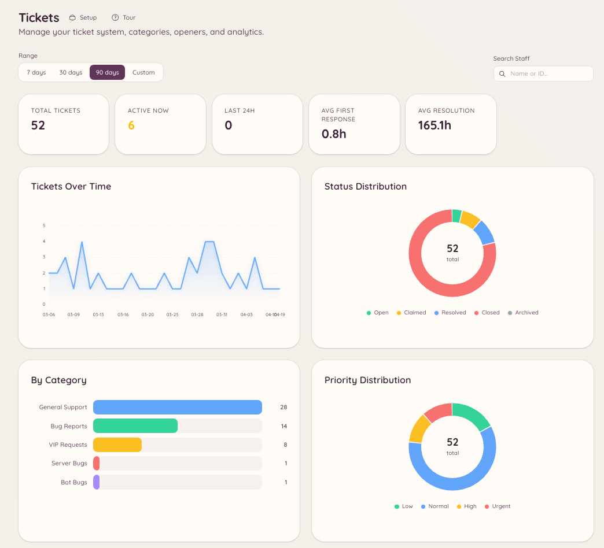

import { DashboardLink } from "/snippets/dashboard-link.jsx";

Las funciones de tickets y de modmail incluyen una capa de analíticas que sigue el volumen, los tiempos de respuesta y la actividad del staff. Las analíticas dan a los administradores del servidor datos objetivos sobre lo bien que funciona el soporte y qué miembros del staff aportan más.

## Acceder a las analíticas

- Analíticas de tickets: <DashboardLink to="tickets/analytics">**Tickets \> Analytics**</DashboardLink>
- Analíticas de modmail: <DashboardLink to="modmail/analytics">**Modmail \> Analytics**</DashboardLink>

Ambas secciones tienen la misma estructura y los mismos tipos de métricas.

<Frame>
  
</Frame>

## Métricas que se siguen

### Volumen

| Métrica | Descripción |
| --- | --- |
| **Total opened** (total abiertos) | Número de tickets o hilos abiertos en el periodo seleccionado |
| **Total closed** (total cerrados) | Número de resueltos en el periodo seleccionado |
| **Open at end of period** (abiertos al final del periodo) | Tickets que seguían sin resolver al final del rango de fechas |
| **Daily breakdown** (desglose diario) | Gráfico con las aperturas y los cierres de cada día |

### Tiempos de respuesta

| Métrica | Descripción |
| --- | --- |
| **First response time** (tiempo de primera respuesta) | Cuánto pasa desde que se crea el ticket hasta que un miembro del staff envía el primer mensaje |
| **Average handle time** (tiempo medio de gestión) | Duración total desde que se abre hasta que se cierra |
| **SLA compliance** (cumplimiento del SLA) | Porcentaje de tickets en los que la primera respuesta llegó dentro del objetivo que configuraste |

Los objetivos de SLA se configuran en <DashboardLink to="tickets/config">**Tickets \> Configuration**</DashboardLink> o en <DashboardLink to="modmail/config">**Modmail \> Configuration**</DashboardLink> como una duración (por ejemplo, 2 horas para la primera respuesta).

### Rendimiento del staff

La tabla de rendimiento del staff muestra, para cada miembro del staff:

- Número de tickets que ha reclamado o que se le han asignado
- Tiempo medio de primera respuesta
- Tiempo medio de gestión
- Número de tickets cerrados
- Puntuación de las valoraciones de los clientes (si las valoraciones están activadas)

Pulsa la fila de cualquier miembro del staff para ver en detalle su historial de tickets.

## Valoraciones de satisfacción

Cuando se cierra un ticket o un hilo de modmail, se puede invitar al miembro a dejar una valoración de satisfacción. La valoración aparece como una puntuación de 1 a 5 estrellas junto con un comentario opcional.

### Activar las valoraciones

Ve a <DashboardLink to="tickets/config">**Tickets \> Configuration**</DashboardLink> o a <DashboardLink to="modmail/config">**Modmail \> Configuration**</DashboardLink> y activa las valoraciones (**Enable Ticket Reviews** en los tickets, **Enable Reviews** en el modmail). También puedes configurar:

- **Review Channel** (canal de valoraciones): dónde se publican las valoraciones enviadas
- **Require Moderation** (requerir moderación): retiene las valoraciones hasta que el staff las aprueba antes de publicarlas, en el **Moderation Channel** (canal de moderación) que elijas
- **Button emoji** (emoji del botón): el emoji del botón de valoración
- **Review fields** (campos de la valoración): las preguntas que se puntúan. Deja la lista vacía para una única valoración general con estrellas

### Ver las valoraciones

Las valoraciones aparecen en <DashboardLink to="tickets/reviews">**Tickets \> Reviews**</DashboardLink> y en <DashboardLink to="modmail/analytics">**Modmail \> Analytics**</DashboardLink>. La página de valoraciones muestra cada puntuación, el ticket asociado y los comentarios que haya dejado el miembro.

## Filtrar por rango de fechas

Todas las páginas de analíticas se pueden filtrar por rango de fechas. Elige un rango predefinido (últimos 7 días, últimos 30 días, últimos 90 días) o define uno personalizado. Las métricas se actualizan al instante cuando cambias el rango.

## Permisos necesarios

| Acción | Clave de permiso |
| --- | --- |
| Ver las analíticas de tickets | `tickets.analytics.view_analytics` |
| Ver las analíticas de modmail | `modmail.analytics.view_analytics` |
| Gestionar las valoraciones | `tickets.operations.manage_reviews`, `modmail.management.manage_reviews` |
