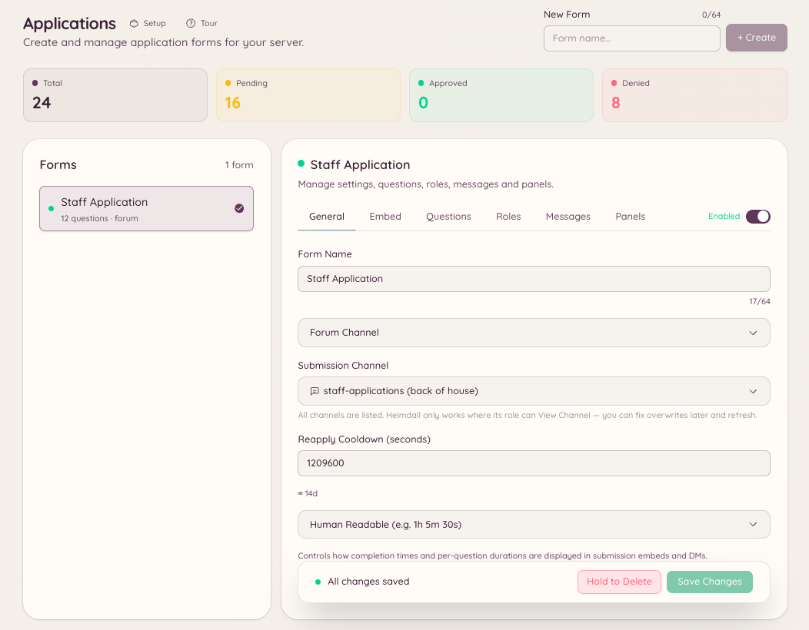

import { DashboardLink } from "/snippets/dashboard-link.jsx";

El plugin de solicitudes te permite crear formularios que los miembros rellenan y envían para que el staff los revise. Úsalo para solicitudes de staff, inscripciones a eventos, peticiones para entrar en la lista de permitidos o cualquier situación en la que necesites información estructurada de los miembros.

<Frame>
  
</Frame>

## Cómo funcionan las solicitudes

Creas un formulario en <DashboardLink to="applications">**Applications**</DashboardLink> (Solicitudes) en el panel, con tantas preguntas como necesites. Los miembros acceden al formulario con `/application` y eligiendo el formulario al que quieren presentarse. Una vez enviadas, sus respuestas aparecen en <DashboardLink to="applications">**Applications**</DashboardLink> para que el staff las revise, las apruebe o las rechace. Los miembros reciben la decisión por MD.

## Crear un formulario

Ve a <DashboardLink to="applications">**Applications**</DashboardLink> en el panel y haz clic en **New Form** (nuevo formulario).

| Ajuste | Descripción |
| --- | --- |
| **Nombre** | El nombre visible del formulario, que ven los miembros al elegirlo |
| **Descripción** | Una explicación breve de para qué sirve el formulario |
| **Canal** | Dónde se publican los avisos de envío para el staff |
| **Preguntas** | Los campos que rellenan los miembros (texto corto, texto largo u opción múltiple) |
| **Roles revisores** | Qué roles pueden aprobar o rechazar los envíos |
| **Mensaje de aceptación** | El MD que se envía al miembro cuando se aprueba su solicitud |
| **Mensaje de rechazo** | El MD que se envía al miembro cuando se rechaza su solicitud |

### Tipos de pregunta

| Tipo | Descripción |
| --- | --- |
| **Texto corto** | Un campo de texto de una sola línea, de hasta 256 caracteres |
| **Texto largo** | Un campo de texto de varias líneas, de hasta 4000 caracteres |
| **Opción múltiple** | El miembro elige una opción de una lista definida |

## Enviar una solicitud

```text
/application list
/application post <form>
```

`/application list` muestra al miembro todos los formularios disponibles. `/application post` abre el formulario elegido como un formulario interactivo de Discord. El miembro rellena cada campo y lo envía. Si el formulario tiene más campos de los que caben en un solo formulario de Discord, el envío se divide en varios pasos.

## Revisar los envíos

Ve a <DashboardLink to="applications">**Applications**</DashboardLink> en el panel. Cada envío muestra todas las respuestas, el nombre de usuario de Discord del solicitante y la marca de tiempo del envío. Desde el panel de revisión:

- **Aprobar**: marca el envío como aprobado y envía al solicitante el MD de aceptación
- **Rechazar**: marca el envío como rechazado y envía el MD de rechazo
- **Pendiente**: todavía no se ha hecho nada, y lo ven todos los revisores

## Permisos necesarios

| Acción | Clave de permiso |
| --- | --- |
| Enviar una solicitud | No requiere permiso |
| Ver los formularios y los envíos | `applications.view` |
| Aprobar y rechazar envíos | `applications.review` |
| Crear, editar y publicar formularios | `applications.manage` |
