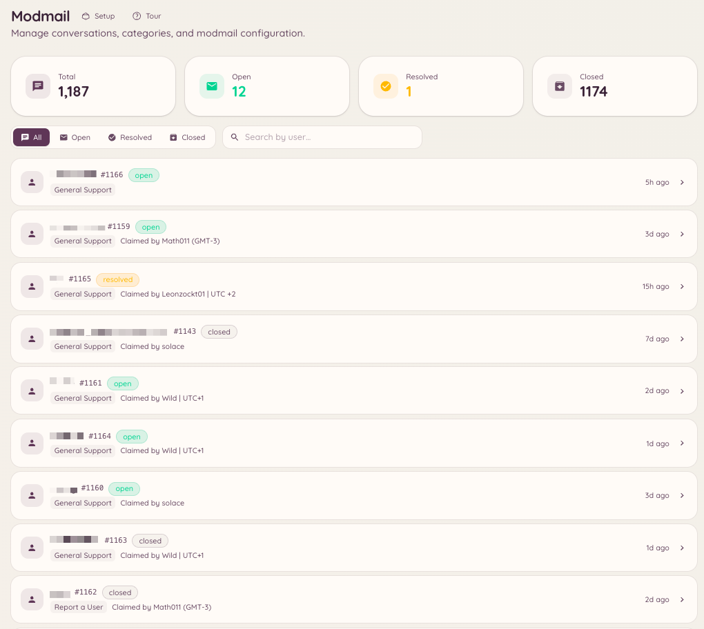

import { DashboardLink } from "/snippets/dashboard-link.jsx";

Modmail da a los miembros una línea privada con tu staff a través de los mensajes directos de Discord. Cuando un miembro envía un MD al bot, se crea un hilo en un canal de foro concreto de tu servidor. El staff responde en ese hilo y el bot reenvía sus mensajes al miembro por MD. En ningún momento el miembro y el staff ven los servidores del otro: desde el punto de vista del miembro, está teniendo una conversación privada con el bot.

<Frame>
  
</Frame>

## Cómo funciona para los miembros

Un miembro envía un mensaje directo al bot de Heimdall. El bot confirma que se ha abierto un hilo de soporte y le avisa de que el staff le responderá. Todos los mensajes que el miembro envíe a partir de ahí se reenvían al hilo del staff. Cuando el staff responde en el hilo, sus mensajes aparecen en el MD del miembro como si los enviara el bot.

Los miembros no pueden saber qué miembro del staff lleva su caso, salvo que el staff decida identificarse en sus mensajes.

## Configuración

### Configuración básica

Ve a <DashboardLink to="modmail/config">**Modmail \> Configuration**</DashboardLink> (Modmail > Configuración) en el panel. Los ajustes principales son:

| Ajuste | Descripción |
| --- | --- |
| **Canal de foro** | El canal donde se crean los hilos de modmail. Tiene que ser un canal de foro de Discord. |
| **Roles del staff** | Los roles que pueden ver y responder a los hilos de modmail |
| **Mensaje de apertura** | El MD que se envía al miembro cuando se abre su hilo |
| **Cierre automático** | Cierra automáticamente los hilos que llevan inactivos un tiempo determinado |
| **Respuestas anónimas** | Oculta qué miembro del staff envía cada respuesta (activado por defecto) |

### Categorías

Las categorías de modmail te permiten enviar distintos tipos de MD a distintos canales de foro o equipos del staff. Ve a <DashboardLink to="modmail/categories">**Modmail \> Categories**</DashboardLink> (Modmail > Categorías) y crea categorías para las distintas áreas de soporte. Cuando un miembro abre un modmail, se le pide que elija una categoría si hay más de una configurada.

### Respuestas automáticas

Las respuestas automáticas son mensajes ya redactados que el bot envía solo en función de las palabras clave del primer mensaje del miembro. Ve a <DashboardLink to="modmail/auto-responses">**Modmail \> Auto-responses**</DashboardLink> (Modmail > Respuestas automáticas) para configurarlas. Las respuestas automáticas no cierran el hilo: dan una primera información mientras el staff se hace cargo.

## Comandos de barra

```text
/modmail open <user>
/modmail close [reason]
/modmail ban <user> [reason]
/modmail unban <user>
/modmail note <content>
/modmail snippet <name>
/modmail transfer <category>
```

| Subcomando | Descripción |
| --- | --- |
| `open` | Abre un hilo de modmail para un miembro sin que lo inicie él |
| `close` | Cierra el hilo actual y envía al miembro un MD de cierre |
| `ban` | Impide que un miembro abra nuevos hilos de modmail |
| `unban` | Quita un baneo de modmail |
| `note` | Añade una nota privada del staff que el miembro no ve |
| `snippet` | Inserta en el hilo un fragmento de respuesta guardado |
| `transfer` | Mueve el hilo a otra categoría |

## Notas del staff

Las notas del staff son mensajes publicados en el hilo de modmail que solo ve el staff. Tienen un formato distinto al de las respuestas normales y nunca se reenvían al miembro. Úsalas para coordinaros internamente: mencionar a compañeros, añadir contexto o marcar asuntos para revisar.

## Botones de apertura

Los botones de apertura son botones o paneles publicados en un canal que los miembros pulsan para empezar un hilo de modmail sin tener que enviar un MD al bot. Son útiles en servidores donde puede que los miembros no sepan que pueden escribir a Heimdall por MD, o cuando quieres poner un botón de "Contactar con el staff" en un canal concreto.

Ve a <DashboardLink to="modmail/openers">**Modmail > Openers**</DashboardLink> (Modmail > Botones de apertura) y haz clic en **New Opener** (nuevo botón de apertura). Configura el texto del botón, la categoría que abre y el mensaje de apertura que se envía al miembro, si quieres uno. Una vez configurado, haz clic en **Post** (publicar) para que el bot coloque el panel en el canal que elijas.

## Cuotas

Las cuotas del staff limitan cuántos hilos abiertos a la vez puede llevar cada miembro del staff. Cuando un miembro del staff llega a su cuota, los hilos nuevos de las categorías que tiene asignadas se ponen en cola o se envían a otro miembro del staff disponible. Configura las cuotas en <DashboardLink to="modmail/quotas">**Modmail > Quotas**</DashboardLink> (Modmail > Cuotas).

## Permisos necesarios

| Acción | Clave de permiso |
| --- | --- |
| Ver las conversaciones | `modmail.conversations.view_conversations` |
| Gestionar las conversaciones | `modmail.conversations.manage_conversations` |
| Ver las estadísticas | `modmail.analytics.view_analytics` |
| Gestionar las valoraciones | `modmail.management.manage_reviews` |
| Gestionar la configuración | `modmail.management.manage_config` |
