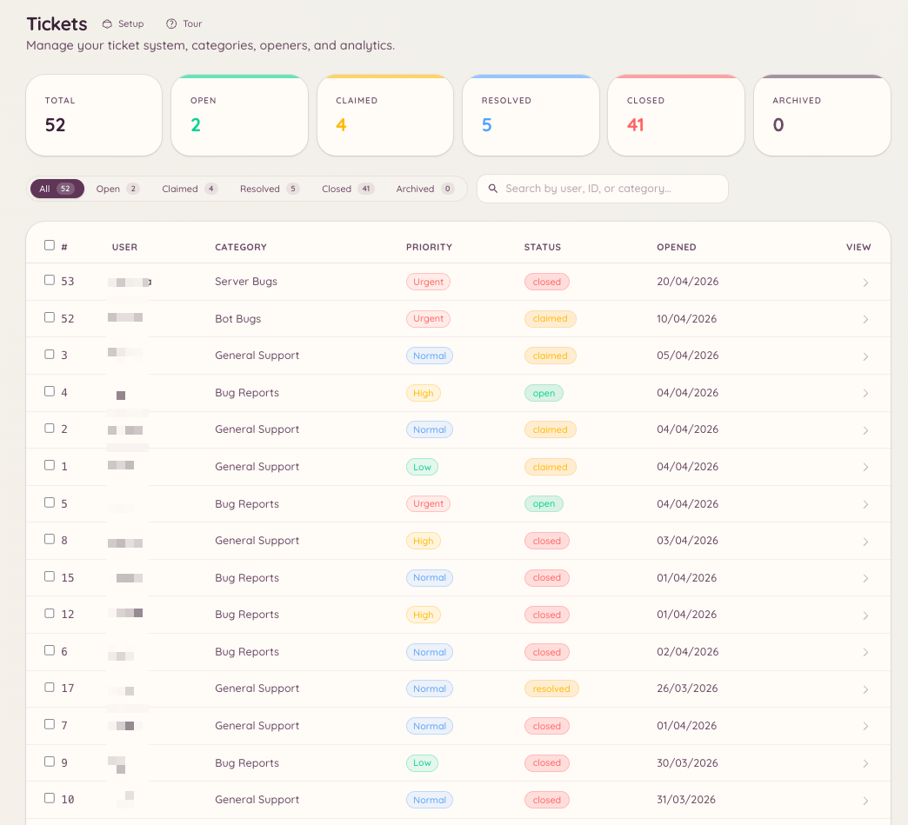

import { DashboardLink } from "/snippets/dashboard-link.jsx";

El sistema de tickets crea hilos privados de Discord para cada petición de soporte. Los miembros abren un ticket, el staff responde dentro del hilo y el ticket se cierra cuando se resuelve el problema. La configuración del panel define qué categorías de soporte hay, quién puede abrir tickets y cómo se comporta el sistema de forma automática.

<Frame>
  
</Frame>

## Cómo funcionan los tickets para los miembros

Un miembro usa `/ticket open` o pulsa un botón de apertura que hayas puesto en un canal. Elige una categoría, rellena si hace falta un formulario de apertura y se crea un hilo privado. El hilo solo lo ven el miembro y los roles del staff configurados para esa categoría. El miembro y el staff se escriben dentro del hilo como en una conversación normal.

Cuando el problema se resuelve, el miembro o un miembro del staff cierra el ticket. Los tickets cerrados se pueden revisar en el panel, en <DashboardLink to="tickets/list">**Tickets \> Tickets**</DashboardLink>.

## Configuración

### Crear categorías

Ve a <DashboardLink to="tickets/categories">**Tickets \> Categories**</DashboardLink> (Tickets > Categorías) en el panel y haz clic en **New Category** (nueva categoría). Cada categoría define:

| Ajuste | Descripción |
| --- | --- |
| **Nombre** | Se muestra cuando un miembro elige un tipo de ticket |
| **Descripción** | Una explicación breve de para qué es esta categoría |
| **Canal** | El canal padre donde se crean los hilos de los tickets |
| **Roles del staff** | Qué roles pueden ver y responder a los tickets de esta categoría |
| **Formulario de apertura** | Preguntas opcionales que el miembro rellena al abrir el ticket |
| **Mensaje de apertura** | El primer mensaje que publica el bot dentro del hilo del ticket |
| **Cierre automático** | Cierra automáticamente los tickets inactivos pasado un tiempo determinado |

### Recordatorios por inactividad

Cada categoría puede avisar sobre los tickets que se quedan parados, y después cerrarlos. En **Inactivity Reminder** (recordatorio por inactividad), dentro del editor de la categoría, eliges cuánto tiempo puede estar parado un ticket antes de que se publique el aviso, cuánto tiempo después del aviso se cierra y a quién menciona el aviso:

| Comportamiento de la mención | A quién se menciona |
| --- | --- |
| **Ping ticket opener** | Al miembro que abrió el ticket |
| **Ping all participants** | A quien abrió el ticket y al miembro del staff que lo reclamó |
| **Smart (direction-aware)** | A quien le toca responder: a quien lo abrió si el staff habló el último, y al staff si quien lo abrió habló el último |
| **No ping** | A nadie |

Con **Smart** (inteligente), elige si un ticket que espera al staff menciona a los roles del staff de la categoría o solo al miembro del staff que lo reclamó. Un ticket sin reclamar siempre menciona a los roles del staff.

#### Preguntar a quien lo abrió cuando parece resuelto

Una conversación de soporte suele terminar con el staff respondiendo y el miembro contestando "gracias". Entonces Smart consideraría que el ticket está esperando al staff. Para no mencionar al staff por un ticket ya resuelto, Smart puede reconocer una despedida y preguntar al miembro: el aviso pasa a ser "Is your issue sorted?" (¿Está resuelto tu problema?) con los botones **Yes, close it** (Sí, ciérralo) e **I still need help** (Todavía necesito ayuda). "I still need help" menciona al staff de inmediato. Si nadie responde, el ticket se cierra en el plazo normal.

Dos ajustes deciden cuándo una respuesta cuenta como despedida:

| Ajuste | Cómo lo decide | Por defecto |
| --- | --- | --- |
| **Ask the opener when they look done (AI)** | [Odin AI](/es/ai/odin) lee el final de la conversación. Solo funciona en servidores con la IA configurada, y envía los mensajes recientes del ticket al proveedor de IA | Activado |
| **Ask the opener when they look done (length)** | Todo lo que ha dicho el miembro desde la última respuesta del staff está por debajo del límite de caracteres, sin signos de interrogación ni adjuntos. También se usa cuando no se puede hacer la comprobación con IA | Desactivado |

El texto de la pregunta se puede cambiar en <DashboardLink to="tickets/config">**Tickets \> Configuration**</DashboardLink> (Tickets > Configuración), en el mensaje **Resolution Check** (comprobación de resolución).

### Configurar los botones de apertura

Los botones de apertura son los botones o menús desplegables que usan los miembros para crear tickets. Ve a <DashboardLink to="tickets/openers">**Tickets \> Openers**</DashboardLink> (Tickets > Botones de apertura) y haz clic en **New Opener** (nuevo botón de apertura). Después de configurarlo, haz clic en **Post** (publicar) para que el bot envíe el panel a un canal que elijas. Puedes publicar el mismo botón de apertura en varios canales, y actualizar o borrar cada copia desde la lista **Posted in** (publicado en) del cuadro de publicación. Consulta [Paneles publicados en más de un canal](/es/dashboard#panels-posted-in-more-than-one-channel).

Un botón de apertura puede mostrar un único botón "Open Ticket" (abrir ticket) o un menú desplegable con varias categorías, según cómo lo configures.

## Comandos de barra

El comando `/ticket` tiene los siguientes subcomandos:

| Subcomando | Descripción |
| --- | --- |
| `/ticket open [category]` | Abre un ticket nuevo, con una categoría ya elegida si quieres |
| `/ticket close [reason]` | Cierra el hilo del ticket actual |
| `/ticket claim` | Te asigna el ticket como el miembro del staff que lo lleva |
| `/ticket unclaim` | Deja de reclamar el ticket |
| `/ticket assign <user>` | Asigna el ticket a otro miembro del staff |
| `/ticket add <user>` | Añade a un miembro al hilo privado |
| `/ticket remove <user>` | Quita a un miembro del hilo privado |
| `/ticket rename <name>` | Cambia el nombre del hilo del ticket |
| `/ticket priority <level>` | Fija el nivel de prioridad del ticket |
| `/ticket note <content>` | Añade una nota privada del staff al ticket |
| `/ticket transcript` | Genera una transcripción en texto de la conversación |

El comando `/ticket-admin` permite gestionar las categorías directamente desde Discord, con las mismas operaciones que <DashboardLink to="tickets/categories">**Tickets \> Categories**</DashboardLink>.

## Respuestas asistidas por IA

Si el plugin de IA está activado y conectado a tus categorías de tickets, Heimdall puede sugerir borradores de respuesta a partir de tu base de conocimiento y de resoluciones anteriores. Consulta [Odin AI](/es/ai/odin) para configurarlo.

## Valoraciones

Si quieres, se puede pedir a los miembros que dejen una valoración de satisfacción cuando se cierra un ticket. La petición le pide al miembro que puntúe su experiencia y, si quiere, que deje un comentario. Las puntuaciones y los comentarios se agrupan en el panel de estadísticas, en <DashboardLink to="tickets/reviews">**Tickets > Reviews**</DashboardLink> (Tickets > Valoraciones), y se pueden filtrar por categoría y por intervalo de fechas.

Activa las valoraciones en <DashboardLink to="tickets/config">**Tickets > Configuration**</DashboardLink>. Si al cerrar un ticket se envía la petición de valoración se decide en cada categoría, con **Send Review Prompt on Close** (enviar petición de valoración al cerrar) en <DashboardLink to="tickets/categories">**Tickets \> Categories**</DashboardLink>.

## Respuestas automáticas

Las respuestas automáticas de los tickets son respuestas ya redactadas que se envían solas al abrir un ticket si el mensaje de apertura coincide con un activador. Ve a <DashboardLink to="tickets/auto-responses">**Tickets > Auto-Responses**</DashboardLink> (Tickets > Respuestas automáticas) para configurarlas.

Cada respuesta automática tiene:

| Ajuste | Descripción |
|---|---|
| **Nombre** | Etiqueta interna |
| **Activador** | Una palabra clave o frase que tiene que aparecer en el mensaje de apertura |
| **Respuesta** | El mensaje que se publica automáticamente dentro del hilo del ticket |
| **Ámbito por categoría** | Limita, si quieres, la respuesta automática a categorías de tickets concretas |

Las respuestas automáticas se publican como el bot dentro del hilo. No cierran el ticket: el staff sigue llevando la conversación.

## Cuotas

Las cuotas limitan cuántos tickets abiertos puede tener asignados a la vez cada miembro del staff. Ve a <DashboardLink to="tickets/quotas">**Tickets > Quotas**</DashboardLink> (Tickets > Cuotas) para configurar límites por rol o por usuario.

Cuando un miembro del staff llega a su cuota:

- La asignación automática se lo salta al repartir los tickets nuevos
- La asignación manual sigue siendo posible si un responsable pasa por alto la cuota

El uso de las cuotas se ve en <DashboardLink to="tickets/analytics">**Tickets \> Analytics**</DashboardLink> (Tickets > Estadísticas), junto a las métricas de tiempo de respuesta y de cierre.

## Permisos necesarios

| Acción | Clave de permiso |
| --- | --- |
| Abrir un ticket | No requiere permiso |
| Cerrar cualquier ticket | `tickets.operations.manage_tickets` |
| Reclamar tickets | `tickets.operations.claim_tickets` |
| Ver todos los tickets | `tickets.operations.view_tickets` |
| Ver las estadísticas | `tickets.analytics.view_analytics` |
| Gestionar la configuración | `tickets.config.manage_config` |
