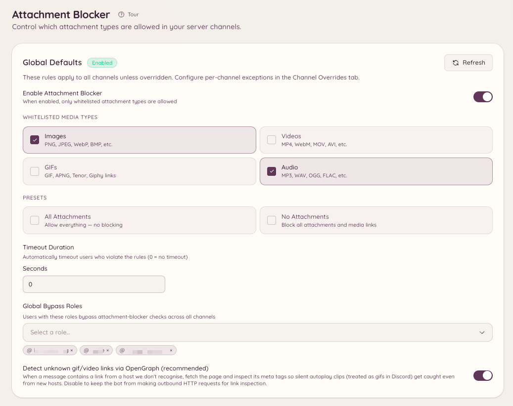

import { DashboardLink } from "/snippets/dashboard-link.jsx";

El bloqueador de adjuntos decide qué tipos de multimedia pueden publicar los miembros y elimina todo lo que incumpla la regla. Funciona con cuatro tipos de multimedia: **Images** (imágenes), **Videos** (vídeos), **GIFs** y **Audio**. Fijas una regla para todo el servidor, la sustituyes en los canales que necesitan algo distinto y restringes a miembros concretos cuando el problema es una sola persona.

<Frame>
  
</Frame>

## Cómo funciona

Cada mensaje de un canal cubierto se compara con la regla que se aplica allí. La comprobación mira:

- Los archivos subidos como adjuntos.
- El contenido multimedia que lleva un mensaje reenviado.
- Los embeds que Discord genera para un enlace, que es como se detecta un GIF de Tenor o un vídeo insertado.
- Los enlaces a contenido multimedia en el texto del mensaje: Tenor, Giphy, Imgur y enlaces directos a archivos.
- Los enlaces desconocidos, en los que se busca contenido multimedia OpenGraph cuando **OG fallback** está activado. Un enlace que resulta apuntar a una imagen o a un vídeo se trata como ese tipo de multimedia.

No bloquea por extensión de archivo. No hay ninguna lista de `.exe` o `.zip` que rellenar ni cadenas MIME que escribir. Tú eliges tipos de multimedia, y el modo que elijas decide qué pasa con todo lo demás.

## Elegir un modo

Cada nivel de configuración usa uno de dos modos.

| | Whitelist (lista blanca) | Blacklist (lista negra) |
| --- | --- | --- |
| Qué significa la lista | Solo se permiten los tipos de la lista | Solo se eliminan los tipos de la lista |
| Un tipo de multimedia que no has puesto en la lista | Se elimina | Se permite |
| Un archivo que no es multimedia, como un PDF o un archivo comprimido | Se elimina | Se permite |
| Ajustes predefinidos | **All** (permitir todo, en la práctica desactivado) y **No attachments** (bloquear todo) | Sin ajustes predefinidos |
| Una lista vacía | No es un estado útil: elige un tipo o usa un ajuste predefinido | No bloquea nada |

La fila de los archivos que no son multimedia es la que pilla a la gente por sorpresa. Una lista blanca es una afirmación sobre todo, así que un canal con lista blanca de **Images** también elimina PDF, archivos de texto y archivos comprimidos. Una lista negra es una afirmación sobre los tipos que nombra, así que una lista negra de **Videos** elimina los vídeos y deja en paz un PDF.

Una lista negra vacía no bloquea nada, a propósito. Es el estado sincero para "he elegido el modo, pero todavía no he elegido los tipos".

Las configuraciones hechas antes de que existiera el modo lista negra son listas blancas, así que no ha cambiado nada para un servidor que ya estaba configurado.

## Valores predeterminados del servidor

El valor predeterminado del servidor se aplica en todos los sitios que no tienen una excepción. Fíjalo desde <DashboardLink to="attachment-blocker/global">**Attachment Blocker \> Global Settings**</DashboardLink> en el panel, o en Discord:

```text
/attachment-blocker setup type: Images mode: Whitelist timeout: 60
```

Cada llamada añade **un** tipo a la lista, así que ejecútala una vez por cada tipo que quieras en la lista. Si no indicas `mode`, el servidor mantiene el modo que ya usa. **All** y **None** son conceptos de lista blanca y se rechazan en el modo lista negra, porque una lista negra de todo es una lista blanca de nada y basta con una forma de escribir cada resultado.

`/attachment-blocker view` muestra la regla vigente y `/attachment-blocker disable` desactiva la función en todo el servidor.

## Excepciones por canal

Una excepción de canal sustituye el valor predeterminado del servidor en ese canal, modo incluido. Añade una desde <DashboardLink to="attachment-blocker/channels">**Attachment Blocker \> Channel Overrides**</DashboardLink>, o así:

```text
/attachment-blocker channel add channel: #media type: Videos mode: Blacklist
/attachment-blocker channel remove channel: #media
```

Dos cosas que conviene saber:

- **Los hilos siguen a su canal padre.** Un hilo sin excepción propia usa la excepción del canal o del foro en el que está.
- **Una excepción que no indica ningún tipo lo hereda todo.** Toma tanto el modo como la lista del valor predeterminado del servidor, así que una excepción a medio rellenar nunca se convierte sin avisar en una regla propia.

## Canales de voz temporales

Los canales de voz temporales se crean cuando se necesitan, así que no se les puede poner una excepción a mano. En su lugar, fijas la regla en el canal creador que los genera, desde <DashboardLink to="attachment-blocker/tempvc">**Attachment Blocker \> TempVC Openers**</DashboardLink>. Cada canal temporal que crea ese canal creador recibe esa regla.

## Roles de excepción

Un rol de excepción se salta la comprobación del modo, así que quien lo tiene puede publicar lo que quiera. Puedes dar una excepción para todo el servidor o solo en un canal:

```text
/attachment-blocker bypass add role: @Moderator
/attachment-blocker bypass channel-add channel: #media role: @Content Team
```

`/attachment-blocker bypass list` y `/attachment-blocker bypass channel-list` muestran quién tiene excepción ahora mismo, y `/attachment-blocker bypass remove` y `/attachment-blocker bypass channel-remove` se la vuelven a quitar al rol.

Un rol de excepción no protege a un miembro de una restricción dirigida a él personalmente. Para eso precisamente están las restricciones.

## Restringir a un miembro

Cuando el problema es un solo miembro, restringe a ese miembro en lugar de endurecer el canal para todo el mundo. Abre el panel de restricción con cualquiera de estos comandos:

```text
/attachment-blocker user restrict user: @member
/attachmentban user: @member
```

La entrada del menú contextual **Aplicaciones \> Restrict Attachments** en uno de sus mensajes abre el mismo panel, y suele ser más rápido.

En el panel eliges los tipos que se bloquean, si se aplica en todo el servidor o solo en los canales elegidos, cuánto dura y un motivo. Una restricción:

- **Prevalece sobre los roles de excepción.** Un miembro restringido sigue restringido aunque tenga uno.
- **Prevalece sobre la regla del canal.** Se aplica permita lo que permita ese canal.
- **Avisa al miembro cuando termina.** Recibe un MD cuando se levanta y cuando caduca.

`/attachment-blocker user list` muestra las restricciones activas, `/attachment-blocker user unrestrict` y `/attachmentunban` levantan una, y <DashboardLink to="attachment-blocker/restrictions">**Attachment Blocker \> User Restrictions**</DashboardLink> en el panel permite hacerlo todo desde la web.

## Aislamientos y MD

Cuando un mensaje incumple la regla:

1. Se borra el mensaje.
2. El miembro recibe un MD explicando qué se ha eliminado y por qué. Ese mensaje es una plantilla, así que puedes reescribirlo en **Message Templates**.
3. Si el nivel que ha detectado el mensaje fija un aislamiento, se aísla temporalmente al miembro durante esos segundos.

El aislamiento se aplica a través del sistema de moderación de Heimdall y no como una acción directa de Discord, así que aparece en el registro de acciones de moderación junto con el resto de tu historial de moderación. Ponlo a `0` para borrar sin aislar a nadie. Cada nivel tiene su propio aislamiento, así que una excepción de canal puede aislar durante más tiempo que el valor predeterminado del servidor, o no aislar en absoluto.

## Comandos

```text
/attachment-blocker setup type: [mode:] [timeout:]
/attachment-blocker view
/attachment-blocker disable
```

```text
/attachment-blocker channel add channel: type: [mode:] [timeout:]
/attachment-blocker channel remove channel:
```

```text
/attachment-blocker bypass add role:
/attachment-blocker bypass remove role:
/attachment-blocker bypass list
/attachment-blocker bypass channel-add channel: role:
/attachment-blocker bypass channel-remove channel: role:
/attachment-blocker bypass channel-list channel:
```

```text
/attachment-blocker user restrict user:
/attachment-blocker user unrestrict user:
/attachment-blocker user list
/attachmentban user:
/attachmentunban user:
```

## Permisos necesarios

| Acción | Clave de permiso |
| --- | --- |
| Ver la configuración y las listas de excepciones | `attachment-blocker.view_config` |
| Cambiar los valores predeterminados del servidor, las excepciones por canal y las de los canales creadores | `attachment-blocker.manage_config` |
| Ver las restricciones por miembro | `attachment-blocker.view_restrictions` |
| Aplicar, editar y levantar restricciones por miembro | `attachment-blocker.manage_restrictions` |
| Restringirte o quitarte la restricción a ti mismo, sobre todo para pruebas | `attachment-blocker.manage_own_restrictions` |

**Manage Own Restrictions** solo quita la protección que te impide elegirte a ti mismo en el panel de restricción. Por sí sola no hace nada, así que concédela junto con **Manage User Restrictions**.
