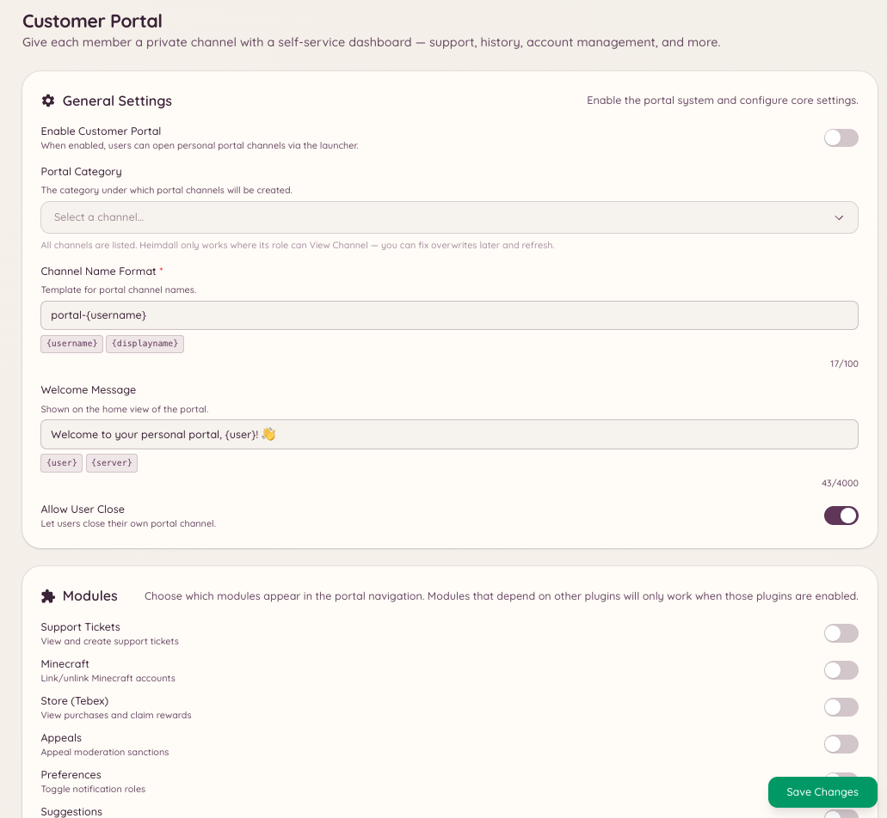

import { DashboardLink } from "/snippets/dashboard-link.jsx";

El portal de clientes es un panel para los miembros que funciona por completo dentro de Discord. Cuando un miembro abre el portal, ve un resumen de todo lo que Heimdall sabe de él: sus cuentas vinculadas (Minecraft, PlanetSide 2, cuentas del foro), sus tickets o hilos de modmail activos, sus recordatorios pendientes y su saldo de la economía.

El portal sirve como punto de entrada único para que los miembros gestionen su relación con el bot y con los servicios del servidor sin tener que ir de comando en comando.

<Frame>
  
</Frame>

## Abrir el portal

```text
/portal setup
```

Abre el panel del portal de clientes para el miembro que ha ejecutado el comando. El panel se muestra como un mensaje interactivo que solo ve ese miembro. El portal actualiza sus datos al abrirse.

## Qué muestra el portal

El contenido del portal depende de qué plugins estén activos en tu servidor:

| Sección | Se muestra cuando |
| --- | --- |
| **Cuentas vinculadas** | Están activadas las integraciones de Minecraft, PlanetSide 2 o NamelessMC |
| **Tickets activos** | El plugin de tickets está activado y el miembro tiene tickets abiertos |
| **Hilos de modmail** | El plugin de modmail está activado y el miembro tiene conversaciones abiertas |
| **Recordatorios** | El plugin de recordatorios está activado |
| **Saldo de la economía** | El plugin de juegos y economía está activado |

Los miembros pueden hacer cosas directamente desde el portal (cerrar un ticket, ver un recordatorio o comprobar qué cuentas tienen vinculadas) sin ejecutar comandos sueltos.

## Configurar el portal

Ve a <DashboardLink to="customer-portal/config">**Customer Portal \> Configuration**</DashboardLink> (Portal de clientes > Configuración) en el panel para:

- Activar o desactivar las secciones que aparecen
- Elegir qué integraciones incluye el portal
- Configurar en qué canales está disponible el comando del portal

```text
/portal close
```

Cierra un panel del portal activo. Los portales caducan solos tras un tiempo de inactividad.

```text
/portal refresh
```

Vuelve a cargar todos los datos y actualiza el panel del portal con la información actual. Es útil si el estado de un miembro ha cambiado mientras tenía el portal abierto.

## Permisos necesarios

| Acción | Clave de permiso |
| --- | --- |
| Usar el portal | Disponible para todos los miembros por defecto |
| Ver la configuración del portal | `customerPortal.viewConfig` |
| Gestionar la configuración del portal | `customerPortal.manageConfig` |
| Gestionar los portales de los miembros | `customerPortal.managePortals` |
