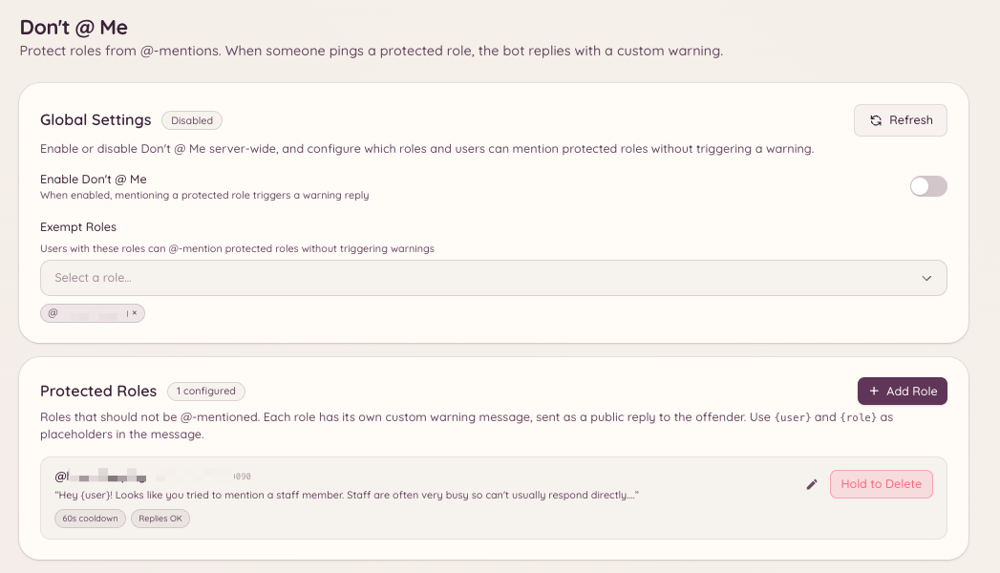

import { DashboardLink } from "/snippets/dashboard-link.jsx";

La función "Don't @ Me" impide que los miembros mencionen roles que no deberían recibir menciones masivas. Cuando el mensaje de un miembro menciona un rol protegido, el bot borra el mensaje y le advierte. Es una alternativa ligera a desactivar por completo las @menciones de un rol: el rol sigue siendo mencionable para el staff, pero el bot intercepta los usos no autorizados.

<Frame>
  
</Frame>

## Configurar los roles protegidos

```text
/dontatme add <role>
```

Añade un rol a la lista de protegidos. A los miembros que mencionen este rol (salvo las exenciones) se les borra el mensaje y reciben una advertencia.

```text
/dontatme remove <role>
```

Quita un rol de la lista de protegidos.

Ve a <DashboardLink to="dont-at-me">**Don't @ Me**</DashboardLink> en el panel para ver la lista de todos los roles protegidos. Desde el panel también puedes configurar el mensaje de advertencia que se envía a los miembros y si la advertencia se publica en el canal o se envía por MD.

## Exenciones

Puedes eximir roles y canales de la función:

- **Exención por rol**: los roles del staff que necesitan mencionar roles protegidos de forma legítima quedan exentos. Añade los roles exentos en la página <DashboardLink to="dont-at-me">**Don't @ Me**</DashboardLink> del panel.
- **Exención por canal**: puedes excluir de la vigilancia canales concretos (por ejemplo, canales solo para el staff).

## Comportamiento de la advertencia

Cuando se detecta una mención protegida:

1. El mensaje se borra al instante.
2. El bot publica una advertencia breve en el canal (o envía un MD al miembro, según tu configuración) explicando que ese rol no se puede mencionar.
3. Opcionalmente, la advertencia se registra como sanción a través de la función de moderación, lo que suma puntos al historial del miembro.

## Permisos necesarios

| Acción | Clave de permiso |
| --- | --- |
| Ver la configuración | `dontAtMe.viewConfig` |
| Cambiar la configuración | `dontAtMe.manageConfig` |
