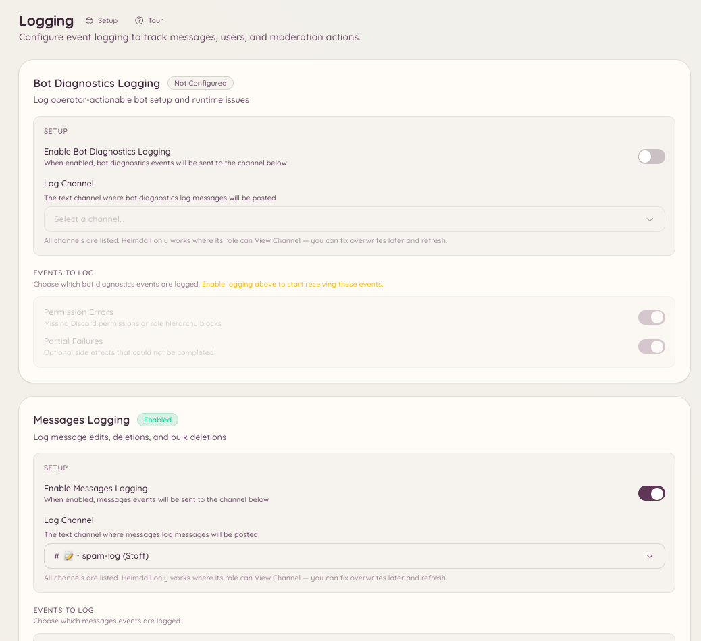

import { DashboardLink } from "/snippets/dashboard-link.jsx";

El plugin de registros captura los eventos del servidor de Discord y publica avisos con formato en los canales que elijas. Cada categoría de eventos puede ir a un canal distinto, así que puedes enviar los eventos de mensajes a un canal, los de miembros a otro y las acciones de moderación a un tercero.

<Frame>
  
</Frame>

## Configuración

```text
/logging setup <category> <channel>
```

Configura una categoría de eventos concreta para que se registre en el canal indicado. Ejecuta el comando una vez por cada categoría que quieras activar.

```text
/logging disable <category>
```

Deja de registrar una categoría sin tocar el resto de tu configuración.

Ve a <DashboardLink to="logging">**Logging**</DashboardLink> (Registros) en el panel para ver de un vistazo todas las categorías configuradas y sus canales de destino.

## Categorías de eventos

| Categoría | Eventos registrados |
| --- | --- |
| **Mensajes** | Ediciones de mensajes (con el contenido de antes y de después), borrados de mensajes, borrados masivos |
| **Miembros** | Entradas y salidas de miembros, cambios de nombre de usuario, de avatar y de apodo |
| **Roles** | Creación, borrado y edición de roles; asignación y retirada de roles |
| **Canales** | Creación y borrado de canales, y cambios en sus ajustes |
| **Voz** | Miembros que entran, salen o se mueven entre canales de voz |
| **Moderación** | Baneos, desbaneos, expulsiones, aislamientos temporales y sus motivos (del registro de auditoría de Discord) |
| **Servidor** | Cambios en el nombre, el icono o los ajustes del servidor |
| **Invitaciones** | Creación y borrado de invitaciones (qué invitación usó un miembro para entrar) |

## Formato de los mensajes de registro

Cada entrada del registro muestra:

- El tipo de evento como encabezado
- El usuario, canal o rol correspondiente, con una mención o su nombre
- Los valores de antes y de después en las ediciones
- Una marca de tiempo
- Cuando procede, un enlace al mensaje original o a su contexto

El bot usa el registro de auditoría de Discord para atribuir los eventos al miembro del staff que los realizó siempre que puede. Los eventos que no recoge el registro de auditoría (como las ediciones de mensajes que hace su autor) se atribuyen directamente al autor.

## Permisos necesarios

| Acción | Clave de permiso |
| --- | --- |
| Ver la configuración de los registros | `logging.view_config` |
| Cambiar la configuración de los registros | `logging.manage_config` |
