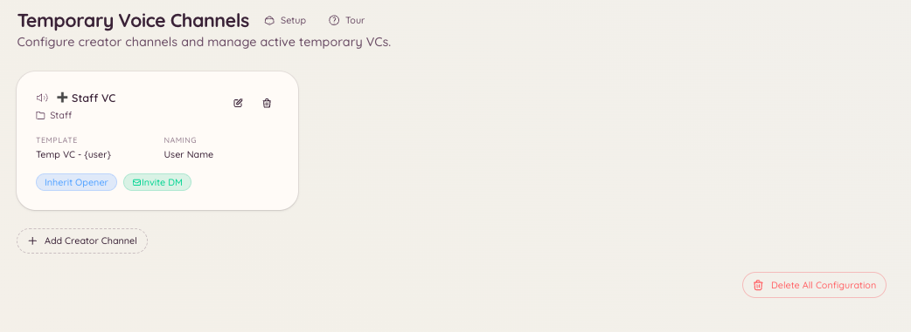

import { DashboardLink } from "/snippets/dashboard-link.jsx";

El sistema de canales de voz temporales permite a los miembros crear sus propios canales de voz cuando los necesitan. Designas uno o varios canales de voz "creadores". Cuando un miembro entra en un canal creador, el bot crea al momento un canal de voz nuevo, mueve al miembro a él y borra el canal automáticamente cuando sale el último miembro.

Así los administradores ya no tienen que crear y borrar a mano canales de voz para grupos pequeños, y los miembros controlan sus propios espacios sin tener que darles el permiso Gestionar canales.

<Frame>
  
</Frame>

## Cómo funciona para los miembros

Entra en el canal de voz creador (normalmente con un nombre como "Crea un canal" o "Entra para crear"). El bot crea un canal nuevo que, por defecto, lleva tu nombre y te mueve a él. Después puedes invitar a otras personas. Cuando todo el mundo sale, el bot borra el canal.

Mientras estás en tu canal temporal, lo controlas con el comando `/tempvc`.

## Configuración

Ve a <DashboardLink to="tempvc/config">**Temp VC \> Configuration**</DashboardLink> en el panel.

| Ajuste | Descripción |
| --- | --- |
| **Creator channel** (canal creador) | El canal de voz al que entran los miembros para que se cree un canal |
| **Category** (categoría) | La categoría donde se crean los canales temporales nuevos |
| **Default name** (nombre predeterminado) | Plantilla para el nombre de los canales nuevos. Admite las variables `{user}` y `{count}`. |
| **Default user limit** (límite de usuarios predeterminado) | Cuántos miembros pueden entrar en los canales nuevos (0 = sin límite) |
| **Default bitrate** (tasa de bits predeterminada) | La calidad de audio de los canales nuevos |
| **Permitted roles** (roles permitidos) | Qué roles pueden usar el canal creador (déjalo vacío para todos los miembros) |

Puedes tener varios canales creadores con distintos ajustes.

## Controles para los miembros

```text
/tempvc create
/tempvc delete
/tempvc delete-all
```

| Subcomando | Descripción |
| --- | --- |
| `create` | Crea un canal temporal a mano (sin entrar en el canal creador) |
| `delete` | Borra al instante tu canal temporal actual |
| `delete-all` | Borra todos los canales temporales que son tuyos |

Los miembros también pueden cambiar el nombre, fijar un límite de usuarios o bloquear su canal temporal desde el menú contextual del canal de voz de Discord, siempre que el bot les haya dado los permisos correspondientes.

## Ver los canales activos

Ve a <DashboardLink to="tempvc/active">**Temp VC \> Active Channels**</DashboardLink> en el panel para ver todos los canales temporales activos ahora mismo: quién los creó, cuántos miembros hay en ellos y cuánto tiempo llevan activos.

## Permisos necesarios

| Acción | Clave de permiso |
| --- | --- |
| Usar el canal creador | Disponible para todos los miembros por defecto |
| Ver la configuración | `tempvc.view_config` |
| Cambiar la configuración | `tempvc.manage_config` |
| Gestionar canales (por ejemplo, borrarlos a la fuerza) | `tempvc.manage_channels` |
