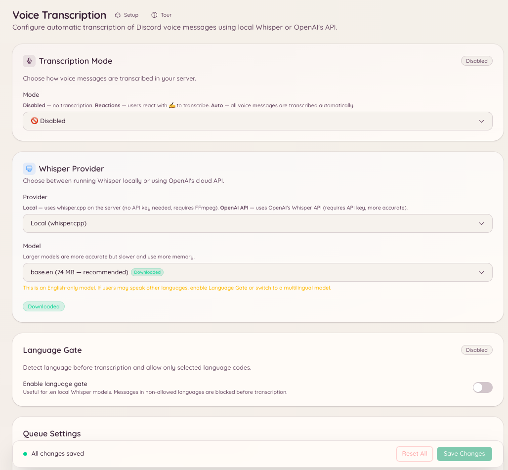

import { DashboardLink } from "/snippets/dashboard-link.jsx";

La función de transcripción de voz convierte en texto los mensajes de voz de Discord, los clips de audio que los miembros graban directamente en el cliente de Discord. Cuando un miembro envía un mensaje de voz en un canal configurado, el bot responde con una transcripción de lo que se ha dicho.

Así los mensajes de voz son accesibles para los miembros que no pueden o prefieren no escuchar audio, las conversaciones se pueden buscar mejor y resulta útil en entornos ruidosos donde escuchar no es práctico.

<Note>
  Esta función transcribe los mensajes de voz de Discord (la opción de grabar un mensaje de voz en el cliente de Discord). No transcribe el audio de los canales de voz.
</Note>

<Frame>
  
</Frame>

## Configuración

Ve a <DashboardLink to="vc-transcription">**VC Transcription**</DashboardLink> en el panel, o usa el comando de barra:

```text
/voice-transcription set <channel>
```

Configura en qué canales debe vigilar el bot los mensajes de voz. Puedes activar la transcripción en canales concretos o en todo el servidor.

```text
/voice-transcription status
```

Muestra qué canales tienen la transcripción activada.

## Cómo funciona la transcripción

Cuando se envía un mensaje de voz en un canal configurado, el bot descarga el audio, lo envía al modelo de voz a texto Whisper y publica la transcripción como respuesta al mensaje de voz. La transcripción aparece unos segundos después de enviar el mensaje de voz, según la duración del audio.

Las transcripciones se marcan claramente como generadas por el bot y pueden contener errores, sobre todo con acentos poco comunes, términos técnicos o audio de mala calidad.

## Configuración en el panel

Ve a <DashboardLink to="vc-transcription">**VC Transcription**</DashboardLink> en el panel para:

- Añadir o quitar canales de la lista de transcripción
- Ver el historial de transcripciones de un canal
- Activar o desactivar la transcripción sin borrar la configuración

## Permisos necesarios

| Acción | Clave de permiso |
| --- | --- |
| Ver la configuración | `vcTranscription.viewConfig` |
| Cambiar la configuración | `vcTranscription.manageConfig` |
