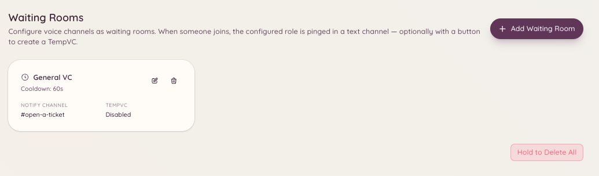

import { DashboardLink } from "/snippets/dashboard-link.jsx";

La función de sala de espera vigila un canal de voz que designas como sala de espera. Cuando un miembro entra en ese canal, el bot publica un aviso en un canal del staff configurado para que alguien del staff lo atienda. Es útil para servidores que hacen sesiones de soporte por voz uno a uno, entrevistas u otros casos en los que un miembro necesita indicar que está listo para hablar.

<Frame>
  
</Frame>

## Cómo funciona

Un miembro entra en el canal de voz de la sala de espera. El bot envía al momento un mensaje de aviso al canal de avisos del staff configurado. El mensaje incluye el nombre del miembro y una marca de tiempo. El staff ve el aviso y puede entrar en el canal de voz de la sala de espera o mover al miembro a un canal privado.

Cuando el miembro sale de la sala de espera, el bot actualiza o elimina el aviso para que no queden alertas obsoletas.

## Configuración

Ve a <DashboardLink to="waiting-room/config">**Waiting Room \> Configuration**</DashboardLink> en el panel.

| Ajuste | Descripción |
| --- | --- |
| **Waiting room channel** (canal de sala de espera) | El canal de voz al que entran los miembros para indicar que necesitan ayuda |
| **Notification channel** (canal de avisos) | El canal de texto donde el staff recibe las alertas de la sala de espera |
| **Notification message** (mensaje de aviso) | La plantilla de mensaje que se publica cuando entra un miembro |
| **Ping roles** (roles a mencionar) | Roles que se mencionan en el aviso para que el staff se entere al instante |

Puedes configurar varios canales de sala de espera, cada uno con su propio canal de avisos y sus roles a mencionar.

## Variables del mensaje de aviso

| Variable | Se sustituye por |
| --- | --- |
| `{user}` | Una mención del miembro que ha entrado |
| `{user.name}` | El nombre visible del miembro |
| `{channel}` | El nombre del canal de la sala de espera |
| `{time}` | La hora a la que entró el miembro |

## Usar la opción de aceptar

El staff puede pulsar el botón **Accept** del mensaje de aviso para hacerse cargo de la persona que espera. Al hacerlo, el aviso queda marcado como atendido y se evita que varios miembros del staff atiendan a la misma persona a la vez.

## Permisos necesarios

| Acción | Clave de permiso |
| --- | --- |
| Ver la configuración | `waitingRoom.viewConfig` |
| Cambiar la configuración | `waitingRoom.manageConfig` |
| Aceptar a miembros de la sala de espera | `waitingRoom.accept` |
