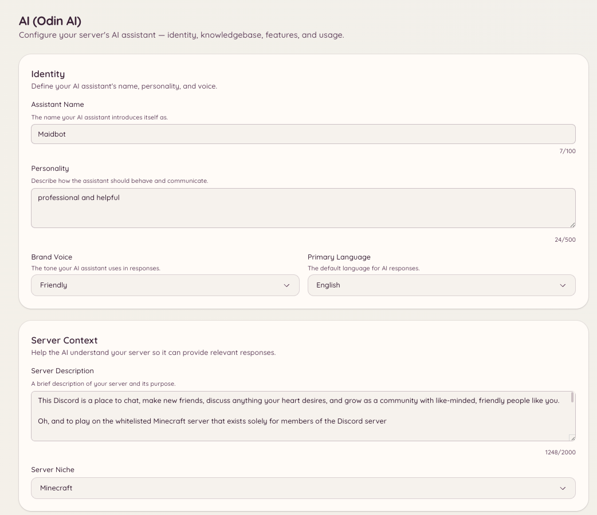

import { DashboardLink } from "/snippets/dashboard-link.jsx";

Odin est l’assistant IA de Heimdall. Les membres posent des questions et reçoivent des réponses fondées sur la base de connaissances de ton serveur : documentation, FAQ, règles ou tout autre contenu que tu importes. Odin garde le contexte de la conversation pendant une session, donc les questions de suivi fonctionnent naturellement, sans avoir à tout réexpliquer.

<Frame>
  
</Frame>

## Poser une question

```text
/ask <question>
```

Les membres posent n’importe quelle question en langage courant. Odin répond à partir de ta base de connaissances et cite les entrées qu’il a utilisées. Par défaut, `/ask` répond uniquement à partir de la base de connaissances : si elle ne couvre pas la question, Odin le dit au lieu de deviner et propose au membre un moyen de contacter le staff (un bouton de ticket ou de modmail, selon la façon dont ton serveur reçoit les demandes de support).

Pour que `/ask` réponde aussi aux questions générales avec les connaissances propres d’Odin, active **Allow general knowledge** dans <DashboardLink to="ai/feature-qa_bot">**AI \> Q&A Bot**</DashboardLink>. Les informations sur ton serveur (liens, tarifs, commandes, staff) viennent toujours uniquement de la base de connaissances.

Par défaut, `/ask` est disponible pour tous les membres. L’accès peut être restreint dans la configuration des permissions.

## Base de connaissances

La base de connaissances est l’ensemble des documents qu’Odin utilise pour répondre aux questions. Va dans <DashboardLink to="ai/knowledgebase">**AI \> Knowledgebase**</DashboardLink> sur le tableau de bord pour la gérer.

### Ajouter des documents

Clique sur **Add Document** et colle le contenu ou importe un fichier. Chaque document doit porter sur un sujet précis : règles du serveur, FAQ, guides d’intégration, ou tout contenu structuré que tu veux qu’Odin utilise.

Formats pris en charge :

- Texte brut
- Markdown
- PDF
- Les formats de documents courants

Une fois importé, le document est traité et indexé. Odin commence à s’en servir dans ses réponses en quelques minutes.

### Importer depuis le web

Au lieu de coller du contenu, tu peux importer des pages directement depuis un site :

- **Import URLs** récupère les pages que tu listes, une par ligne, et met chacune en forme dans sa propre entrée.
- **Deep Crawl** suit les liens d’un site, jusqu’à la limite de pages que tu fixes, et importe chaque page qui a un vrai contenu.

Les deux utilisent des tokens IA pour mettre en forme chaque page. Un site qui publie des versions markdown de ses pages (c’est le cas de la plupart des plateformes de documentation) est enregistré tel quel et ne coûte rien à mettre en forme.

Importer une page déjà présente dans la base de connaissances ne crée pas de deuxième copie. Les pages sont reconnues par leur adresse : une page inchangée est ignorée sans utiliser de tokens, et une page modifiée met à jour son entrée existante, en gardant le titre et les tags que tu lui as donnés. **Preview Pages** montre combien de pages sont nouvelles, modifiées et inchangées avant que tu valides, donc relancer le crawl d’un site déjà importé ne coûte des tokens que pour ce qui a changé.

### Garder les entrées à jour

Odin revérifie chaque page importée une fois par semaine. Si la page n’a pas changé, rien ne se passe et aucun token n’est utilisé. Si elle a changé, l’entrée est mise à jour à partir de la page, en utilisant les tokens IA de ce serveur pour les pages à mettre en forme. Si l’IA ne peut pas mettre en forme la nouvelle version, par exemple parce que le serveur n’a plus de tokens IA, l’entrée reste exactement comme elle était et une nouvelle tentative a lieu plus tard, au lieu d’être remplacée par le texte brut de la page. La page <DashboardLink to="ai/usage">**AI \> Usage**</DashboardLink> l’affiche à part sous **Knowledgebase Upkeep**. Désactive-le avec **Keep imported pages up to date** en bas de la page <DashboardLink to="ai/knowledgebase">**AI \> Knowledgebase**</DashboardLink>.

- **Tes modifications sont conservées.** Dès que tu modifies le contenu d’une entrée à la main, Odin ne recopie plus jamais la page par-dessus. Si la page change ensuite, l’entrée est marquée **Page changed since your edit**, et tu choisis **Replace with new version** ou **Keep my version**.
- **Les pages supprimées sont signalées, jamais effacées.** Une entrée dont la page renvoie « not found » est marquée **Page missing**. Après deux vérifications hebdomadaires de suite, elle est exclue des réponses, pour qu’Odin arrête de citer une page que le site a retirée. Elle revient d’elle-même si la page réapparaît. Pour continuer à l’utiliser malgré tout, modifie l’entrée et efface son URL source.
- **Surveille un site pour repérer les nouvelles pages.** Chaque site exploré en profondeur est listé sous **Crawled sites**. Active son interrupteur de surveillance et Odin l’explore chaque semaine et importe jusqu’à 25 pages qui ne sont pas encore dans la base de connaissances. Trouver des pages ne coûte aucun token ; mettre en forme chaque nouvelle page, si. Une page sur laquelle l’IA ne trouve rien qui vaille la peine d’être gardé, comme une page de connexion, est mémorisée et n’est plus regardée tant que son contenu ne change pas.
- **Les pages qui changent à chaque visite sont vérifiées moins souvent.** Certaines pages changent à chaque chargement, par exemple parce qu’elles affichent l’heure actuelle. Après trois vérifications hebdomadaires de suite qui ont trouvé un changement, l’intervalle entre deux vérifications double à chaque fois, jusqu’à une toutes les huit semaines, pour qu’une telle page ne coûte pas de tokens chaque semaine.

Utilise le filtre **Needs attention** pour voir chaque entrée dont la page a disparu, dont la page a changé depuis ta modification, ou dont la même page a été importée deux fois.

<Note>
Une entrée que l’IA a construite à partir de plusieurs pages à la fois est marquée **Not updated automatically**, car relire une seule de ses pages la remplacerait par une fraction d’elle-même. Relance le crawl du site pour la mettre à jour.
</Note>

### Gérer les documents

La page <DashboardLink to="ai/knowledgebase">**AI \> Knowledgebase**</DashboardLink> liste tous les documents avec leur date de création et leur statut. Tu peux :

- **Modifier** le contenu d’un document si les informations changent
- **Supprimer** un document pour qu’Odin arrête de s’en servir
- **Prévisualiser** la façon dont Odin interprète et résume le document

## Contexte de conversation

Odin garde le contexte au sein d’une session de conversation. Quand un membre pose une question de suivi, Odin utilise les échanges précédents de la même session pour comprendre de quoi il parle. Le contexte est propre à chaque membre et expire après une période d’inactivité.

Le staff peut lire les conversations passées dans <DashboardLink to="ai/conversations">**AI \> Conversations**</DashboardLink>, ce qui est utile pour comprendre une réponse inattendue.

## Configuration

Va dans <DashboardLink to="ai/setup">**AI \> Setup & Context**</DashboardLink> sur le tableau de bord pour définir :

| Paramètre | Description |
| --- | --- |
| **Identity** | Le nom d’Odin, sa personnalité, le ton de ta marque et la langue principale |
| **Server context** | Une description de ton serveur et de sa thématique, pour que les réponses collent à ta communauté |
| **Channel context** | À quoi sert chaque salon, pour qu’Odin puisse orienter les membres au bon endroit |
| **Rules and guidelines** | Les règles de ton serveur, ce qu’il faut faire ou éviter, les sujets interdits et les mentions obligatoires |
| **Branding** | La couleur, le logo et le texte de pied de page des réponses d’Odin |

Pour limiter les salons où `/ask` fonctionne, ou définir ses délais d’attente, utilise <DashboardLink to="ai/feature-qa_bot">**AI \> Q&A Bot**</DashboardLink>.

## Fonctionnalités

Va dans <DashboardLink to="ai/features">**AI \> Features**</DashboardLink> pour voir et activer les différentes capacités IA disponibles sur ton serveur. Chaque fonctionnalité est un comportement distinct qu’Odin peut adopter.

### Modération de texte

Odin peut évaluer chaque message dans les salons configurés et signaler ou supprimer le contenu qui enfreint tes règles. Contrairement à l’automod basé sur les regex, la modération de texte comprend le contexte : elle sait faire la différence entre parler d’un sujet et enfreindre réellement une règle à son propos.

Configure les salons surveillés, ce que l’IA recherche et l’action à effectuer (signaler pour examen, supprimer ou avertir) dans <DashboardLink to="ai/feature-text_moderation">**AI \> Text Moderation**</DashboardLink>.

#### Paramètres recommandés

La modération de texte part d’un ensemble de paramètres recommandés que nous maintenons et améliorons au fil du temps. Chaque paramètre que tu ne touches pas suit la recommandation, donc quand nous publions une meilleure version, ton serveur l’adopte automatiquement.

Un paramètre que tu modifies devient le tien et est marqué **Custom**. Il garde ta valeur quand les recommandations changent. Clique sur **Use recommended** à côté pour recommencer à suivre la recommandation.

Quand une nouvelle version modifie un paramètre que tu as personnalisé, la carte **New recommendations** le liste. Pour chacun, tu peux choisir **Use recommended** ou **Keep mine**. Heimdall publie aussi un avis unique dans ton salon d’escalade pour que le changement ne passe pas inaperçu.

#### Retours et amélioration des recommandations

Chaque escalade IA dans ton salon de journal a des boutons 👍 et 👎, plus un bouton de commentaire. Utilise-les pour dire à Odin quand une décision était juste ou fausse. Ces retours sont ce qui permet d’améliorer les paramètres recommandés.

Pour améliorer les recommandations pour tous les serveurs, les retours sont collectés de façon centralisée avec la décision qu’ils concernent. Avant que quoi que ce soit ne quitte ton serveur, les mentions, les ID d’utilisateur et les noms de l’auteur sont retirés du message, et l’auteur n’est identifié que par un code à sens unique qui ne peut pas être reconverti en ID Discord. Les messages qui soulèvent une inquiétude liée au bien-être ou à l’automutilation ne sont jamais envoyés. Les retours sont conservés jusqu’à 24 mois.

<Note>
Les serveurs qui utilisent leur propre clé OpenRouter peuvent se désinscrire dans **Improving recommended settings** sur la page <DashboardLink to="ai/feature-text_moderation">**AI \> Text Moderation**</DashboardLink>. Se désinscrire supprime aussi les retours que ton serveur a déjà envoyés. Les serveurs sur l’IA gérée par Heimdall ne peuvent pas se désinscrire, car les recommandations sur lesquelles ils s’appuient sont construites à partir de ces retours.
</Note>

### Modération d’images

Une fois activée, Odin analyse les images jointes aux messages dans les salons surveillés. Configure les seuils de sensibilité et l’action à effectuer quand une infraction aux règles est détectée dans <DashboardLink to="ai/feature-image_moderation">**AI \> Image Moderation**</DashboardLink>.

### Réponse automatique aux tickets

Quand un ticket s’ouvre, Odin compare le premier message à ta base de connaissances et publie une réponse suggérée dans le fil, que le staff vérifie avant l’envoi. Cela réduit le nombre de tickets auxquels le staff doit répondre à la main et raccourcit les délais de réponse pour les questions courantes.

Active-la et configure-la dans <DashboardLink to="ai/feature-ticket_auto_reply">**AI \> Ticket Auto-Reply**</DashboardLink> ou dans la section <DashboardLink to="tickets/ai">**Tickets \> AI**</DashboardLink>.

### Assistant modmail

La même capacité que la réponse automatique aux tickets, appliquée aux conversations de modmail entrantes. Quand un membre ouvre un fil de modmail, Odin suggère une réponse à partir du premier MP et de ta base de connaissances.

Active-le et configure-le dans <DashboardLink to="ai/feature-modmail_assistant">**AI \> Modmail Assistant**</DashboardLink> ou dans la section <DashboardLink to="modmail/ai">**Modmail \> AI**</DashboardLink>.

### Bot de Q&R

Le bot de Q&R surveille les salons configurés et répond automatiquement aux questions, sans que les membres aient besoin d’utiliser la commande `/ask`. Quand un message ressemble à une question, Odin le compare à ta base de connaissances et répond s’il trouve une réponse fiable.

C’est différent des réponses auto : le bot de Q&R utilise un vrai raisonnement IA plutôt qu’une correspondance de motifs, et ne répond que s’il est suffisamment sûr. Configure les salons qu’il surveille et le seuil de confiance dans <DashboardLink to="ai/feature-qa_bot">**AI \> Q&A Bot**</DashboardLink>.

### Modes de conversation

Les modes de conversation te permettent de configurer le comportement d’Odin dans certains salons, par exemple un salon où Odin garde un contexte de conversation continu et sert d’assistant permanent. Configure les modes disponibles et les salons auxquels ils s’appliquent dans <DashboardLink to="ai/feature-conversation_modes">**AI \> Conversation Modes**</DashboardLink>.

Chaque mode a deux paramètres qui décident de sa façon de répondre :

- **Allow general knowledge** (activé par défaut). Odin répond aux questions générales, comme le jeu ou le sujet de ta communauté, avec ses propres connaissances, et utilise ta base de connaissances pour tout ce qui concerne ton serveur. Il dit quand il n’est pas sûr, et signale quand ton serveur peut différer du cas général. Les informations sur ton serveur lui-même, comme les liens, tarifs, commandes et membres du staff, viennent toujours uniquement de la base de connaissances. Désactive-le pour que le mode ne réponde qu’à partir de la base de connaissances, comme `/ask` par défaut.
- **Handoff action**. Ce qui se passe quand un membre demande un humain ou a besoin de quelque chose que seul le staff peut faire. Les questions ordinaires reçoivent toujours une réponse, elles ne sont jamais transmises.
  - **No hand-off** (par défaut) : Odin dit qu’il ne peut pas aider et s’arrête là.
  - **Open a ticket** : Odin affiche le bouton de ticket de ton serveur, ou celui du modmail si tu utilises plutôt le modmail.
  - **Ping a staff role** : Odin mentionne le rôle que tu choisis. Chaque membre peut le mentionner au plus une fois toutes les 10 minutes, et le rôle est mentionné au plus une fois par minute ; les transmissions suivantes nomment le rôle sans le notifier. Le rôle doit être mentionnable, ou Heimdall a besoin de la permission **Mentionner @everyone, @here et tous les rôles**. Sinon, le mode se comporte comme **No hand-off**.

Odin répond dans la langue dans laquelle le membre écrit. La phrase fixe de transmission et les libellés des boutons suivent la **Primary Language** définie dans <DashboardLink to="ai/setup">**AI \> Setup & Context**</DashboardLink>.

## Journaux de modération

<DashboardLink to="ai/moderation-logs">**AI \> Moderation Logs**</DashboardLink> affiche un journal des actions de modération de l’IA : les événements de modération de texte et d’images, ce qui a été signalé et l’action effectuée. Utilise-le pour examiner les décisions de l’IA et ajuster ta configuration si elle est trop sévère ou trop permissive.

## Conversations

<DashboardLink to="ai/conversations">**AI \> Conversations**</DashboardLink> est un journal des conversations des membres avec Odin. Le staff peut ouvrir une conversation pour la lire, la signaler ou la marquer comme examinée, ajouter une bonne réponse à la base de connaissances, ou interdire au membre l’accès aux fonctionnalités IA.

## Restrictions

<DashboardLink to="ai/restrictions">**AI \> Restrictions**</DashboardLink> liste les membres bannis ou exclus temporairement des fonctionnalités IA, et permet au staff d’ajouter ou de lever ces restrictions.

Limiter `/ask` à certains salons, et régler ses délais d’attente, se fait plutôt dans <DashboardLink to="ai/feature-qa_bot">**AI \> Q&A Bot**</DashboardLink>. Sans limite de salons, `/ask` est disponible dans tous les salons.

## Utilisation et facturation

<DashboardLink to="ai/usage">**AI \> Usage**</DashboardLink> montre la consommation de tokens IA de ton serveur au fil du temps, détaillée par fonctionnalité (Q&R, modération, réponse automatique aux tickets, etc.) et par jour. C’est utile pour comprendre quelles fonctionnalités consomment le plus de tokens.

<DashboardLink to="ai/billing">**AI \> Billing**</DashboardLink> affiche ton solde actuel de crédits IA et permet d’acheter des crédits supplémentaires. Les fonctionnalités IA consomment des crédits pour chaque token traité ; le coût exact dépend du modèle sous-jacent configuré pour ton déploiement.

<Note>
  Usage et Billing ne sont visibles que si ton déploiement de Heimdall utilise des crédits IA basés sur les tokens. Les déploiements auto-hébergés qui utilisent un modèle local ou leur propre clé API ne voient pas ces sections.
</Note>

## L’IA dans les autres plugins

Odin s’intègre aux tickets, au modmail et aux suggestions :

- <DashboardLink to="tickets/ai">**Tickets \> AI**</DashboardLink> : active la réponse automatique aux tickets pour certaines catégories de tickets
- <DashboardLink to="modmail/ai">**Modmail \> AI**</DashboardLink> : active l’assistant modmail pour certaines catégories de modmail
- **Suggestions** : Odin génère automatiquement un titre concis quand un membre soumet une suggestion, si **AI Titles** est activé pour la catégorie de la suggestion dans <DashboardLink to="suggestions/categories">**Suggestions \> Categories**</DashboardLink>. Une suggestion sans catégorie n’en reçoit jamais. Sur l’IA gérée par Heimdall, **Suggestion Titles** doit aussi être activé dans <DashboardLink to="ai/features">**AI \> Features**</DashboardLink>

## Permissions requises

| Action | Clé de permission |
| --- | --- |
| Utiliser `/ask` | `ai.qa.use_ask` (autorisé par défaut) |
| Voir le contexte de conversation | `ai.context.view_context` |
| Gérer le contexte de conversation | `ai.context.manage_context` |
| Voir la configuration | `ai.config.view_config` |
| Gérer la configuration | `ai.config.manage_config` |
| Voir la base de connaissances | `ai.knowledgebase.view_knowledgebase` |
| Gérer la base de connaissances | `ai.knowledgebase.manage_knowledgebase` |
