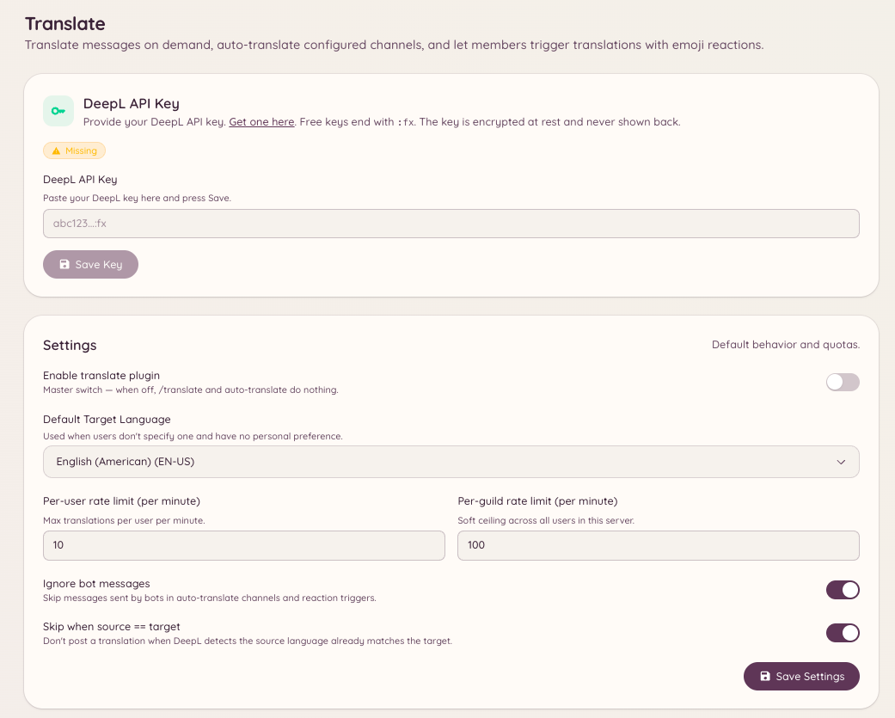

import { DashboardLink } from "/snippets/dashboard-link.jsx";

Le plugin de traduction utilise DeepL pour traduire les messages. Les membres peuvent traduire n’importe quel message à la demande, et les administrateurs peuvent configurer des salons où chaque message est automatiquement traduit dans une langue cible.

<Frame>
  
</Frame>

## Traduire un message

```text
/translate message <message_id> <target_language>
```

Traduit un message précis dans la langue cible. Le bot répond avec le texte traduit. Le message d’origine n’est pas modifié.

Tu peux aussi traduire avec le menu contextuel **Applications** de Discord : fais un clic droit sur n’importe quel message, choisis **Applications**, puis **Translate**.

## Vérifier une langue

```text
/translate language <language>
```

Recherche une langue par son nom ou son code pour confirmer comment DeepL l’identifie et depuis et vers quelles autres langues elle peut être traduite.

## Salons à traduction automatique

Des salons peuvent être configurés pour traduire automatiquement tous les messages dans une langue cible donnée. C’est utile pour les communautés multilingues où tu veux qu’un même salon soit accessible à des personnes qui parlent des langues différentes.

Va dans <DashboardLink to="translate/channels">**Translate \> Channels**</DashboardLink> sur le tableau de bord pour ajouter des salons à la liste de traduction automatique. Pour chaque salon, configure :

| Paramètre | Description |
| --- | --- |
| **Channel** | Le salon Discord pour lequel activer la traduction automatique |
| **Target language** | La langue dans laquelle tous les messages sont traduits |
| **Source language** | La langue source attendue, ou la détection automatique si rien n’est défini |
| **Translate bot messages** | Si le bot traduit aussi les messages envoyés par d’autres bots |

Quand la traduction automatique est active, le bot publie une traduction en réponse à chaque message. Les messages déjà dans la langue cible sont ignorés.

## Emojis des langues

Va dans <DashboardLink to="translate/emoji">**Translate \> Emoji Mappings**</DashboardLink> sur le tableau de bord pour configurer quel drapeau ou emoji personnalisé représente chaque langue. Ces emojis sont utilisés dans l’en-tête des messages traduits pour indiquer visuellement la langue source et la langue cible.

## Tester la traduction

Va dans <DashboardLink to="translate/test">**Translate \> Test**</DashboardLink> sur le tableau de bord pour envoyer un texte de test au moteur de traduction et vérifier le résultat avant de l’appliquer à des salons en activité.

## Permissions requises

| Action | Clé de permission |
| --- | --- |
| Traduire des messages | `translate.use` (autorisé par défaut) |
| Voir la configuration | `translate.view_config` |
| Gérer la configuration | `translate.manage_config` |
