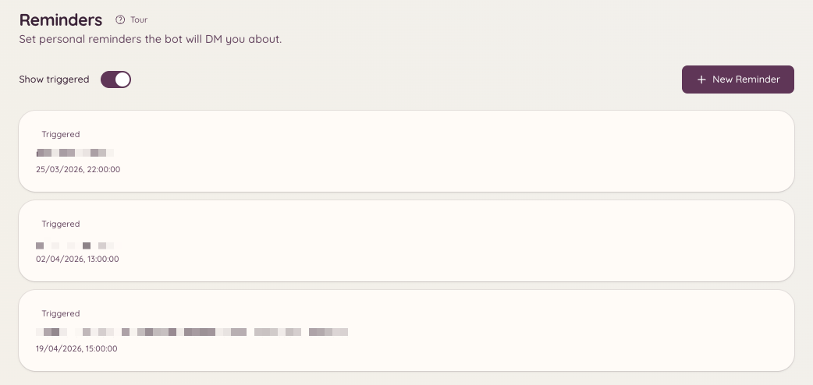

import { DashboardLink } from "/snippets/dashboard-link.jsx";

Le plugin de rappels permet aux membres de se créer des rappels. À l’heure prévue, le bot envoie le rappel en MP ou le publie dans le salon où il a été créé. Les rappels peuvent inclure du contexte, par exemple un lien vers un ticket ou un fil de modmail, pour qu’ils arrivent avec assez d’informations pour agir.

<Frame>
  
</Frame>

## Créer un rappel

```text
/reminder
```

`/reminder` ouvre un panneau interactif. Depuis ce panneau, tu peux :

- Décrire ce dont tu dois te souvenir
- Choisir quand tu veux qu’on te le rappelle (une heure précise, ou un délai à partir de maintenant comme `in 2 hours` ou `tomorrow at 9am`)
- Choisir si le rappel est envoyé en MP ou publié dans le salon actuel

Le bot confirme le rappel avec un message qui indique son contenu et l’heure d’envoi prévue.

## Gérer tes rappels

```text
/reminders
```

Ouvre un panneau qui liste tous tes rappels à venir. Depuis ce panneau, tu peux :

- **Voir** le contenu complet de chaque rappel
- **Supprimer** les rappels dont tu n’as plus besoin
- **Modifier** l’heure ou la description d’un rappel en attente

Si tu as accès au tableau de bord, la page <DashboardLink to="reminders">**Reminders**</DashboardLink> affiche la même liste, toujours avec tes rappels uniquement, et te permet aussi d’en ajouter, d’en modifier ou d’en supprimer.

## Contexte de ticket et de modmail

Quand tu lances `/reminder` dans un ticket ou un fil de modmail actif, le bot joint automatiquement au rappel un lien vers ce fil. Quand le rappel se déclenche, il contient un lien direct pour revenir tout de suite à la conversation.

## Envoi des rappels

Les rappels sont envoyés à l’heure prévue, que tu sois connecté ou non. Si le bot ne peut pas t’envoyer de MP (par exemple parce que tu as désactivé les MP des membres du serveur), il essaie de publier le rappel dans le salon où il a été créé.

## Permissions requises

| Action | Clé de permission |
| --- | --- |
| Créer des rappels | `reminders.view_reminders` (autorisé par défaut) |
| Gérer ses propres rappels | `reminders.view_reminders` (autorisé par défaut) |
| Envoyer des rappels à d’autres membres | `reminders.send_public_reminders` |
| Voir tous les rappels du serveur | `reminders.manage_reminders` |
