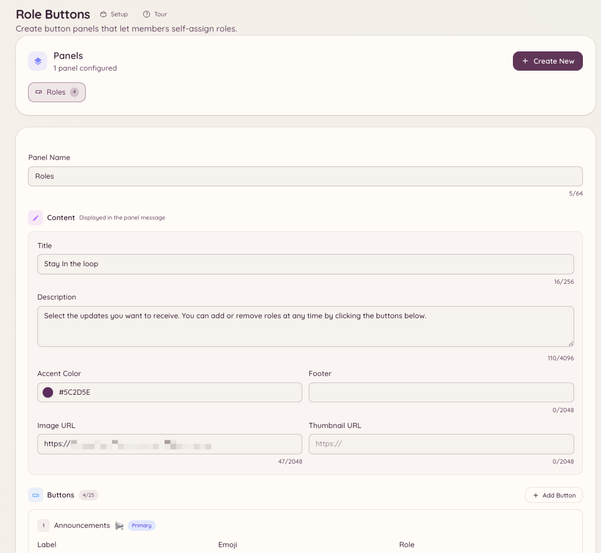

import { DashboardLink } from "/snippets/dashboard-link.jsx";

Les boutons de rôles sont des panneaux permanents publiés dans un salon, avec des boutons sur lesquels les membres cliquent pour se donner ou se retirer des rôles. Contrairement à la sélection de rôles intégrée à Discord, les panneaux de Heimdall prennent en charge des modes de bascule, le regroupement de rôles, ainsi que des libellés et des styles de boutons personnalisés.

<Frame>
  
</Frame>

## Créer un panneau

```text
/rolebuttons create
```

Lancer cette commande ouvre un parcours de configuration où tu définis le panneau. Tu peux aussi créer et gérer les panneaux entièrement depuis le tableau de bord, dans <DashboardLink to="rolebuttons">**Role Buttons**</DashboardLink>.

### Paramètres du panneau

| Paramètre | Description |
| --- | --- |
| **Title** | Le texte d’en-tête du panneau |
| **Description** | Un texte explicatif affiché sous le titre |
| **Mode** | La façon dont les rôles sont donnés (voir ci-dessous) |

### Modes d’attribution

| Mode | Comportement |
| --- | --- |
| **Toggle** | Un clic ajoute le rôle si le membre ne l’a pas, et le retire s’il l’a |
| **Add only** | Un clic ajoute toujours le rôle, sans jamais le retirer |
| **Remove only** | Un clic retire toujours le rôle, sans jamais l’ajouter |
| **Exclusive** | Un seul rôle du panneau peut être détenu à la fois ; en choisir un nouveau retire le précédent |

### Ajouter des boutons

Chaque bouton d’un panneau correspond à un rôle Discord. Pour chaque bouton, tu configures :

| Paramètre | Description |
| --- | --- |
| **Role** | Le rôle Discord à donner |
| **Label** | Le texte du bouton |
| **Style** | Primary (blurple), Secondary (gris), Success (vert) ou Danger (rouge) |
| **Emoji** | Un emoji facultatif affiché sur le bouton |

Un panneau peut contenir jusqu’à 25 boutons (5 rangées de 5).

## Publier le panneau

```text
/rolebuttons post <panel_id> [channel]
```

Publie le panneau dans le salon indiqué (ou dans le salon actuel si aucun n’est indiqué). Le panneau est permanent : il reste dans le salon indéfiniment et continue de fonctionner après un redémarrage du bot.

Si tu dois mettre à jour le contenu du panneau après sa publication, modifie-le dans <DashboardLink to="rolebuttons">**Role Buttons**</DashboardLink> sur le tableau de bord. Le message publié se met à jour automatiquement.

## Gérer les panneaux

```text
/rolebuttons list
/rolebuttons edit <panel_id>
/rolebuttons delete <panel_id>
/rolebuttons update <panel_id>
```

Le tableau de bord, dans <DashboardLink to="rolebuttons">**Role Buttons**</DashboardLink>, affiche tous les panneaux avec l’endroit où ils sont publiés, leur nombre de boutons et leur date de dernière mise à jour.

## Permissions requises

| Action | Clé de permission |
| --- | --- |
| Utiliser les panneaux de boutons de rôles | Tous les membres par défaut |
| Voir les panneaux sur le tableau de bord | `rolebuttons.view` |
| Créer et modifier des panneaux | `rolebuttons.manage` |
