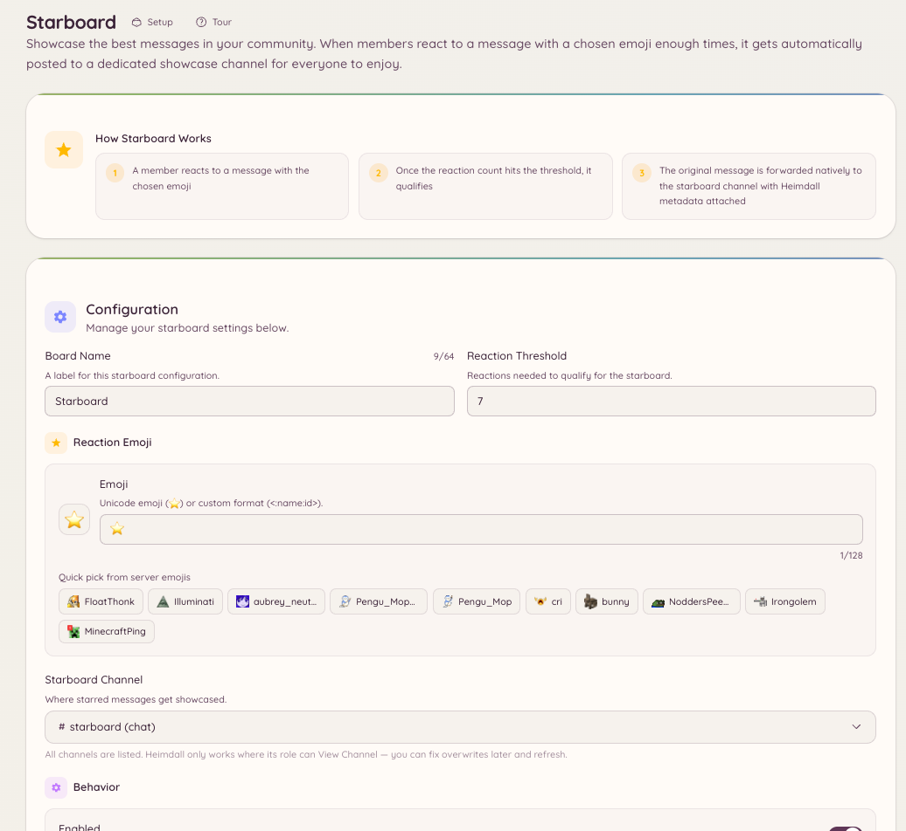

import { DashboardLink } from "/snippets/dashboard-link.jsx";

Le starboard rassemble les messages qui reçoivent assez de réactions et les republie dans un salon dédié. C’est un outil de sélection par la communauté : les membres votent avec des réactions et les contenus les plus populaires ressortent automatiquement.

<Frame>
  
</Frame>

## Comment ça marche

Quand un message atteint ou dépasse le nombre de réactions que tu as configuré, le bot le copie dans le salon du starboard. Le message republié affiche l’auteur d’origine, le salon d’origine, un lien vers l’original et le nombre actuel de réactions.

Si le nombre de réactions repasse sous le seuil (parce que des membres retirent leurs réactions), le bot retire l’entrée du starboard ou la garde, selon ta configuration.

## Configuration

Va dans <DashboardLink to="starboard">**Starboard**</DashboardLink> sur le tableau de bord et configure :

| Paramètre | Description |
| --- | --- |
| **Channel** | Le salon où les messages étoilés sont republiés |
| **Reaction emoji** | La réaction qui déclenche le starboard (par défaut : l’emoji étoile) |
| **Threshold** | Le nombre minimum de réactions requis |
| **Self-star** | Si la réaction de l’auteur d’origine compte |
| **Bot messages** | Si les messages de bots peuvent être étoilés |
| **NSFW channels** | Si les messages des salons marqués NSFW sont inclus |

## File de modération

Le starboard propose une file de modération facultative. Quand elle est activée, les messages ne sont pas publiés dans le starboard dès qu’ils atteignent le seuil. Ils entrent plutôt dans une file d’attente sur la page <DashboardLink to="starboard">**Starboard**</DashboardLink>, où le staff peut les approuver ou les refuser avant qu’ils apparaissent.

Va dans <DashboardLink to="starboard">**Starboard**</DashboardLink> sur le tableau de bord et active **Require moderation approval**. Les entrées en attente apparaissent dans la **Moderation Queue** sur la même page.

Le staff qui a la permission `starboard.moderate` peut approuver ou refuser les entrées en attente. Les entrées approuvées sont publiées ; les entrées refusées sont écartées.

## Modifier le seuil après la configuration

Relever le seuil après la configuration ne retire pas les entrées déjà publiées sous l’ancien seuil. L’abaisser n’ajoute pas rétroactivement d’anciens messages. Le seuil ne s’applique qu’aux réactions reçues à partir du moment où il change.

## Permissions requises

Le starboard est entièrement automatique et ne demande aucune permission aux membres. La configuration est réservée aux admins :

| Action | Clé de permission |
| --- | --- |
| Voir la configuration | `starboard.view_config` |
| Modifier la configuration | `starboard.manage_config` |
| Modérer la file d’approbation | `starboard.moderate` |
