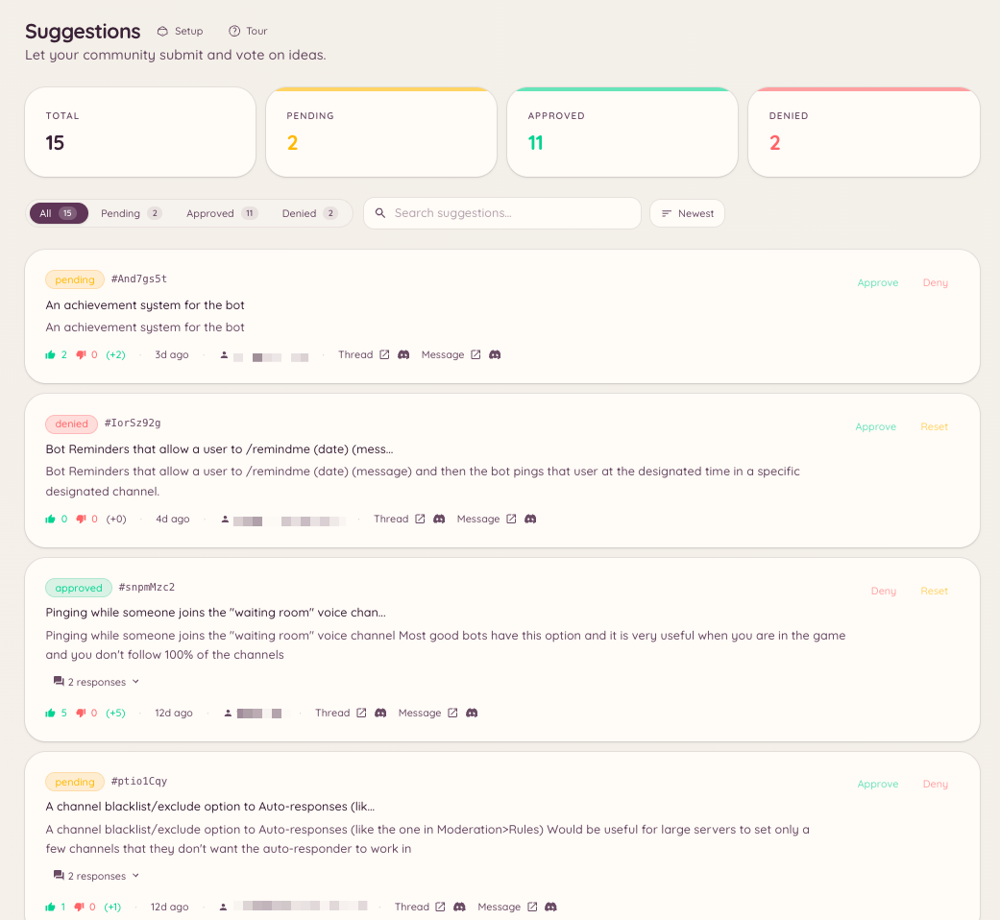

import { DashboardLink } from "/snippets/dashboard-link.jsx";

Le plugin de suggestions met en place un circuit dédié aux retours des membres. Les membres envoient leurs suggestions avec une commande slash, le bot les publie sous forme de messages mis en forme dans un salon désigné, avec des réactions pour voter pour ou contre, et le staff les examine et les traite depuis le tableau de bord ou avec des commandes slash.

<Frame>
  
</Frame>

## Envoyer une suggestion

```text
/suggest <content>
```

Le membre écrit le texte de sa suggestion. Le bot la publie dans le salon de suggestions configuré, avec les réactions de vote déjà ajoutées. Si la génération de titres par IA est activée, le bot produit aussi un titre court qui résume la suggestion à partir de son contenu.

## Catégories

Les suggestions peuvent être envoyées dans différents salons selon leur catégorie. Ouvre <DashboardLink to="suggestions/categories">**Suggestions \> Categories**</DashboardLink> dans le tableau de bord pour les créer.

Chaque catégorie a :

| Paramètre | Description |
| --- | --- |
| **Nom** | Affiché quand un membre choisit une catégorie |
| **Salon** | L’endroit où les suggestions de cette catégorie sont publiées |
| **Style de vote** | Pour/contre, note en étoiles ou réactions avec des emojis personnalisés |
| **Qui peut suggérer** | Limite l’envoi à certains rôles |

Quand il y a plusieurs catégories, le membre doit en choisir une en lançant `/suggest`.

## Gérer les suggestions

```text
/suggestion-config
/suggestion-categories list
/suggestion-categories create <name>
/suggestion-categories delete <id>
```

Le staff gère chaque suggestion depuis le tableau de bord sous <DashboardLink to="suggestions/list">**Suggestions \> Suggestions**</DashboardLink>, ou avec les actions du menu contextuel sur le message de la suggestion.

Actions disponibles sur une suggestion :

| Action | Description |
| --- | --- |
| **Approuver** | Marque la suggestion comme acceptée ; le bot ajoute un badge de statut au message |
| **Refuser** | La marque comme refusée, avec une raison facultative publiée en réponse |
| **En cours** | La marque comme en cours de réalisation |
| **Réalisée** | La marque comme terminée |
| **Archiver** | La retire du fil actif sans la supprimer |

Quand une suggestion est traitée, le bot met à jour le message d’origine pour afficher le nouveau statut, tout en gardant les résultats du vote visibles.

## Configuration dans le tableau de bord

Ouvre <DashboardLink to="suggestions/config">**Suggestions \> Configuration**</DashboardLink> pour configurer :

| Paramètre | Description |
| --- | --- |
| **Salon par défaut** | L’endroit où vont les suggestions quand aucune catégorie n’est définie |
| **Suggestions anonymes** | Publie les suggestions sans afficher le nom de leur auteur |
| **Détection des doublons** | Prévient l’auteur si une suggestion similaire existe déjà |
| **Titres IA** | Génère automatiquement un titre court à partir du texte de la suggestion |
| **Longueur min./max.** | Impose des limites de caractères au contenu envoyé |

## Ouvreurs

Les ouvreurs sont des boutons publiés dans un salon : les membres cliquent dessus pour envoyer une suggestion via un formulaire, sans avoir à taper la commande `/suggest`. Ouvre <DashboardLink to="suggestions/openers">**Suggestions \> Openers**</DashboardLink> et clique sur **New Opener** (nouvel ouvreur). Configure le libellé du bouton et un texte d’invite facultatif, puis clique sur **Post** pour placer le panneau dans un salon.

Les ouvreurs sont utiles pour garder le circuit des suggestions visible dans un salon dédié, ou sur les serveurs où les commandes slash sont restreintes.

## Permissions requises

| Action | Clé de permission |
| --- | --- |
| Envoyer des suggestions | `suggestions.create_suggestion` (autorisé par défaut) |
| Voir les suggestions dans le tableau de bord | `suggestions.items.view_suggestions` |
| Approuver et refuser des suggestions | `suggestions.items.manage_suggestions` |
