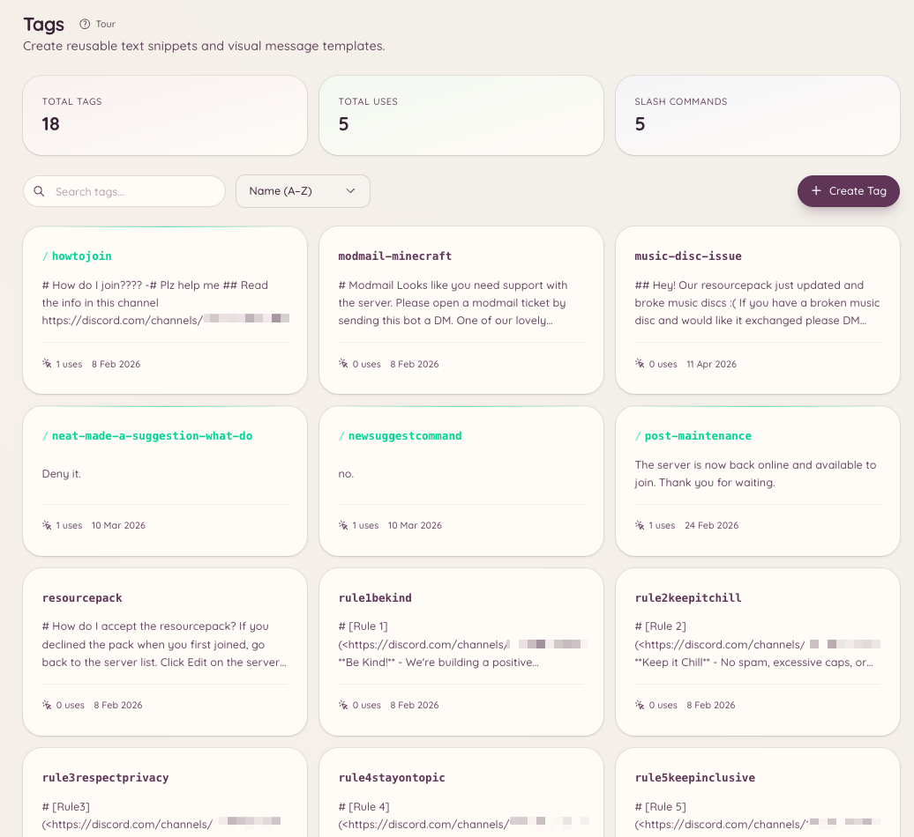

import { DashboardLink } from "/snippets/dashboard-link.jsx";

Les tags sont des contenus réutilisables (un bloc de texte, un embed ou un message mis en forme) que l’on peut publier dans n’importe quel salon avec une seule commande. Ils sont particulièrement utiles au staff qui répond souvent aux mêmes questions, partage les mêmes ressources ou publie des annonces mises en forme. Le contenu est enregistré une fois, et toute personne qui y a accès peut le publier instantanément.

<Frame>
  
</Frame>

## Utiliser un tag

```text
/tag use <name>
```

Publie le contenu du tag dans le salon actuel. Les noms de tags ont l’autocomplétion : commence à taper et le bot te propose les tags correspondants.

## Créer un tag

```text
/tag create <name>
```

Ouvre une fenêtre où tu écris le contenu du tag. Le contenu prend en charge le markdown de Discord. Si tu veux créer un tag avec un embed riche, passe plutôt par <DashboardLink to="tags/tags">**Tags**</DashboardLink> dans le tableau de bord, qui propose un éditeur d’embed visuel.

Pour créer un tag depuis le tableau de bord, ouvre <DashboardLink to="tags/tags">**Tags**</DashboardLink> et clique sur **New Tag** (nouveau tag). L’éditeur du tableau de bord prend en charge :

- Du texte simple
- Un embed avec titre, description, champs, couleur et miniature
- L’envoi d’un fichier en pièce jointe

## Modifier et supprimer

```text
/tag edit <name>
/tag delete <name>
```

La modification ouvre la même fenêtre que la création. La suppression retire le tag définitivement.

## Lister les tags

```text
/tag list
```

Liste tous les tags disponibles sur ton serveur. La page <DashboardLink to="tags/tags">**Tags**</DashboardLink> du tableau de bord affiche la même liste, avec recherche et filtres.

## Posts

Les posts ressemblent aux tags, mais ils sont pensés pour du contenu plus long, destiné à des salons précis. Les posts programmés se gèrent dans le tableau de bord sous <DashboardLink to="settings/messages">**Settings \> Messages**</DashboardLink>, dans **Scheduled posts** (posts programmés). La commande `/post` fonctionne avec `/tag` :

```text
/post send <name> [channel]
/post list
```

Un post envoie le contenu dans un salon désigné plutôt que dans le salon où la commande est lancée. Utilise les posts pour des choses comme les annonces hebdomadaires ou les ressources épinglées qui doivent aller à un endroit précis, peu importe où la commande est lancée.

## Modèles

Les modèles sont des squelettes d’embed enregistrés dans le tableau de bord, que le staff peut utiliser comme point de départ pour créer de nouveaux tags. Ils se trouvent sous <DashboardLink to="settings/messages">**Settings \> Messages**</DashboardLink>, dans **Reusable templates** (modèles réutilisables).

## Permissions requises

| Action | Clé de permission |
| --- | --- |
| Utiliser les tags | `tags.view_tags` (autorisé par défaut) |
| Créer, modifier et supprimer des tags | `tags.manage_tags` |
| Envoyer des posts | `tags.manage_posts` |
