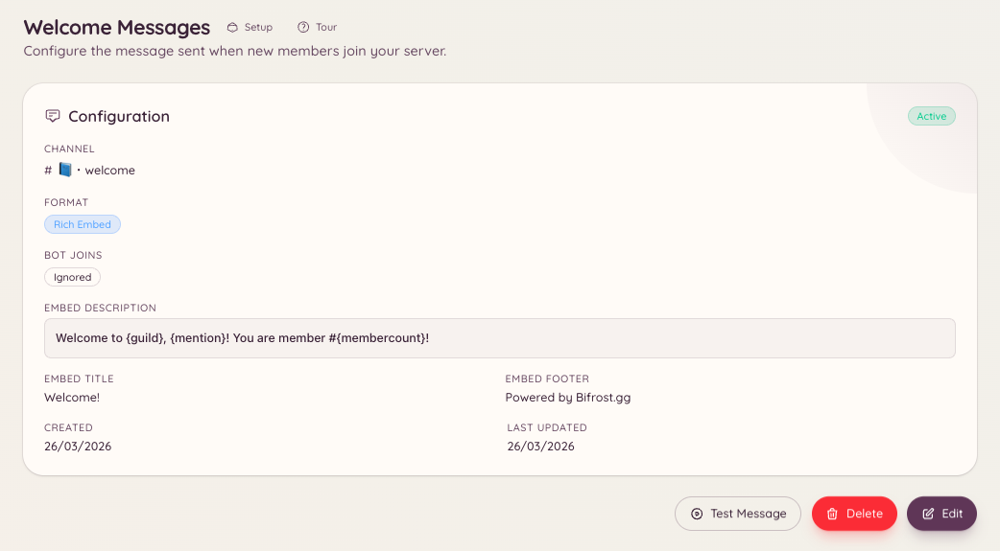

import { DashboardLink } from "/snippets/dashboard-link.jsx";

Le plugin de bienvenue publie un message dans un salon dédié chaque fois qu’un membre rejoint ton serveur. Le message est entièrement personnalisable : tu peux l’écrire en texte brut ou sous forme d’embed enrichi, et utiliser des variables pour inclure le nom du membre, le nom du serveur et le nombre actuel de membres.

<Frame>
  
</Frame>

## Configuration

```text
/welcome setup
```

Lancer `/welcome setup` ouvre une fenêtre de configuration où tu définis le salon de bienvenue et rédiges ton message. Tu peux aussi tout configurer depuis le tableau de bord, dans <DashboardLink to="welcome">**Welcome**</DashboardLink>.

### Configuration sur le tableau de bord

Va dans <DashboardLink to="welcome">**Welcome**</DashboardLink> dans la barre latérale du tableau de bord. La page de configuration propose :

| Paramètre | Description |
| --- | --- |
| **Channel** | Le salon où les messages de bienvenue sont publiés |
| **Message content** | Le texte brut ou le contenu de l’embed du message de bienvenue |
| **Embed toggle** | Envoie le message sous forme d’embed enrichi avec couleur et champs |
| **Embed colour** | La couleur du bord gauche de l’embed |

## Variables disponibles

Les variables sont des emplacements dans ton message que le bot remplit au moment de l’envoi. Entoure les variables d’accolades :

| Variable | Remplacée par |
| --- | --- |
| `{user}` | Une mention du nouveau membre (`@Username`) |
| `{user.name}` | Le nom d’affichage du membre (sans mention) |
| `{user.id}` | L’ID d’utilisateur Discord du membre |
| `{server}` | Le nom de ton serveur |
| `{server.count}` | Le nombre total de membres après l’arrivée |
| `{server.id}` | L’ID de ton serveur |

### Exemple de message

```text
Welcome to {server}, {user}! You are member number {server.count}.
Please read <#channel-id> before getting started.
```

## Tester le message de bienvenue

```text
/welcome test
```

Publie un aperçu de ton message de bienvenue dans le salon actuel, en utilisant ton propre compte comme membre de test. Pratique pour vérifier la mise en forme et les variables avant la prochaine vraie arrivée.

## Voir la configuration actuelle

```text
/welcome view
```

Affiche la configuration actuelle du message de bienvenue sans déclencher d’envoi de test.

## Retirer le message de bienvenue

```text
/welcome remove
```

Désactive le message de bienvenue. La configuration est conservée pour que tu puisses le réactiver plus tard.

## Permissions requises

| Action | Clé de permission |
| --- | --- |
| Voir la configuration de bienvenue | `welcome.view_config` |
| Modifier la configuration de bienvenue | `welcome.manage_config` |
