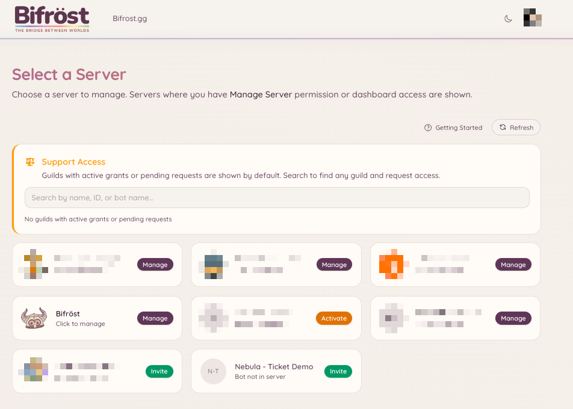
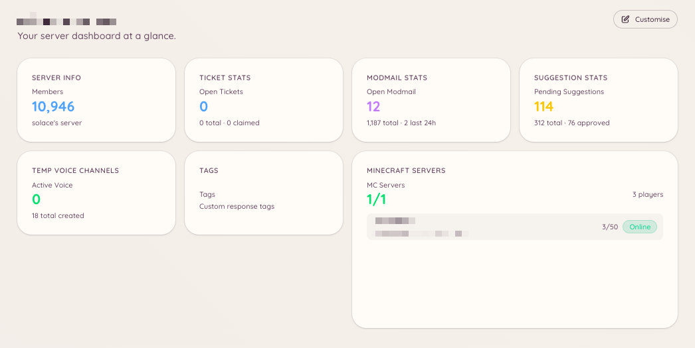

import { DashboardLink } from "/snippets/dashboard-link.jsx";

Le tableau de bord Heimdall est une interface web où les administrateurs du serveur configurent toutes les fonctionnalités du bot. Les membres ordinaires n’ont pas besoin d’y accéder, sauf si on leur a donné cet accès explicitement.

## Se connecter

Va sur [**bot.bifrost.gg**](https://bot.bifrost.gg) et clique sur **Sign in with Discord** (se connecter avec Discord). Discord te demande d’autoriser l’application du tableau de bord, qui lit ton nom d’utilisateur, ton avatar et la liste des serveurs que tu gères. Aucun accès aux messages ou au contenu n’est demandé.

Une fois connecté, tu arrives sur le sélecteur de serveurs.

## Sélecteur de serveurs

Le sélecteur de serveurs liste tous les serveurs Discord où tu as la permission Gérer le serveur et où Heimdall est présent. Clique sur la carte d’un serveur pour ouvrir son tableau de bord.

Si tu gères un serveur où Heimdall n’a pas encore été ajouté, la carte affiche « Invite ». Il suffit de cliquer dessus pour inviter Heimdall sur ton serveur.

<Frame>
  
</Frame>

## Page d’aperçu

La page <DashboardLink to="overview">**Overview**</DashboardLink> (Aperçu) est la première chose que tu vois après avoir choisi un serveur. Plutôt qu’une mise en page fixe, c’est un tableau de bord de widgets entièrement personnalisable. Heimdall propose une bibliothèque de widgets d’information (du nombre de membres du serveur et des files de tickets jusqu’au statut du serveur Minecraft et au volume du modmail), et tu les organises selon ta façon de travailler.

Pour personnaliser la mise en page, clique sur **Edit layout** (modifier la mise en page) en haut à droite de la page <DashboardLink to="overview">**Overview**</DashboardLink>. En mode édition, tu peux :

- **Ajouter des widgets** : clique sur le bouton **\+** pour ouvrir le sélecteur de widgets et placer des widgets de la bibliothèque
- **Déplacer des widgets** : fais glisser n’importe quelle carte vers une nouvelle position de la grille
- **Redimensionner des widgets** : fais glisser la poignée de redimensionnement pour changer la taille d’une carte
- **Retirer des widgets** : survole une carte et clique sur le bouton de retrait pour l’enlever de la grille

Les widgets disponibles dépendent des plugins activés sur ton serveur et des permissions du tableau de bord accordées à ton rôle. Les widgets des plugins inactifs n’apparaissent pas dans le sélecteur.

<Frame>
  
</Frame>

## Navigation

La barre latérale gauche liste tous les plugins disponibles. Chaque entrée mène à la section de configuration et de gestion du plugin. Les sections qui ont des sous-pages se déplient au clic pour afficher des onglets comme **Configuration**, **Analytics**, **Categories**, etc.

La barre latérale est divisée en groupes qui correspondent aux sections de cette documentation : Moderation, Support, Community, Voice, Games, Integrations, AI et Utilities.

## Panneaux publiés dans plusieurs salons

Un panneau est un message avec des boutons sur lesquels les membres appuient, comme un ouvreur de tickets, un panneau de boutons de rôles ou le panneau de liaison de compte Minecraft. Tu peux publier le même panneau dans autant de salons que tu veux. Le publier dans un nouveau salon y ajoute une copie. Ça ne déplace et ne supprime jamais les copies que tu as déjà.

Quand tu publies un panneau, la fenêtre de publication affiche une liste **Posted in** (publié dans) avec toutes les copies que Heimdall connaît. Chaque ligne indique le salon, la date de publication de la copie, qui l’a publiée quand Heimdall le sait, et son état :

| État | Signification | Ce que tu peux faire |
| --- | --- | --- |
| **Live** | Le message est dans le salon | **Refresh** le met à jour avec le texte actuel. **Delete** le retire du salon |
| **Deleted** | Quelqu’un a supprimé le message dans Discord | **Post again** le remet dans le même salon. **Remove from list** l’oublie |
| **Can't reach** | Heimdall ne peut pas voir le salon ou lire son historique | **Remove from list** l’oublie. Heimdall ne peut pas savoir si le message est toujours là, donc supprime-le à la main si c’est le cas |

Changer le texte d’un panneau, ou un réglage qui change ce qu’il affiche, met à jour toutes les copies encore présentes. Une copie que quelqu’un a supprimée est retirée de la liste plutôt que republiée.

Heimdall ne supprime que les messages qu’il a envoyés. Si une copie listée s’avère être le message de quelqu’un d’autre, Delete la laisse dans le salon et la retire seulement de la liste.

Supprimer un ouvreur de suggestions ou de jeux supprime aussi les copies listées que Heimdall peut atteindre. Une copie qu’il ne peut pas atteindre, ou qui n’a jamais été listée, reste dans Discord avec des boutons qui ne marchent plus, donc supprime-la depuis Discord.

<Note>
  Pour la plupart des panneaux, Heimdall ne retenait auparavant que la copie la plus récente, c’est donc la seule copie ancienne listée au début. Une ancienne copie ailleurs est ajoutée la première fois qu’un membre appuie sur l’un de ses boutons, à condition que Heimdall puisse savoir à quel panneau elle appartient. Pour les ouvreurs (tickets, modmail, suggestions et jeux), Heimdall ne peut pas toujours savoir à quel ouvreur appartient une ancienne copie, donc une ancienne copie d’ouvreur peut ne jamais être ajoutée de cette façon. Tant qu’une copie n’est pas listée, Refresh et Delete ne peuvent pas l’atteindre, et tu peux la supprimer dans Discord comme d’habitude.
</Note>

## Les permissions dans le tableau de bord

Ton accès aux sections du tableau de bord dépend des permissions accordées à tes rôles Discord. Si tu ne vois pas une section, soit tu n’as pas la permission correspondante, soit le plugin n’a pas été activé. Les administrateurs qui ont la permission Discord **Administrateur** ont toujours un accès complet.

Voir [Permissions](/fr/permissions) pour une explication complète du fonctionnement du système de permissions.

## Faire des changements

Les changements faits dans le tableau de bord s’appliquent immédiatement. Il n’y a pas d’étape de publication ou d’enregistrement global : chaque section a son propre bouton **Save** qui applique les changements à cette section seulement.

<Note>
  Le bot n’a pas besoin d’être redémarré quand tu changes la configuration. Les changements sont pris en compte automatiquement.
</Note>
