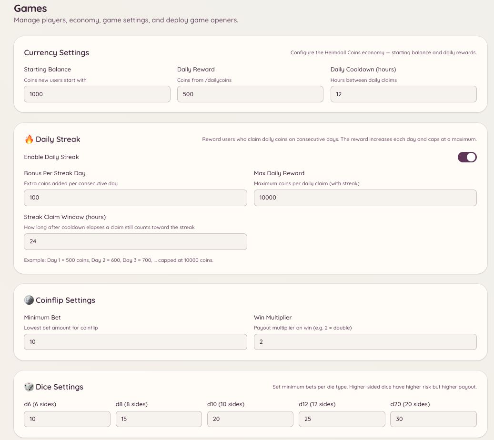

import { DashboardLink } from "/snippets/dashboard-link.jsx";

Le système d’économie donne à ton serveur une monnaie virtuelle que les membres gagnent et dépensent dans les jeux et avec les réclamations quotidiennes. La monnaie est propre à chaque serveur : les soldes ne passent pas d’un serveur à l’autre.

<Frame>
  
</Frame>

## Voir ton solde

```text
/balance [user]
```

Affiche ton solde de pièces actuel. Si tu indiques un utilisateur, la commande affiche plutôt le solde de ce membre (à condition qu’il ait rendu son solde visible).

## Réclamation quotidienne

```text
/dailycoins
```

Récupère ta part quotidienne de pièces. Les membres peuvent lancer cette commande une fois par période d’attente (24 heures par défaut). Le montant se règle dans <DashboardLink to="games/config/economy">**Games \> Configuration \> Economy**</DashboardLink>.

Les administrateurs peuvent aussi créer d’autres commandes de réclamation, avec leurs propres montants et délais d’attente, grâce à la configuration `/economy claim`.

## Donner des pourboires

```text
/tip <user> <amount>
```

Transfère des pièces de ton solde vers celui d’un autre membre. Le pourboire est immédiat et ne peut pas être annulé. Utilise-le pour récompenser les membres serviables, payer des services dans l’économie du jeu ou partager tes gains.

## Classement

```text
/leaderboard
```

Affiche les membres qui ont le plus de pièces sur ton serveur, classés par solde. Le classement est propre à chaque serveur.

Les administrateurs peuvent aussi voir le classement complet dans le tableau de bord, sous <DashboardLink to="games/players">**Games \> Players**</DashboardLink>, avec plus de détails que la version dans Discord.

## Récompenses à réclamer

La commande `/economy claim` permet aux administrateurs de créer des événements de réclamation ponctuels ou récurrents. Les membres lancent la commande pour recevoir une récompense définie par l’administrateur. Configure les événements de réclamation dans <DashboardLink to="games/config">**Games \> Configuration**</DashboardLink>.

## Gérer les soldes des membres

Les administrateurs peuvent voir et ajuster le solde de chaque membre dans le tableau de bord, sous <DashboardLink to="games/players">**Games \> Players**</DashboardLink>. Choisis un membre et utilise les outils d’ajustement pour ajouter des pièces, en retirer ou fixer directement son solde. Tous les ajustements sont enregistrés.

## Historique des transactions

La page <DashboardLink to="games/transactions">**Games \> Transactions**</DashboardLink> du tableau de bord affiche le journal de toutes les transactions de l’économie : réclamations quotidiennes, pourboires, gains et pertes aux jeux, et ajustements des administrateurs. Chaque entrée indique le membre, le montant, le type de transaction et l’heure.

## Personnaliser la monnaie

Configure le nom de la monnaie, son emoji, le montant de la réclamation quotidienne et le solde de départ dans <DashboardLink to="games/config/economy">**Games \> Configuration \> Economy**</DashboardLink>. Changer le nom de la monnaie ne modifie pas les soldes existants.

## Permissions requises

| Action | Clé de permission |
| --- | --- |
| Voir son solde et réclamer | `games.use` (autorisé par défaut) |
| Donner des pourboires | `games.use` (autorisé par défaut) |
| Gérer les soldes des joueurs | `games.manage` |
