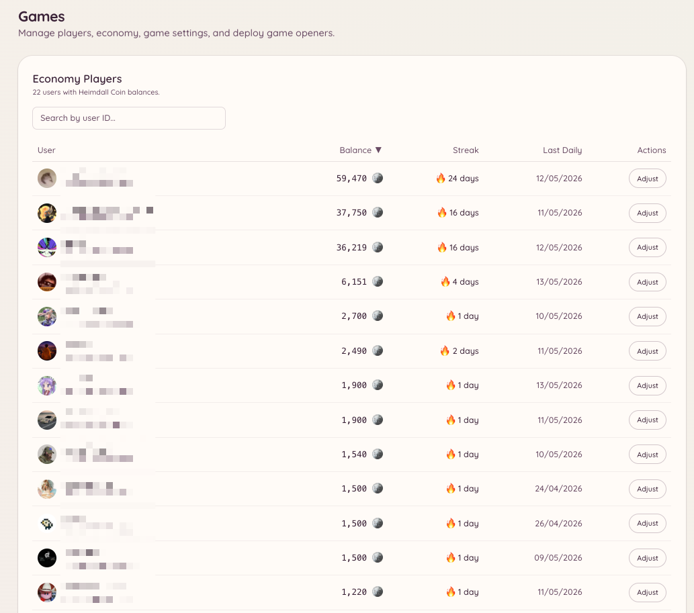

import { DashboardLink } from "/snippets/dashboard-link.jsx";

Le plugin de jeux propose toute une série de jeux interactifs (jeux de plateau, jeux de casino et un système d’économie), tous jouables directement dans Discord. Chaque jeu a sa propre commande slash. La couche d’économie donne aux membres une monnaie virtuelle qu’ils gagnent avec les réclamations quotidiennes, les gains aux jeux et les pourboires.

<Frame>
  
</Frame>

## Jeux disponibles

<Columns cols={2}>
  <Card title="Jeux de plateau" icon="chess-board" href="/fr/games/board-games">
    2048, Puissance 4, Memory, Morpion, Bataille navale, Solitaire
  </Card>

  <Card title="Jeux de casino" icon="dice" href="/fr/games/casino">
    Blackjack, Coinflip, Dice, Higher-Lower, Horse Racing, Mines, Roulette
  </Card>

  <Card title="Économie" icon="coins" href="/fr/games/economy">
    Solde, pièces quotidiennes, pourboires, classement et récompenses à réclamer
  </Card>
</Columns>

## Activer les jeux

Ouvre <DashboardLink to="games/config">**Games \> Configuration**</DashboardLink> dans le tableau de bord. Une fois le plugin actif, les jeux sont activés par défaut pour tous les membres.

## Contrôle d’accès

Tu peux limiter les salons et les rôles qui ont accès aux jeux :

- **Salons** : ouvre <DashboardLink to="games/config/channels">**Games \> Configuration \> Channels**</DashboardLink> et indique les salons où les jeux sont autorisés. Si aucun salon n’est configuré, les jeux fonctionnent partout.
- **Rôles** : ouvre <DashboardLink to="games/config/openers">**Games \> Configuration \> Openers**</DashboardLink> pour réserver les commandes de jeux à certains rôles.

Limiter les jeux à un salon dédié évite qu’ils encombrent le reste de ton serveur.

## Configuration de l’économie

Ouvre <DashboardLink to="games/config/economy">**Games \> Configuration \> Economy**</DashboardLink> pour configurer :

| Paramètre | Description |
| --- | --- |
| **Nom de la monnaie** | Le nom que ton serveur donne à sa monnaie (par exemple « pièces », « or », « crédits ») |
| **Emoji de la monnaie** | Un emoji facultatif affiché à côté des soldes |
| **Montant de la réclamation quotidienne** | Le nombre de pièces que les membres reçoivent à chaque réclamation quotidienne |
| **Délai de la réclamation quotidienne** | Le temps entre deux réclamations quotidiennes (24 heures par défaut) |
| **Solde de départ** | Le nombre de pièces avec lequel les nouveaux membres commencent |

## Paramètres de visibilité

Chaque jeu peut être masqué de la liste des commandes sans être désactivé. Ouvre <DashboardLink to="games/config/visibility">**Games \> Configuration \> Visibility**</DashboardLink> pour choisir quels jeux les membres voient.

## Statistiques des joueurs

Ouvre <DashboardLink to="games/players">**Games \> Players**</DashboardLink> dans le tableau de bord pour voir tous les membres qui ont utilisé le système de jeux. Pour chaque joueur, tu vois son solde actuel, son nombre total de parties, son bilan de victoires et de défaites pour chaque type de jeu, et sa dernière activité.

Le staff qui a la permission `games.manage` peut ajuster le solde d’un joueur, réinitialiser ses statistiques ou le retirer du classement depuis cette page.

## Transactions

Ouvre <DashboardLink to="games/transactions">**Games \> Transactions**</DashboardLink> pour voir le registre complet des transactions de l’économie sur ton serveur. Chaque entrée enregistre :

| Champ | Description |
| --- | --- |
| **Joueur** | Le membre à qui appartient la transaction |
| **Type** | L’origine de la transaction (réclamation quotidienne, gain ou perte à un jeu, pourboire, ajustement d’un administrateur, récompense de vote) |
| **Montant** | Le nombre de pièces ajoutées ou retirées |
| **Solde après** | Le solde du joueur après la transaction |
| **Horodatage** | Le moment où la transaction a eu lieu |

Filtre par joueur, par type de transaction ou par période. Le journal des transactions est en lecture seule.

## Statistiques

Ouvre <DashboardLink to="games/analytics">**Games \> Analytics**</DashboardLink> pour voir les statistiques globales des jeux de ton serveur :

- Les jeux les plus joués, par nombre de parties
- Le total de pièces en circulation
- Les joueurs actifs par jour au fil du temps
- Les membres qui gagnent et dépensent le plus

## Questions de quiz

Si le jeu de quiz est activé, ouvre <DashboardLink to="games/trivia">**Games \> Trivia Questions**</DashboardLink> pour gérer la banque de questions. Tu peux :

- Ajouter tes propres questions de quiz à choix multiples
- Importer un lot de questions depuis un fichier CSV
- Modifier ou supprimer les questions existantes
- Activer ou désactiver une question sans la supprimer

Les questions personnalisées apparaissent dans la rotation du quiz avec les questions intégrées.

## Récompenses de vote

Ouvre <DashboardLink to="games/topgg">**Games \> Vote Rewards**</DashboardLink> pour configurer des récompenses pour les membres qui votent pour ton serveur sur top.gg. Quand un membre vote, Heimdall reçoit une notification par webhook de top.gg et crédite automatiquement la récompense en pièces configurée sur son solde.

Pour mettre en place les récompenses de vote :

1. Saisis l’URL de ton serveur sur top.gg dans la configuration
2. Copie l’URL de webhook fournie et colle-la dans les paramètres de webhook de la fiche de ton serveur sur top.gg
3. Fixe le montant de la récompense (pièces par vote)
4. Si tu veux, configure un multiplicateur bonus pour les votes du week-end

## Permissions requises

| Action | Clé de permission |
| --- | --- |
| Jouer aux jeux | `games.use` (autorisé par défaut) |
| Gérer la configuration | `games.manage` |
