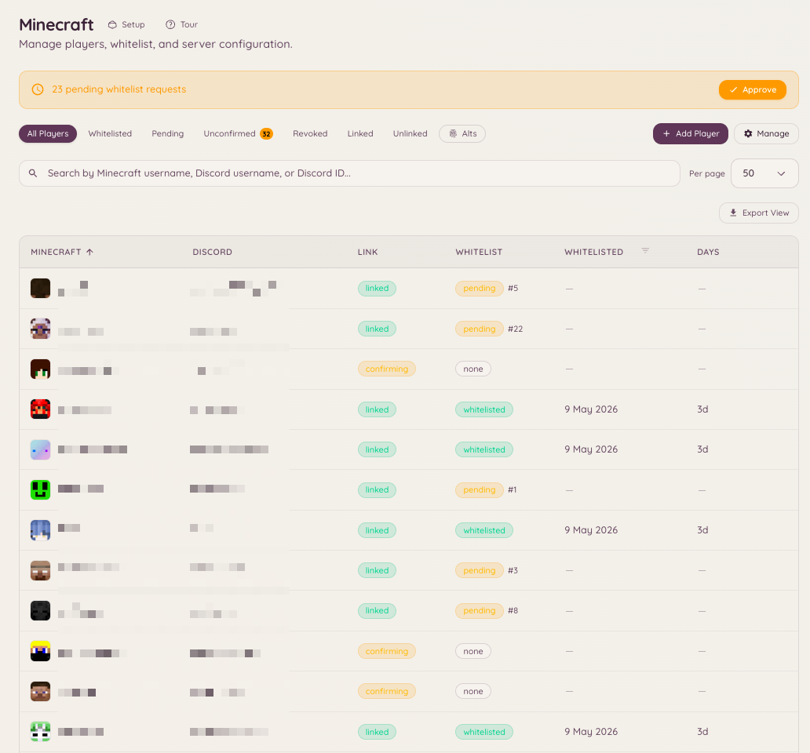

import { DashboardLink } from "/snippets/dashboard-link.jsx";

L’intégration Minecraft relie ton serveur Discord à un ou plusieurs serveurs Minecraft Java Edition. Elle propose la liaison de compte (associer un utilisateur Discord à son pseudo Minecraft), une gestion de la whitelist synchronisée avec les rôles Discord, un accès RCON pour les commandes à distance, un affichage du statut du serveur en direct, et un moteur de sanctions natif pour les bans, mutes, avertissements et expulsions.

<Frame>
  
</Frame>

## Navigation dans le tableau de bord

La fonctionnalité Minecraft a sept pages dans la barre latérale du tableau de bord :

| Page | Ce qu’on y trouve |
| --- | --- |
| <DashboardLink to="minecraft/networks">**Networks**</DashboardLink> | Tes serveurs, qui est dessus, et ce qui vient de se passer |
| <DashboardLink to="minecraft/players">**Players**</DashboardLink> | La liste des joueurs, la file d’attente des arrivées et chaque profil de joueur |
| <DashboardLink to="minecraft/rules">**Rules**</DashboardLink> | Ce qui compte comme une infraction et comment ça s’aggrave |
| <DashboardLink to="minecraft/history">**History**</DashboardLink> | Tout ce qui est arrivé à un joueur, dans l’ordre chronologique |
| <DashboardLink to="minecraft/enforcement">**Enforcement**</DashboardLink> | Comment Heimdall sanctionne, et ce que le public voit |
| <DashboardLink to="minecraft/bridge">**Chat Bridge**</DashboardLink> | Relaie le chat en jeu vers des salons Discord, et inversement |
| <DashboardLink to="minecraft/settings">**Settings**</DashboardLink> | Liaison, RCON, synchronisation des rôles, alertes et messages pour tout le serveur Discord |

## Liaison de compte

Une liaison associe un pseudo Minecraft à un compte Discord. Les membres la lancent depuis Discord et prouvent que le compte est le leur avec un code à 6 chiffres affiché en jeu.

### Le panneau de liaison de compte

Le panneau est un message Discord avec les boutons **Link Account**, **Unlink Account** et **My Account**. Tu peux le publier de plusieurs façons :

- La dernière étape de la configuration Minecraft propose de le publier.
- <DashboardLink to="settings/messages">**Settings \> Messages**</DashboardLink>, sur l’**Account linking panel** : **Post** l’envoie dans un salon que tu choisis. Le publier dans le salon où il se trouve déjà met à jour ce message ; le publier ailleurs y ajoute une copie et laisse les autres en place (voir [Panneaux publiés dans plusieurs salons](/fr/dashboard#panels-posted-in-more-than-one-channel)). Tu peux aussi y réécrire le texte du panneau en gardant ses boutons.
- `/minecraft-setup panel` depuis Discord.

Les membres peuvent aussi commencer avec une commande slash :

```text
/link-minecraft
```

### Recevoir le code

Une fois que le membre a saisi son pseudo Minecraft, le code lui arrive en jeu :

- **Un serveur qui exige une whitelist** refuse sa connexion et affiche le code sur l’écran de déconnexion.
- **Un réseau réglé pour laisser tout le monde entrer** (voir plus bas) le laisse entrer. Avec le plugin Heimdall 3.0.0-rc.19 ou plus récent, le code s’affiche dès qu’il se connecte, et tout de suite s’il est déjà en ligne. Sur Paper 1.21.7 ou plus récent, avec un client 1.21.6 ou plus récent, il s’ouvre dans une boîte de dialogue avec un bouton **Copy code** ; partout ailleurs, y compris pour les joueurs Bedrock, c’est un message dans le chat sur lequel on peut cliquer pour le copier. Le message indique le compte Discord qui a fait la demande, et prévient le joueur de ne jamais donner le code à qui que ce soit.
- **N’importe quel serveur** donne aussi le code sur demande : le joueur lance **/linkdiscord** en jeu.

Le membre appuie ensuite sur **Confirm Code** dans son panneau de compte sur Discord et saisit le code.

Les joueurs peuvent aussi commencer en jeu : **/linkdiscord** leur donne un code sans passer d’abord par Discord.

<Note>
Sur un réseau qui laisse tout le monde entrer, **/linkdiscord** demande le plugin 3.0.0-rc.13 ou plus récent. Les versions plus anciennes la traitent comme la commande du module de whitelist et se contentent de la répéter. Mets à jour le plugin avec **/hd update** en jeu ou depuis sa page de téléchargement.
</Note>

### Laisser tout le monde entrer

La politique de chaque réseau, sur sa page sous <DashboardLink to="minecraft/networks">**Minecraft \> Networks**</DashboardLink>, propose **Anyone can join, linking is optional** (tout le monde peut entrer, la liaison est facultative). Quand c’est activé, personne n’est refoulé, la whitelist est désactivée sur les serveurs de ce réseau, et les joueurs qui veulent leurs rôles Discord en jeu font la liaison comme décrit plus haut. Le reste de la politique du réseau s’applique de nouveau quand tu désactives l’option.

Une fois le compte lié, Heimdall peut :

- Ajouter le membre à la whitelist, automatiquement ou après validation du staff, selon la politique du réseau
- Le retirer de la whitelist s’il perd l’accès
- Synchroniser ses rôles Discord avec des groupes en jeu (<DashboardLink to="minecraft/settings">**Minecraft \> Settings \> Role sync**</DashboardLink>)
- Afficher son pseudo Minecraft à côté de son profil Discord dans le portail client

<span id="linked-role"></span>
### Rôle de liaison

Heimdall peut donner un rôle Discord à chaque membre qui a lié un compte Minecraft, par exemple pour ouvrir un salon réservé aux joueurs. Active-le dans <DashboardLink to="minecraft/settings">**Minecraft \> Settings**</DashboardLink>, sous **Who can link, and how**, et choisis le rôle.

- Le rôle est donné dès que la liaison est confirmée, que le joueur soit déjà sur la whitelist ou non. Ça marche de la même façon avec la whitelist activée ou avec la liaison seule.
- Il est retiré quand le membre délie son dernier compte Minecraft, ou quand le staff supprime définitivement le joueur.
- **Take it away from blocked players** (activé par défaut) retire aussi le rôle tant qu’un joueur est bloqué, révoqué ou retiré par le staff, et le lui rend quand il est débloqué.
- Les membres qui avaient lié leur compte avant que tu actives l’option reçoivent le rôle quand tu enregistres. Changer de rôle fait passer tout le monde de l’ancien rôle au nouveau.
- Changer le rôle, ou l’option **Take it away from blocked players**, lance une [tâche de fond](/fr/community/levels#background-jobs) sur tous les membres liés. Sa progression s’affiche sous le réglage après l’enregistrement, et dans <DashboardLink to="settings/background-jobs">**Settings \> Background Jobs**</DashboardLink>, où tu peux aussi l’annuler. Pour la voir, il faut `minecraft.server.manage_config`.
- Heimdall ne reprend le rôle qu’aux membres à qui il l’a donné, donc toute personne à qui tu l’as donné à la main le garde.

Le bot a besoin de la permission **Gérer les rôles** et d’un rôle placé au-dessus du rôle de liaison. Un rôle qui a des permissions de modération ou d’administration, dans Discord ou dans Heimdall, est refusé, tout comme un rôle déjà donné par une correspondance de synchronisation des rôles de Minecraft vers Discord.

## Gestion de la whitelist

Ouvre <DashboardLink to="minecraft/players">**Minecraft \> Players**</DashboardLink> dans le tableau de bord pour voir l’état complet de la whitelist : qui est lié, qui attend une vérification, et qui a été approuvé ou refusé à la main.

### Whitelist automatique et validation

La politique de chaque réseau, sous <DashboardLink to="minecraft/networks">**Minecraft \> Networks**</DashboardLink>, décide de ce qu’une liaison donne : **Auto-whitelist** ajoute un membre lié à la whitelist de ce réseau sans examen, et **Require staff approval** place les demandes dans une file d’attente sur la page <DashboardLink to="minecraft/players">**Players**</DashboardLink> en attendant une décision. La whitelist est envoyée à tes serveurs par le plugin Heimdall, pas via RCON.

La façon dont les membres font la liaison, le nombre de comptes que chacun peut avoir et la durée de validité d’un code se règlent sous <DashboardLink to="minecraft/settings">**Minecraft \> Settings \> Who can link, and how**</DashboardLink>.

```text
/import-whitelist
```

Importe un fichier de whitelist existant depuis ton serveur Minecraft, en liant chaque pseudo à son compte Discord quand une correspondance est trouvée.

## Statut du serveur

```text
/mcstatus [server]
/minecraft-status
```

Affiche le statut en direct de ton serveur Minecraft configuré : en ligne ou hors ligne, nombre de joueurs actuel, liste des joueurs et version du serveur. Les informations sont récupérées directement via le protocole du serveur Minecraft et ne demandent pas RCON.

La page <DashboardLink to="minecraft/networks">**Minecraft \> Networks**</DashboardLink> du tableau de bord affiche les mêmes informations, serveur par serveur, avec une mise à jour continue.

## Liste des joueurs

```text
/playerlist [public]
```

`/playerlist` est facultative et désactivée par défaut : elle n’enregistre aucune commande, et ne coûte aucun emplacement de commande, tant qu’un administrateur n’a pas activé **Player list command** dans <DashboardLink to="minecraft/settings">**Minecraft \> Settings**</DashboardLink>. La commande elle-même n’a pas d’option de serveur. Le tableau de bord fixe ce qu’elle liste au moment où tu l’actives : un seul serveur revendiqué ou, pour un serveur Discord qui gère plusieurs réseaux, un réseau entier, regroupé selon le serveur sur lequel se trouve chaque joueur. Les membres ne choisissent jamais la cible eux-mêmes ; ils voient seulement celle choisie dans le tableau de bord.

La réponse n’est visible que par la personne qui a lancé la commande, sauf si elle ajoute `public:true`, ce qui publie la liste dans le salon. C’est une réponse unique qui ne se met jamais à jour. Pour une carte en direct qui se rafraîchit, utilise plutôt `/mcstatus watch`.

### Joueurs invisibles

Les serveurs connectés qui utilisent le plugin Minecraft `3.0.0-rc.13` ou plus récent signalent lesquels de leurs joueurs en ligne sont en mode invisible (vanish), en reconnaissant la clé de métadonnées `vanished` définie par EssentialsX, SuperVanish, PremiumVanish, CMI et VanishNoPacket. Heimdall masque le nom d’un joueur invisible à toute personne qui n’a pas `minecraft.server.view_vanished`, partout où un nom s’affiche : `/playerlist`, `/mcstatus get` et le panneau **Online players** de chaque serveur dans <DashboardLink to="minecraft/networks">**Minecraft \> Networks**</DashboardLink>.

Les nombres de joueurs du tableau de bord, la tuile Players dans <DashboardLink to="minecraft/networks">**Minecraft \> Networks**</DashboardLink>, sa courbe et l’aperçu affichent toujours le nombre visible, pour tout le monde, afin de rester cohérents avec les mises à jour en direct. Une personne qui a `minecraft.server.view_vanished` voit en plus une pastille « +N vanished » à côté de la tuile Players, et un badge Vanished sur les lignes concernées du panneau Online Players. `/mcstatus get` fonctionne autrement : une personne qui a la permission y obtient la liste complète, avec des marques `(vanished)`, et un nombre qui les inclut.

Les affichages publics masquent toujours les joueurs invisibles, peu importe qui regarde : une carte de statut surveillée, `/mcstatus send` et `/playerlist public:true` ne les montrent jamais, même à la personne qui a lancé la commande. Une personne qui a la permission les voit quand même dans sa propre réponse privée, chacun marqué `(vanished)` pour qu’on sache bien qui ses collègues du salon ne peuvent pas voir.

Un backend qui utilise une version plus ancienne du plugin, ou aucun plugin, ne peut pas signaler l’état d’invisibilité, donc ses joueurs invisibles sont listés comme tout le monde. Sur un réseau, si une personne qui a la permission lance `/playerlist` et qu’au moins un backend ne peut pas signaler l’invisibilité, une note d’une ligne prévient que quelqu’un de caché peut quand même être listé. Il n’y a rien à configurer : c’est une limite de ce que ce serveur peut dire à Heimdall, pas un réglage.

## Pont de chat

Le pont de chat relaie le chat en jeu vers des salons Discord, et les messages Discord vers le jeu. Configure-le sur <DashboardLink to="minecraft/bridge">**Minecraft \> Chat Bridge**</DashboardLink> en ajoutant une correspondance : choisis un salon Discord, les serveurs avec lesquels il communique (un serveur, un réseau ou tous les serveurs) et le sens des messages. Chaque correspondance choisit aussi si le chat, les arrivées, les départs et les morts sont relayés.

Rien n’est stocké. Les messages sont relayés puis effacés, côté bot comme côté serveur Minecraft.

### Canaux ChatControl

Si tes serveurs utilisent ChatControl avec les canaux activés, chaque correspondance a une section **ChatControl channels** qui liste les canaux signalés par tes serveurs. Seul le chat des canaux que tu coches est relayé vers ce salon Discord, donc les canaux du staff et des administrateurs restent hors de Discord sauf si tu les choisis.

- **Choisir un canal est obligatoire.** ChatControl n’a pas de canal par défaut, donc une correspondance sans canal choisi ne relaie aucun chat d’un serveur où les canaux ChatControl sont activés. La correspondance affiche un avertissement tant que tu n’en as pas choisi un.
- **Un salon Discord par public.** Pour relayer un canal du staff, ajoute une correspondance séparée pour un salon Discord réservé au staff et choisis-y seulement le canal du staff.
- **De Discord vers Minecraft, les messages vont dans le premier canal choisi.** Les messages envoyés dans le salon Discord ne sont montrés qu’aux joueurs de ce canal ChatControl, donc les réponses dans un salon Discord du staff restent dans le canal du staff en jeu.
- **Les serveurs sans canaux ne sont pas concernés.** Un serveur sans ChatControl, ou avec ses canaux désactivés, relaie le chat exactement comme avant, vers les correspondances sans canal choisi.

<Note>
Le filtrage par canal demande, sur chaque serveur, une version du plugin Heimdall qui prend en charge ChatControl. Une version plus ancienne ne sait pas distinguer les canaux et relaie tous les canaux, et les messages Discord d’une correspondance par canal ne lui sont pas envoyés du tout. Un proxy ne sait pas non plus distinguer les canaux, donc tant qu’un serveur signale des canaux ChatControl, le chat relayé par un proxy est abandonné. Laisse tes serveurs backend relayer leur propre chat.
</Note>

## RCON

RCON te permet de lancer des commandes sur le serveur Minecraft directement depuis Discord. Configure la connexion dans <DashboardLink to="minecraft/settings">**Minecraft \> Settings \> RCON**</DashboardLink> avec l’hôte, le port et le mot de passe RCON de ton serveur. L’accès RCON est réservé aux membres qui ont la permission Heimdall correspondante.

## Configuration du serveur Minecraft

Les serveurs s’ajoutent sous <DashboardLink to="minecraft/networks">**Minecraft \> Networks**</DashboardLink> : ajoute un serveur, installe le plugin Heimdall dessus et revendique-le avec le code que te donne le tableau de bord. La configuration te guide à chaque étape et propose à la fin de publier le panneau de liaison de compte.

Les réglages qui valent pour tout le serveur Discord se trouvent sous <DashboardLink to="minecraft/settings">**Minecraft \> Settings**</DashboardLink> :

| Carte | Ce qu’elle contient |
| --- | --- |
| **Server address** | L’adresse montrée aux membres quand on leur dit de se connecter |
| **Who can link, and how** | Si une liaison est obligatoire pour se connecter, la possibilité de se délier soi-même, le nombre de comptes par membre, la durée de vie du code, les rappels |
| **Role sync** | Les rôles Discord associés à des groupes en jeu |
| **RCON** | L’hôte, le port et le mot de passe pour lancer des commandes |
| **Player list command** | Le serveur ou le réseau affiché par `/playerlist` |
| **Messages** | Ce que les joueurs voient en jeu, et un lien pour modifier le panneau de liaison de compte |

## Règles

<DashboardLink to="minecraft/rules">**Minecraft \> Rules**</DashboardLink> est l’endroit où tu définis ce qui compte comme une infraction sur ton serveur Minecraft et comment les récidives s’aggravent. Chaque règle est un type d’infraction (griefing, spam dans le chat, etc.) avec une échelle de paliers : la première infraction peut donner un avertissement, une suivante une expulsion, et une autre encore peut passer la main à ton plugin de bannissement ou aux sanctions natives, selon ton mode de sanction sous Enforcement.

Le staff enregistre une infraction en jeu avec la commande offend, en choisissant le type d’infraction ; Heimdall regarde à quel palier se trouve le joueur et lance la commande configurée pour ce palier.

<span id="history"></span>
## Historique

<DashboardLink to="minecraft/history">**Minecraft \> History**</DashboardLink> est une chronologie unique de tout ce qui est arrivé à un joueur. Le journal des infractions alimenté par Rules et le journal natif des bans, mutes, avertissements et expulsions sont fusionnés en une seule liste triée par date.

Avant, c’étaient deux endroits différents, et la liste des sanctions était une carte en bas de la page des réglages, ce qui n’est pas là que l’on cherche un ban.

Le tableau affiche Kind, Player, Reason, Staff, Length et Status. Une sanction qui peut se terminer d’elle-même porte le badge **Temporary** ; une sanction qui ne le peut pas indique **Permanent**.

### Filtres

Quatre filtres, tous conservés dans l’URL, pour qu’une vue filtrée puisse être collée dans un ticket et ouverte par quelqu’un d’autre.

| Filtre | Accepte |
| --- | --- |
| **Kind** | All, Offense, Ban, IP ban, Mute, Warn, Kick, Other |
| **Status** | All, Active, Expired or done, Revoked or pardoned |
| **Player** | Un pseudo ou un UUID |
| **Staff** | Un nom de membre du staff ou un identifiant Discord |

Kind couvre les deux registres : une infraction dont le palier a donné un avertissement au joueur apparaît ici comme **Warn**, pas seulement comme **Offense**. **Other** couvre les types que personne ne cherche par leur nom (geo, subnet et freeze). Sous Status, **Expired or done** regroupe une sanction arrivée à expiration et une sanction terminée dès son application, comme une expulsion ; elles sont indiquées Expired et Done dans le tableau, parce qu’une seule des deux a jamais eu une date de fin.

La liste se pagine avec un bouton **Load more** qui ajoute des lignes au lieu de les remplacer.

### Agir sur une ligne

**Revoke** lève une sanction et **Pardon** lève une infraction. Les deux demandent une raison facultative et l’enregistrent, ce qui est la seule trace de la raison de la levée. Révoquer demande `minecraft.punishments.revoke` ; gracier demande `minecraft.offenses.pardon_infractions`.

<span id="issue-punishment"></span>
### Prononcer une sanction

Le bouton **Issue punishment** dans l’en-tête de la page ouvre une fenêtre :

| Champ | Remarques |
| --- | --- |
| **Type** | Ban, Mute, Warn, Kick ou Freeze |
| **Player** | Un pseudo ou un UUID |
| **Length** | Seulement pour Ban et Mute. Vide signifie permanent. Un freeze dure jusqu’à ce que quelqu’un le lève |
| **Reason** | Texte libre |
| **Announcement** | Affiché seulement si tu as `minecraft.punishments.silent`. Bloqué en silencieux pour un freeze, dont seul le staff est informé |

<Note>
History s’ouvre pour toute personne qui a l’une des clés de consultation des infractions ou l’une des clés de sanction, mais le flux revérifie les deux familles et ne renvoie que les parties auxquelles tu as droit. Une personne qui a `minecraft.offenses.view_infractions` et aucune clé de sanction ouvre History et n’y voit aucun ban.
</Note>

## Application des sanctions

<DashboardLink to="minecraft/enforcement">**Minecraft \> Enforcement**</DashboardLink> définit comment Heimdall sanctionne et ce que le public voit. C’est le moteur natif de Heimdall pour les bans, bans d’IP, mutes, avertissements et expulsions sur les serveurs Minecraft connectés. Au lieu d’envoyer une commande console à un plugin de bannissement séparé, Heimdall applique les sanctions directement, et tient un registre unique des sanctions que History, `/mc-punish` et les commandes en jeu ci-dessous lisent et écrivent.

Chaque serveur a l’un des trois modes, choisi parmi trois cartes sur <DashboardLink to="minecraft/enforcement">**Minecraft \> Enforcement**</DashboardLink> et, pour un réseau qui n’a encore jamais eu de mode, lors d’une étape de l’assistant de configuration :

| Mode | Ce qui se passe |
| --- | --- |
| **Offenses only** | Le mode par défaut. Heimdall enregistre les infractions et lance les commandes de tes paliers d’escalade ; ton plugin de bannissement existant, si tu en as un, reste aux commandes en jeu et rien n’est appliqué nativement. Choisis-le si tu ne veux pas du tout que Heimdall applique des sanctions. |
| **Alongside your ban plugin** | Heimdall prononce les sanctions via ton plugin existant et les reproduit ici, pour que le tableau de bord, les appels et la page publique des bans voient tout. Ton plugin reste la source de vérité en jeu. Demande LiteBans sur le serveur. Les freezes sont l’exception : LiteBans n’en a pas, donc Heimdall les prononce et les applique lui-même dans ce mode aussi (voir [Freezes](#freezes)). Choisis-le comme première étape d’une migration, pour que le staff voie l’historique avant que quoi que ce soit change sur le serveur. |
| **Heimdall runs bans** | Aucun autre plugin de bannissement. Heimdall applique lui-même les bans, mutes, avertissements, expulsions et freezes, avec tes écrans, la page publique des bans et les appels, tout depuis ici. Ajoute `/mc-punish` dans Discord, et les commandes de sanction en jeu ci-dessous. Choisis-le une fois l’historique importé, quand tu es prêt à retirer l’ancien plugin de bannissement. |

Changer de mode prend effet immédiatement, donc le tableau de bord te demande d’abord de confirmer et détaille ce qui change : quelles commandes apparaissent ou disparaissent, et qui applique les sanctions ensuite. Toutes les sanctions déjà enregistrées sont conservées, quel que soit le mode de départ ou d’arrivée.

### Ce qu’on trouve sur la page Enforcement

- **Mode** : le sélecteur Offenses only / Alongside your ban plugin / Heimdall runs bans décrit plus haut.
- **Enforcement settings** : les alias de commandes racines (une option pour tout le serveur Discord, sans exception par serveur), le silence par défaut, le ban d’un joueur gelé qui se déconnecte, et la liste des commandes bloquées par un mute. Tous au niveau du serveur Discord, tous enregistrés ici, tous protégés par `minecraft.punishments.manage`.
- **Screens** : les segments MiniMessage que lit un joueur sanctionné, dont le message de freeze, plus les deux modèles d’annonce. Voir [Écrans](#screens) plus bas.
- **Minecraft appeal form** : choisis un formulaire d’appel propre à Minecraft pour remplir `{appeal_url}` sur les écrans. Utilise un formulaire distinct de celui des appels de sanctions Discord.
- **Import existing punishments** : **Run import** demande au serveur connecté de lancer en une seule passe ses importateurs LiteBans, AdvancedBan, BanManager et `banned-players.json` vanilla, en sautant ceux qu’il ne trouve pas. **Preview import** fait la même lecture sans rien écrire, pour que tu voies d’abord ce que ferait un import. Les adresses IP sont hachées sur ce serveur avant que quoi que ce soit n’atteigne Heimdall. Un import n’envoie jamais de lui-même une mise à jour d’application, donc il n’expulse pas un joueur qui se trouve en ligne et ne remplace jamais une sanction déjà active pour la même cible, mais une ligne importée encore active est appliquée ensuite par la synchronisation normale. La carte de chaque import montre ce qui est arrivé, ce qui est encore en vigueur, et ce qui a été levé pour correspondre à LiteBans.
- **Public bans page** : désormais sous <DashboardLink to="cases/bans-page">**Cases \> Bans page**</DashboardLink> ; cette carte y renvoie. Voir plus bas.

Le navigateur de sanctions et le formulaire de sanction ne sont plus ici. Ils ont été déplacés dans [Historique](#history), qui les fusionne avec le journal des infractions. Un ancien lien `/minecraft/punishments` fonctionne toujours : il mène à Enforcement, sauf s’il contient l’un des filtres de l’ancien navigateur, auquel cas il mène à History avec ces filtres convertis.

### Migrer depuis LiteBans

Si tu utilises LiteBans aujourd’hui, fais la migration dans cet ordre. Chaque serveur a besoin du plugin Heimdall 3.0.0-rc.22 ou plus récent pour l’aperçu et pour que les avertissements ne soient montrés qu’une fois.

1. **Alongside your ban plugin.** Passe en **Alongside your ban plugin**. Le staff voit l’historique dans le tableau de bord pendant que LiteBans continue d’appliquer les sanctions, et chaque ban, mute ou levée faits par LiteBans à partir de maintenant sont copiés dans Heimdall.
2. **Permissions.** Accorde les nœuds `heimdall.punishments.*` aux rangs de ton staff (voir [Commandes en jeu](#in-game-commands)), et `heimdall.admin` à la personne qui lance l’import.
3. **Sauvegarde** la base de données LiteBans. C’est aussi ton chemin de retour.
4. **Prévisualise l’import.** Appuie sur **Preview import** sur la page <DashboardLink to="minecraft/enforcement">**Enforcement**</DashboardLink>, ou lance `hd import --dry-run` dans la console du serveur (ou `/hd import --dry-run` en jeu). L’aperçu lit tout ce que lirait un vrai import et n’écrit rien. Il indique :
   - combien de bans, bans d’IP et mutes seraient encore en vigueur ;
   - combien de lignes correspondent à quelque chose que Heimdall a déjà copié en fonctionnant à côté de LiteBans ;
   - combien de sanctions Heimdall applique encore alors que LiteBans les a levées. L’import les lève pour correspondre.
   - combien de sanctions Heimdall détient que LiteBans n’a pas, comme celles prononcées depuis Discord. Vérifie-les avant de basculer, parce que Heimdall les applique aussi une fois qu’il gère les bans.
5. **Lance l’import.** Utilise **Run import**, ou lance `hd import` dans la console du serveur (`hdp import` sur le proxy). Lance-le sur chaque serveur qui a sa propre base de données LiteBans. Un lot qui échoue est indiqué dans le résultat, et relancer l’import reprend à partir de là.
6. **Prévisualise à nouveau.** L’aperçu ne devrait plus rien trouver de nouveau à importer ni rien à lever. Si ce n’est pas le cas, relance l’import avant d’aller plus loin.
7. **Passe en Heimdall runs bans** à un moment calme, en demandant au staff de ne pas utiliser les commandes de sanction pendant ce temps.
8. **Arrête chaque serveur et retire `LiteBans.jar`.** Garde le jar et sa base de données jusqu’à ce que tu sois sûr, puisque les remettre en place et repasser en **Alongside your ban plugin** est le retour en arrière.
9. Si tu veux, active **Register root command aliases**, pour que les commandes `ban`, `mute` et similaires du réseau s’enregistrent comme commandes de Heimdall, et pas seulement celles préfixées par `hd`. C’est un seul réglage pour tout le serveur Discord (il n’y a pas d’option séparée par serveur), et les alias ne sont enregistrés qu’en mode **Heimdall runs bans**.

Les avertissements importés ne sont que de l’historique. LiteBans les a déjà montrés au joueur, donc Heimdall ne les montre pas une seconde fois. Un avertissement prononcé dans Heimdall est montré une fois au joueur : tout de suite s’il est en ligne, sinon à sa prochaine connexion. C’est le proxy qui l’affiche, ou le serveur lui-même s’il n’a pas de proxy devant lui.

Les serveurs qui ne veulent jamais du moteur natif peuvent rester indéfiniment en Offenses only ; c’est un état final pris en charge, pas une étape vers Heimdall runs bans.

<span id="in-game-commands"></span>
### Commandes en jeu

<Note>
Les commandes de cette section sont des commandes Minecraft en jeu et de console, lancées sur le serveur connecté, et non des commandes slash Discord. Elles ne figurent pas dans la [référence des commandes](/docs/reference/commands) Discord de Heimdall.
</Note>

Une fois le mode de sanction réglé sur Alongside your ban plugin ou Heimdall runs bans, le plugin enregistre une famille de commandes préfixées par `hd` sur les serveurs backend et une famille préfixée par `hdp` sur le proxy :

```text
/hd ban       /hd tempban    /hd ipban
/hd mute      /hd tempmute   /hd kick      /hd warn
/hd unban     /hd unmute     /hd unwarn
/hd freeze    /hd unfreeze
/hd history   /hd banlist
```

La plupart des verbes de sanction ont la même forme :

```text
/hd ban <player> [duration] [reason] [-s|-p]
```

Une expulsion, un avertissement et un freeze n’ont pas de durée, leur forme est donc `<player> [reason]` et rien d’autre, tandis que `tempban` et `tempmute` exigent une durée. Si tu te trompes de forme, le verbe t’indique la sienne, que tu aies tapé la version `hd` ou un alias racine.

**La durée peut se placer n’importe où après le joueur, tout comme les options.** Le premier mot entier qui est une durée devient la durée, et tout le reste, dans n’importe quel ordre, forme la raison. Ces deux commandes donnent donc le même ban :

```text
/hd ban Steve griefing spawn 7d
/hd ban Steve 7d griefing spawn
```

Un mot qui contient une durée reste un mot : `abc5m` et `1day-old` font partie de la raison, ce ne sont pas des durées.

En mode **Heimdall runs bans**, l’option **Register root command aliases** enregistre en plus les noms de commande nus (`ban`, `mute`, `kick`, etc.) comme alias en jeu. C’est un seul réglage pour tout le serveur Discord qui s’applique à tous les serveurs connectés, sans exception par serveur, et les deux écritures se comportent exactement pareil. Laisse-le désactivé tant qu’un plugin de bannissement comme LiteBans est encore installé, sinon les deux plugins se disputeraient le même nom de commande ; active-le seulement après avoir retiré ce plugin. Ces alias en jeu sont distincts des commandes de modération Discord `/ban`, `/mute` et `/kick` de Heimdall, et ne partagent aucun code avec elles.

### Complétion par tabulation

La complétion par tabulation suit la même règle que l’analyseur, donc elle ne propose jamais un nom au milieu d’une raison. Les options ne comptent pas pour déterminer quel mot est la cible, donc un nom se complète encore après un `-s`.

| Où tu appuies sur Tab | Ce qui est proposé |
| --- | --- |
| À la position de la cible | Des pseudos de joueurs. Tous les joueurs en ligne d’abord, puis tous ceux que ce serveur a vus ou sanctionnés |
| La cible d’un verbe de levée | Seulement les joueurs qui ont vraiment une sanction de ce type à lever |
| Un mot qui commence par `-` | Les options `-s` et `-p`, et seulement si tu as le droit de les utiliser |
| Après la cible, sur un verbe qui a une durée, avant d’en taper une | Une courte liste de durées courantes : 30m, 1h, 6h, 1d, 7d, 30d, perm |
| Dans la raison | Rien |

Les suggestions sont limitées à 100. Un backend d’application n’a pas d’historique d’adresses propre, il complète donc seulement à partir des joueurs en ligne et du registre des sanctions.

<span id="durations"></span>
### Durées

Une seule grammaire, partagée par les commandes en jeu, `/mc-punish` et le formulaire **Issue punishment** de <DashboardLink to="minecraft/history">**Minecraft \> History**</DashboardLink>, et figée par une table de référence contre laquelle le bot et le plugin sont testés. Les durées sont conservées en secondes, donc `30s` vaut trente secondes et n’est pas arrondi à une minute.

| Unité | Écritures |
| --- | --- |
| secondes | `s`, `sec`, `secs`, `second`, `seconds` |
| minutes | `m`, `min`, `mins`, `minute`, `minutes` |
| heures | `h`, `hr`, `hrs`, `hour`, `hours` |
| jours | `d`, `day`, `days` |
| semaines | `w`, `week`, `weeks` |
| mois | `mo`, `month`, `months` (30 jours) |
| années | `y`, `year`, `years` (365 jours) |
| permanent | `perm`, `permanent` |

Un mois fait toujours 30 jours et une année toujours 365, exprès : un ban doit avoir la même durée quel que soit le mois où il a été prononcé.

- **Insensible à la casse.** `1D12H` équivaut à `1d12h`.
- **Composée, sans espace à l’intérieur d’un mot.** `1d12h`, `2h30m`, `1w2d3h`. Les parties s’additionnent, donc `1h1h` fait deux heures. `2 hours` est formé de deux mots et aucun des deux n’est une durée.
- **Mots entiers seulement.** Un mot est une durée ou ne l’est pas ; il n’y a pas de correspondance partielle. C’est ce qui permet à l’analyseur en jeu de repérer la durée dans une ligne de commande libre sans manger une partie de la raison.
- **Zéro n’est pas une durée.** `0s` n’est pas une durée, donc un `0` égaré dans une raison ne peut pas prononcer discrètement un ban de zéro seconde.
- **Dix ans est la sanction la plus longue que l’on puisse prononcer.** Tous les endroits où une personne tape une durée sont d’accord là-dessus, donc un `1000d` tapé par erreur est refusé partout. Utilise plutôt permanent. Les imports et les paliers d’infraction ne sont pas tapés à la main et sont limités séparément, et en mode **Alongside your ban plugin**, un ban LiteBans de plus de dix ans est reproduit comme permanent au lieu d’être refusé, parce que le ban est déjà actif de l’autre côté et que personne n’est là pour être prévenu.

**Un avertissement, une expulsion et un freeze n’ont pas de durée.** Seuls un ban, un ban d’IP et un mute peuvent être temporaires ; tout le reste est un instant plutôt qu’un état. Un avertissement est une note dans un dossier qui n’expire pas, et une expulsion a déjà eu lieu au moment où elle est enregistrée.

En jeu, ces deux verbes ne proposent aucune durée, et une commande qui en contient une quand même est refusée avec un message qui nomme le mot, au lieu de la retirer discrètement de la raison. Mets le mot dans la raison ou supprime-le. Ça attrape aussi `perm`, qui est un mot de durée même s’il ne correspond à aucune durée.

Permanent s’écrit de la même façon partout : `perm` ou `permanent`, ou aucune durée. En jeu, ça veut dire omettre le mot ; dans le formulaire **Issue punishment** de <DashboardLink to="minecraft/history">**Minecraft \> History**</DashboardLink>, laisser **Length** vide ; et sur `/mc-punish`, omettre l’option `duration`. Les trois acceptent indifféremment le mot ou le vide.

### Freezes

Un freeze immobilise un joueur pendant que le staff le vérifie, par exemple pour regarder son écran à la recherche d’un client modifié. Les freezes demandent le plugin 3.0.0-rc.26 ou plus récent sur chaque serveur, et fonctionnent en mode **Alongside your ban plugin** comme en mode **Heimdall runs bans**. LiteBans n’a pas de freeze, donc en mode hook Heimdall applique lui-même les freezes et laisse tout le reste à LiteBans. En **Offenses only**, le plugin n’applique aucun freeze, donc le tableau de bord et `/mc-punish` refusent d’en prononcer un.

Prononce-en un avec `/hd freeze <player> [reason]` en jeu, `/mc-punish freeze` dans Discord, ou **Freeze** dans le formulaire [Issue punishment](#issue-punishment). Lève-le avec `/hd unfreeze <player>`, `/mc-punish unfreeze`, ou **Revoke** sur la ligne dans History. Un freeze n’a pas de durée : il dure jusqu’à ce que quelqu’un le lève. Personne ne peut se geler soi-même.

Avec les alias racines activés en mode **Heimdall runs bans**, `/freeze` et `/unfreeze` fonctionnent aussi en jeu. {/* docs-manifest-ignore -- Minecraft commands, not Heimdall's */}

Ce que subit un joueur gelé :

- **Le message de freeze**, quand le freeze tombe, quand il se connecte en étant gelé, puis toutes les 15 secondes. C’est le segment **Freeze message** sous [Écrans](#screens), qui lui dit de ne pas se déconnecter.
- **Pas de déplacement, de construction, de destruction, d’utilisation d’objets, pas de lâcher ni de ramassage d’objets, et pas de combat.** Ça inclut les perles de l’Ender, les fruits de chorus, manger et boire, lancer des objets, et monter dans un bateau, un wagonnet ou sur une monture. Il ne peut pas non plus être blessé. Le staff peut toujours le téléporter.
- **Le chat ne va qu’au staff.** Ce qu’il tape lui est affiché, ainsi qu’au staff du même serveur, sous la forme `[Frozen] Steve: ...`, en texte brut, et à personne d’autre. Rien n’est stocké, ni jamais envoyé à Heimdall ou à Discord.
- **Les commandes sont bloquées.** Toutes les commandes, pas seulement la liste des commandes bloquées par un mute.

**Qui l’entend.** Le staff qui a `heimdall.punishments.freeze` ou `heimdall.admin`. Un freeze caché limite ça aux personnes qui ont `heimdall.punishments.hidden`, et ses lignes sont préfixées par `(hidden)`.

**La permission.** `heimdall.punishments.freeze` suffit à elle seule pour geler et dégeler ; elle n’a pas besoin de `heimdall.admin` en plus. Sur Bukkit, elle est attribuée par défaut aux opérateurs. Sur Velocity et BungeeCord, accorde-la via ton plugin de permissions. Note que `/hd rollback <player>`, qui demande `heimdall.punishments.unban`, lève la dernière sanction active du joueur, et ça peut être un freeze.

**Annonces.** Un freeze n’est jamais annoncé au serveur. Le staff qui a `heimdall.punishments.notify` le voit, de la même façon qu’il voit une sanction silencieuse.

**Se déconnecter en étant gelé.** Le staff qui peut geler est prévenu immédiatement : `[Heimdall] Steve logged out while frozen.` Sur la page <DashboardLink to="minecraft/enforcement">**Enforcement**</DashboardLink>, **Ban frozen players who log out** va plus loin : si le joueur n’est pas revenu dans les 30 secondes, il est banni pour la durée que tu choisis (permanent par défaut), avec la raison « Logged out while frozen ». Les 30 secondes couvrent une connexion perdue et un redémarrage du proxy, donc une reconnexion rapide ou un redémarrage du proxy ne fait jamais bannir personne. Si une expulsion vient d’un serveur qui a planté ou qui s’arrêtait, sans serveur de repli où l’envoyer, le proxy contacte ce serveur quelques secondes après l’expulsion, puis de nouveau avant que le ban ne tombe. Si l’un des deux contacts reste sans réponse, le staff est prévenu au lieu que quelqu’un soit banni. Rien ne se déclenche si le staff le dégèle avant, ou s’il est déjà banni ou banni par IP. Le ban est toujours silencieux, donc le serveur n’en entend jamais parler.

**Expulsé en étant gelé.** L’alerte indique qu’il a été expulsé au lieu de déconnecté. Une expulsion, un ban ou un ban d’IP prononcés via Heimdall (`/hd kick <player>`, `/mc-punish kick`, le tableau de bord, etc.) ne mènent pas à un ban pour déconnexion : c’est le staff qui a choisi de le retirer. Sur un réseau, si Heimdall met plus de 10 secondes à transmettre cette expulsion au proxy, le ban peut quand même avoir lieu ; le dégeler l’arrête. Toute autre expulsion y mène toujours, parce qu’un joueur peut se faire expulser exprès pour échapper à une vérification.

- Sur un réseau, c’est le proxy qui en décide, puisqu’un backend voit un changement de serveur comme une déconnexion.
- En mode **Heimdall runs bans**, Heimdall prononce le ban, qui apparaît dans History comme prononcé par Heimdall.
- En mode **Alongside your ban plugin**, le ban passe par LiteBans, donc LiteBans doit être installé sur le proxy (ou sur le serveur, s’il n’y a pas de proxy). Sans lui, le staff reçoit quand même l’alerte mais personne n’est banni. Si on ne peut pas demander à LiteBans s’il bannit déjà le joueur, personne n’est banni non plus, et le staff est invité à le faire à la main. Un freeze caché n’est jamais transformé en ban LiteBans, puisque ce ban et sa raison seraient visibles par tous ceux à qui LiteBans montre les bans.
- Sur un réseau avec plusieurs proxys, chaque proxy ne connaît que les joueurs qui se déconnectent de lui. Un joueur qui décroche d’un proxy et se reconnecte via un autre dans les 30 secondes est quand même banni.

Sur un réseau, les commandes du proxy lui-même sont aussi bloquées, donc un joueur gelé ne peut pas utiliser `/server` ou une commande de hub pour partir sur un autre serveur. Le staff peut toujours le déplacer, et si son serveur tombe, le proxy l’envoie quand même vers un serveur de repli comme d’habitude. {/* docs-manifest-ignore -- a proxy command, not Heimdall's */}

### Sanctions silencieuses

Chaque serveur Discord a une option **Silent by default** sur la page <DashboardLink to="minecraft/enforcement">**Enforcement**</DashboardLink>. Une sanction publique est annoncée dans le chat à tout le monde sur le serveur ; une sanction silencieuse n’est annoncée qu’au staff qui a le nœud de permission en jeu `heimdall.punishments.notify`, préfixée par `(silent)` pour qu’on voie bien la différence.

Le staff peut s’écarter du réglage par défaut du serveur Discord pour une sanction précise :

- **En jeu**, ajouter `-s` (silencieux) ou `-p` (public) à une commande de sanction demande le nœud en jeu `heimdall.punishments.silent`.
- **Dans Discord ou le tableau de bord**, faire la même chose demande la clé de permission du tableau de bord `minecraft.punishments.silent` (« Override silent punishments »).

Dans les deux cas, sans la permission, l’option est carrément refusée plutôt qu’ignorée sans rien dire : un modérateur ne croit jamais qu’une sanction est passée discrètement alors que ce n’est pas le cas. Une option qui correspond au réglage par défaut du serveur Discord est toujours autorisée, puisqu’elle ne change rien.

Sur un réseau avec proxy, seul le proxy annonce les sanctions dans le chat (un backend d’application ne le fait jamais), donc ce sont les nœuds de permission du proxy qui décident qui voit une annonce silencieuse. Une sanction expirée n’est jamais annoncée, pas plus qu’une sanction remplacée par une plus récente.

Sur Bukkit, `heimdall.punishments.notify` et `heimdall.punishments.silent` sont déclarés comme enfants de `heimdall.admin` attribués par défaut aux opérateurs, donc un administrateur a déjà les deux. Velocity et BungeeCord n’ont pas de descripteur de ce type à lire, donc accorde les deux nœuds aux rangs de ton staff via ton plugin de permissions (LuckPerms ou similaire) avant de compter dessus.

Les nœuds de permission en jeu sont `heimdall.punishments.<action>`, un par action : ban, ipban, mute, warn, kick, unban, unmute, history et dupeip. Le freeze est l’exception : `heimdall.punishments.freeze` couvre à la fois `freeze` et `unfreeze`, voir [Freezes](#freezes). Ces nœuds n’héritent pas de `litebans.*` ni des nœuds d’un autre plugin, donc accorde-les aux rangs de ton staff avant de retirer l’ancien plugin, pas après, sinon le staff perd l’accès dès qu’il est retiré.

### Joueurs mutes

Un mute est appliqué par le backend sur lequel se trouve le joueur. Ce que voit le joueur mute :

- **L’écran de mute une fois.** Il voit l’écran de mute complet quand le mute tombe pendant qu’il est en ligne, ou à son premier message s’il a été mute en son absence. Il s’affiche une fois par mute, sur chaque serveur, à chaque session.
- **Un rappel ensuite.** Chaque message après le premier reçoit une ligne, par défaut « You are muted for another 9m 59s. ». C’est le segment **Mute reminder** sous [Écrans](#screens).

**Commandes bloquées.** La page <DashboardLink to="minecraft/enforcement">**Enforcement**</DashboardLink> liste les commandes qu’un joueur mute ne peut pas lancer (`/msg`, `/tell`, `/me`, `/r`, `/whisper` et `/w` par défaut). {/* docs-manifest-ignore -- Minecraft commands, not Heimdall's */}

- Une entrée bloque cette commande et tout ce qui est tapé après, un mot entier à la fois. `ch send` bloque `/ch send hi` mais pas `/ch join`, et `me` bloque `/me waves` mais pas `/menu`. {/* docs-manifest-ignore -- Minecraft commands, not Heimdall's */}
- Une entrée bloque aussi la forme avec espace de noms d’un plugin, donc `me` bloque aussi `/minecraft:me`.
- Un `*` final est ignoré, donc `tpa*` veut dire `tpa` : il bloque `/tpa` mais pas `/tpaccept`.

La correspondance des sous-commandes demande le plugin 3.0.0-rc.24 ou plus récent. Avant, seul le premier mot de la commande était comparé, donc une entrée comme `ch send` ne bloquait rien.

**Alertes du staff.** Le staff peut être prévenu quand un joueur mute essaie de parler. L’alerte indique `[Heimdall] Steve tried to speak while muted`, ou `tried to use a blocked command while muted`. Deux nœuds de permission en jeu la contrôlent :

| Nœud | Ce qu’il ajoute |
| --- | --- |
| `heimdall.punishments.notify.muted` | L’alerte elle-même |
| `heimdall.punishments.notify.muted.content` | Une deuxième ligne avec ce que le joueur a essayé de dire, ou la commande telle qu’il l’a tapée |

Les deux sont à activer explicitement. Personne ne les a par défaut, pas même les opérateurs, et `heimdall.admin` ne les inclut pas. Accorde-les aux rangs du staff qui doivent voir les alertes.

- **Où les alertes apparaissent :** seulement sur le serveur qui a refusé le message, donc sur un réseau avec plusieurs backends, le staff d’un backend ne voit pas les tentatives sur un autre.
- **Limitation :** chaque mute déclenche au maximum une alerte toutes les 30 secondes tant que le joueur reste en ligne. L’alerte suivante indique combien de tentatives elle couvre, par exemple `(4 more since)`. Une reconnexion, ou un nouveau mute, remet le compteur à zéro.
- **Mutes cachés :** une alerte pour un mute caché demande aussi `heimdall.punishments.hidden`, et est préfixée par `(hidden)`.
- **Confidentialité :** ce que le joueur a dit est affiché en texte brut, donc il ne peut pas glisser de mise en forme ni de liens dans le chat du staff. Rien n’est jamais stocké, ni envoyé à Heimdall ou à Discord.

Les alertes du staff et le rappel modifiable demandent le plugin 3.0.0-rc.25 ou plus récent.

<span id="screens"></span>
### Écrans

Les écrans sont ce que lit un joueur sanctionné. Ce sont des modèles [MiniMessage](https://docs.advntr.dev/minimessage/format.html) modifiés sur la page <DashboardLink to="minecraft/enforcement">**Enforcement**</DashboardLink>, pas dans un fichier du serveur, et ils sont livrés avec un texte par défaut aux couleurs de Bifrost plutôt qu’avec une case vide.

Il y a onze segments :

| Segment | Où il s’affiche |
| --- | --- |
| **Base** | Un bloc d’en-tête inclus au début des écrans de ban, de mute, d’expulsion et d’avertissement, et de leurs variantes permanentes. Pas utilisé par le rappel de mute ni par les annonces |
| **Ban screen** | Sur l’écran de déconnexion quand un joueur banni essaie de se connecter |
| **Ban, permanent variant** | Facultatif. Remplace l’écran de ban quand le ban n’expire jamais |
| **Mute screen** | Dans le chat, une fois par mute : quand il tombe pendant que le joueur est en ligne, ou à son premier message |
| **Mute, permanent variant** | Facultatif. Remplace l’écran de mute quand le mute n’expire jamais |
| **Mute reminder** | Dans le chat, pour chaque message qu’un joueur mute essaie d’envoyer après le premier. Laissé vide, c’est le texte par défaut qui est utilisé |
| **Kick screen** | Dans le chat quand un joueur est expulsé |
| **Warn screen** | Dans le chat quand un joueur reçoit un avertissement |
| **Freeze message** | Dans le chat quand un joueur est gelé, quand il se connecte en étant gelé, et toutes les 15 secondes jusqu’à ce qu’il soit dégelé. Laissé vide, c’est le texte par défaut qui est utilisé |
| **Issue announcement** | La ligne publiée dans le chat quand une sanction est prononcée |
| **Revoke announcement** | La ligne publiée dans le chat quand une sanction est levée avant la fin |

Chaque segment est limité à 4000 caractères.

#### Jetons

Les valeurs sont échappées avant l’analyse du modèle, donc une raison ne peut pas injecter de mise en forme.

| Jeton | Correspond à | Valable dans |
| --- | --- | --- |
| `{base}` | Le segment de base rendu | Les six écrans, pas dans la base elle-même, le rappel de mute ni les annonces |
| `{server}` | Le nom de ton serveur Discord | Tous les segments |
| `{player}` | Le pseudo du joueur sanctionné | Tous les segments |
| `{staff}` | La personne qui l’a prononcée (Console quand elle n’est pas attribuée) | Tous les segments |
| `{id}` | L’identifiant de la sanction, pour les appels et les recherches | Tous les segments |
| `{type}` | Temporary ban, Permanent ban, Temporary mute, Kick, Warning, etc. | Tous les segments |
| `{reason}` | La raison, vide si aucune n’a été donnée | Tous les segments |
| `{duration}` | La durée d’origine (`1d`, `3d 4h`), vide si permanente | Tous les segments |
| `{remaining}` | Le temps restant (`23h 42m`), vide si permanente | Tous les segments |
| `{date_start}` | La date à laquelle elle a été prononcée, `yyyy/MM/dd HH:mm` à l’heure du serveur | Tous les segments |
| `{date_end}` | La date à laquelle elle expire, vide si permanente | Tous les segments |
| `{appeal_url}` | Le lien du formulaire d’appel, vide si aucun formulaire n’est choisi | Tous les segments |
| `{verb}` | banned, temporarily banned, muted, unbanned, etc. | Les deux annonces seulement |

Un jeton utilisé là où il ne veut rien dire est refusé à l’enregistrement, au lieu d’être accepté puis rendu vide. `{base}` dans une annonce et `{verb}` sur un écran de ban sont tous deux rejetés, avec un message qui nomme les jetons disponibles à cet endroit.

#### Segments facultatifs

Le texte entouré de `[ ... ]` est supprimé dès qu’un jeton à l’intérieur est vide, et une ligne qui se retrouve vide à cause de ça est supprimée entièrement. C’est ce qui garde les textes par défaut courts : un ban permanent perd sa ligne Length, un serveur Discord sans formulaire d’appel perd sa ligne Appeal, et une annonce sans raison perd sa partie « for », sans avoir besoin d’un modèle séparé pour chaque combinaison.

Pour afficher un crochet littéral, échappe-le avec `\[` ou `\]`.

La ligne ID est entourée de la même façon. Une sanction prononcée pendant que le bot était injoignable n’a qu’un identifiant local, avec lequel aucun appel ne peut être ouvert, donc la ligne disparaît pendant la panne et revient avec le vrai identifiant une fois la synchronisation faite.

#### Variantes permanentes

Les écrans de ban et de mute ont chacun une variante permanente facultative, et les deux sont vides par défaut. Vide signifie « réutiliser l’écran temporaire », ce qui marche parce que `{type}` indique déjà « Permanent ban » et que la ligne Length se supprime d’elle-même.

N’en écris une que si un ban permanent demande une mise en page différente, pas juste une formulation différente. Une variante que tu écris **remplace** complètement l’écran temporaire, donc commence-la par `{base}` si tu veux retrouver l’en-tête.

#### Rétablir le texte par défaut

Chaque segment a son propre bouton **Reset to default**, et les variantes permanentes ont **Clear** à la place, puisque vide est leur état normal.

Reset ne colle pas le texte par défaut actuel dans les réglages de ton serveur Discord ; il efface la valeur, pour que le segment suive le texte par défaut livré et profite de toute amélioration future. Un segment que tu as écrit reste exactement comme tu l’as écrit.

#### Les anciens codes couleur sont refusés

Les écrans sont en MiniMessage. Un signe de section (`§`) est refusé à l’enregistrement, parce que le plugin passe le modèle à l’analyseur de MiniMessage, qui ne sait pas ce qu’est un signe de section, et le joueur verrait les codes affichés en vrac. Utilise plutôt des balises : `<red>`, `<bold>`, `<gradient:#a:#b>`.

#### Personnaliser l’en-tête de base

La base par défaut commence par le nom de ton serveur Discord dans le dégradé de Bifrost. Pour y mettre plutôt le logo texte de ton réseau, modifie seulement cette première ligne et laisse le reste :

```text
<b><red>Example Network</red></b> <gray>Moderation</gray>
<gradient:#c278b0:#a292dc><st>                                          </st></gradient>
[<gray>Staff</gray> <dark_gray>»</dark_gray> <yellow>{staff}</yellow>]
<gray>You</gray> <dark_gray>»</dark_gray> <yellow>{player}</yellow>
[<gray>ID</gray> <dark_gray>»</dark_gray> <yellow>{id}</yellow>]
```

Tous les écrans qui commencent par `{base}` reprennent le changement, c’est donc le seul endroit à modifier pour ton image de marque.

<Note>
Les clients antérieurs à 1.16 ne peuvent pas afficher un dégradé hexadécimal. Adventure associe chaque couleur à la plus proche des seize couleurs historiques, donc l’en-tête devient violet clair et les séparateurs gris. Lisible, moins joli, et rien à configurer.
</Note>

### Annonces

Les deux modèles d’annonce sont les lignes de chat que ton serveur voit quand une sanction est prononcée ou levée. Ils utilisent les mêmes jetons et la même règle de segments facultatifs que les écrans, plus `{verb}`.

```text
Issue:  {staff} {verb} {player}[ for {reason}][ ({duration})]
Revoke: {staff} {verb} {player}[ for {reason}]
```

`{verb}` est choisi selon le type de sanction et selon qu’elle a une expiration : « banned », « temporarily banned », « muted », « unbanned », etc. Comme les parties raison et durée sont des segments facultatifs, un ban permanent sans raison donne « Adam banned Steve » et rien ne reste en suspens.

Trois choses ne sont volontairement pas configurables ici :

- **Le préfixe `(silent)`.** Une sanction silencieuse produit la même phrase avec `(silent)` devant, affichée seulement aux personnes qui ont `heimdall.punishments.notify`. Il est ajouté par le plugin et ne peut pas être retiré d’un modèle, parce qu’un modèle capable de le supprimer permettrait d’annoncer bruyamment une sanction silencieuse. Le staff apprend toujours qu’une action a eu lieu ; ce que le silence apporte, c’est que le reste du serveur ne l’apprend pas.
- **Ce qu’une annonce ne contient jamais.** Pas d’adresse, pas d’empreinte, pas d’UUID. Un ban d’IP est annoncé comme « IP-banned ». La ligne tient toujours sur une seule ligne : un retour à la ligne dans une raison est remplacé par une espace.
- **Les types qui sont annoncés.** Les bans geo et subnet ne nomment aucun joueur, ils ne produisent donc aucune ligne, pas plus qu’une sanction dont le nom de la cible est inconnu. Un freeze est toujours annoncé en silencieux, donc seul le staff qui a `heimdall.punishments.notify` voit « Adam froze Steve ».

**Vider un modèle désactive cette annonce.** Une case vide sert d’interrupteur, et elle désactive la ligne pour tout le monde, staff compris. C’est voulu : un serveur Discord qui a dit qu’il ne voulait pas d’annonce l’a dit à propos de l’annonce, pas à propos de qui la lit. Faire taire le reste du serveur tout en prévenant le staff, c’est le rôle de `-s`, et c’est une décision prise sanction par sanction. Un modèle vide ne peut venir que du fait que tu as vidé la case, parce que le bot envoie son texte par défaut chaque fois que la valeur n’est pas définie, et que le plugin revient au même texte par défaut chaque fois que le bot n’envoie rien du tout.

### `/mc-punish`

`/mc-punish` est l’interface de Heimdall côté Discord pour les sanctions. Elle n’est enregistrée que sur les serveurs où le mode de sanction est Alongside your ban plugin ou Heimdall runs bans, donc un serveur en Offenses only ne lui consacre aucun emplacement de commande. Ses sous-commandes `ban`, `ipban`, `mute` et `warn` prennent chacune une option de silence facultative, protégée de la même façon que les options `-s`/`-p` en jeu décrites plus haut dans Sanctions silencieuses.

| Sous-commande | Action | Clé de permission |
| --- | --- | --- |
| `/mc-punish ban` | Bannit un joueur, avec une durée et une option de silence facultatives | `minecraft.punishments.issue` |
| `/mc-punish ipban` | Bannit une IP de connexion, éventuellement rattachée à un joueur | `minecraft.punishments.issue` |
| `/mc-punish mute` | Rend un joueur muet, avec une durée facultative | `minecraft.punishments.issue` |
| `/mc-punish warn` | Donne un avertissement à un joueur | `minecraft.punishments.issue` |
| `/mc-punish kick` | Expulse un joueur | `minecraft.punishments.issue` |
| `/mc-punish unban` | Révoque un ban ou un ban d’IP actif | `minecraft.punishments.revoke` |
| `/mc-punish unmute` | Révoque un mute actif | `minecraft.punishments.revoke` |
| `/mc-punish freeze` | Gèle un joueur sur place, toujours en silence | `minecraft.punishments.issue` |
| `/mc-punish unfreeze` | Lève un freeze | `minecraft.punishments.revoke` |
| `/mc-punish history` | Affiche l’historique des sanctions d’un joueur | `minecraft.punishments.view` |

L’option `duration` n’apparaît que sur `ban`, `ipban` et `mute`, et suit la [grammaire décrite plus haut](#durations). Omets-la pour une sanction permanente, ou indique `perm` ; les deux veulent dire la même chose ici.

### Page publique des bans

La page publique des bans se trouve désormais dans [Dossiers](/fr/moderation/cases#public-bans-page), sous <DashboardLink to="cases/bans-page">**Cases \> Bans page**</DashboardLink>, et peut lister les bans Discord à côté des bans Minecraft. Ton lien existant et les règles de visibilité ont été conservés tels quels lors du déplacement. La visibilité se règle par niveaux (Public, Signed in, Members et niveaux de rôles), avec les bans Minecraft, les bans d’IP et les mutes, les raisons, les noms du staff et les entrées expirées cochés pour chaque niveau.

La page se trouve à `/<nanoId>` sur l’hôte de ton site de bans, un identifiant aléatoire pour le serveur plutôt que son identifiant Discord. Un visiteur qui doit se connecter le fait avec Discord via le tableau de bord principal ; le site de bans n’a jamais sa propre connexion Discord. Une sanction que le staff a révoquée avant la fin n’est jamais listée.

Chaque ligne Minecraft active porte son numéro de dossier et un lien **Appeal** qui nomme ce dossier, pour que l’appel arrive sur le bon.

La page n’affiche jamais d’adresse IP ni d’empreinte hachée, que ce soit sur la vue publique ou sur la vue connectée.

### Page du joueur et liste des comptes secondaires

La page d’un joueur Minecraft (<DashboardLink to="minecraft/players">**Minecraft \> Players**</DashboardLink>, puis un joueur) affiche une chronologie combinée de ses sanctions et des infractions de l’échelle de paliers, avec la durée et un badge temporaire ou permanent sur chaque sanction.

Une carte « Shares an address with » liste les autres comptes qui se sont connectés depuis la même adresse que ce joueur, sans jamais afficher cette adresse. Elle demande `minecraft.trace.view_trace`, pas les clés de sanction, parce qu’elle sert à faire ressortir des liens entre comptes secondaires. Elle fusionne deux sources : les sanctions dont l’empreinte d’adresse hachée correspond (indiquées « From punishment records »), et une requête en direct à l’historique d’adresses des serveurs connectés (indiquée « Seen on your servers »). Seul un proxy d’entrée ou un serveur autonome conserve cet historique d’adresses, donc un serveur backend placé derrière un proxy ne peut pas répondre, et la carte nomme ce manque au lieu d’afficher une liste vide : elle peut dire qu’aucun proxy ni serveur autonome n’a pu être interrogé, qu’aucun serveur qui a répondu n’a jamais vu ce joueur, ou, une fois que les deux sources sont vraiment revenues vides, qu’aucun autre compte ne partage d’adresse avec ce joueur. Chaque source est limitée à 50 comptes, avec une mention quand une source est tronquée. Les noms affichés sont ceux qu’un serveur a vus en dernier pour ce compte et peuvent être périmés, donc chaque ligne renvoie au compte par son UUID, jamais par son nom.

<Note>
Heimdall n’affiche jamais d’adresse IP, que ce soit sur la page du joueur dans <DashboardLink to="minecraft/players">**Minecraft \> Players**</DashboardLink>, sur la page des bans ou ailleurs dans le tableau de bord. Dans sa propre base de données, il stocke une empreinte HMAC de chaque IP avec un sel propre à chaque serveur Discord qu’il détient, ce qui suffit pour faire correspondre deux connexions à la même adresse mais n’est affiché nulle part dans l’interface. Cette empreinte n’est pas une barrière cryptographique de confidentialité contre quelqu’un qui a accès à la base de données et au sel, seulement contre ce que l’interface affiche. Une adresse partagée ne prouve pas un propriétaire commun.
</Note>

### Si Heimdall est injoignable

Chaque serveur connecté, proxy comme backend, garde sa propre copie locale des sanctions actives et la consulte directement, donc une connexion ou un message dans le chat n’attend jamais Heimdall. Un joueur banni ne peut toujours pas se connecter et un joueur mute ne peut toujours pas parler pendant une panne. Un ban ou un mute prononcé pendant la déconnexion s’applique immédiatement à la copie de ce serveur et attend d’être synchronisé au retour de la connexion ; les autres serveurs ne le voient pas d’ici là. Un ban prononcé au niveau du proxy s’applique quand même à tout le réseau, puisque chaque connexion passe par le proxy, alors qu’un mute prononcé sur un backend reste local à ce backend jusqu’à sa reconnexion.

Les écrans continuent aussi de fonctionner, à partir de la dernière configuration reçue par le serveur, donc un joueur banni pendant une panne lit quand même ton texte et pas un écran vide.

## Permissions requises

| Action | Clé de permission |
| --- | --- |
| Lier un compte Minecraft | `minecraft.players.use_linking` (autorisé par défaut) |
| Voir la liste des joueurs | `minecraft.players.view_players` |
| Gérer les joueurs et les validations | `minecraft.players.manage_players` |
| Approuver les demandes de whitelist | `minecraft.players.approve_whitelist` |
| Voir le statut du serveur | `minecraft.server.view_status` |
| Utiliser RCON | `minecraft.server.use_rcon` |
| Lancer `/playerlist` | `minecraft.server.use_playerlist` (autorisé par défaut) |
| Publier `/playerlist` publiquement | `minecraft.server.post_playerlist` |
| Voir les joueurs invisibles dans les listes et les nombres de joueurs en ligne | `minecraft.server.view_vanished` |
| Voir les infractions | `minecraft.offenses.view_infractions` |
| Gérer les infractions | `minecraft.offenses.manage_offenses` |
| Gracier une infraction | `minecraft.offenses.pardon_infractions` |
| Enregistrer une infraction et déclencher l’escalade | `minecraft.offenses.offend_players` |
| Voir les sanctions et la configuration de la page publique des bans | `minecraft.punishments.view` |
| Prononcer des sanctions (ban, mute, avertissement, expulsion, freeze) | `minecraft.punishments.issue` |
| Révoquer une sanction active | `minecraft.punishments.revoke` |
| Passer outre le silence d’une sanction depuis Discord ou le tableau de bord | `minecraft.punishments.silent` |
| Gérer le mode de sanction, les alias, les écrans et le formulaire d’appel | `minecraft.punishments.manage` |
| Voir quels comptes partagent une adresse | `minecraft.trace.view_trace` |
| Gérer le pont de chat | `minecraft.bridge.manage_bridge` |
