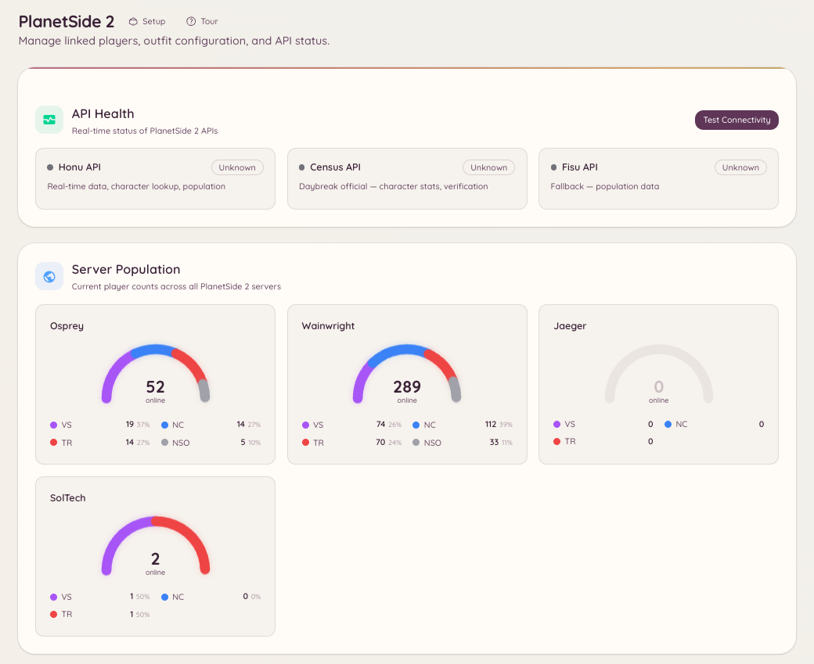

import { DashboardLink } from "/snippets/dashboard-link.jsx";

L’intégration PlanetSide 2 relie ton serveur Discord à l’API Census de Daybreak. Les membres ont accès à la recherche de personnages, à des outils de gestion d’outfit et aux données de population des serveurs en direct, directement dans Discord.

<Frame>
  
</Frame>

## Liaison de compte

Les membres lient leur personnage PlanetSide 2 à leur compte Discord :

```text
/ps2-link <character_name>
```

Une fois le compte lié, les membres peuvent consulter leurs propres statistiques sans indiquer de nom de personnage dans les commandes de recherche.

## Recherche de personnage

```text
/ps2-lookup <character_name>
```

Affiche une fiche de profil pour le personnage indiqué, avec :

- Le Battle Rank et le rang ASP
- L’outfit et le rang dans l’outfit
- La faction
- La date de dernière connexion
- Les statistiques de kills/morts sur toute la carrière

```text
/ps2-info
```

Affiche le profil du personnage lié (comme si tu lançais `/ps2 lookup view` avec ton propre nom de personnage).

## Gestion d’outfit

```text
/ps2-outfit [outfit_tag]
```

Affiche les informations d’un outfit : nombre de membres, date de création, faction et nombre de membres connectés. Demande le tag de l’outfit (l’identifiant court de 1 à 4 caractères, pas le nom complet).

```text
/ps2-promote <member> <rank>
```

Promeut un membre au sein de l’outfit. Demande un rang d’officier suffisant dans l’outfit et des permissions d’API équivalentes à RCON, configurées dans <DashboardLink to="planetside/config">**PlanetSide \> Configuration**</DashboardLink>.

## Population des serveurs

```text
/ps2-population [server]
```

Affiche la répartition actuelle de la population entre les trois factions sur le serveur indiqué (ou sur ton serveur par défaut configuré). Les données viennent du flux temps réel de Census.

La page <DashboardLink to="planetside/status">**PlanetSide \> API Status**</DashboardLink> du tableau de bord affiche les données de population avec une mise à jour continue.

## Configuration

Ouvre <DashboardLink to="planetside/config">**PlanetSide \> Configuration**</DashboardLink> dans le tableau de bord :

```text
/ps2-setup
```

Ou configure tout depuis <DashboardLink to="planetside/config">**PlanetSide \> Configuration**</DashboardLink>. Les principaux paramètres :

| Paramètre | Description |
| --- | --- |
| **Serveur par défaut** | Le monde (serveur) utilisé quand aucun serveur n’est indiqué dans les commandes |
| **Tag d’outfit** | Le tag de l’outfit de ta communauté pour les commandes liées aux outfits |
| **Clé d’API Census** | Facultative ; augmente les limites de requêtes vers l’API. Gratuite chez Daybreak. |

## Permissions requises

| Action | Clé de permission |
| --- | --- |
| Recherche de personnages et population | `planetside.use` (autorisé par défaut) |
| Lier un compte | `planetside.use` (autorisé par défaut) |
| Voir les joueurs liés | `planetside.players.view_players` |
| Gérer les données des joueurs | `planetside.players.manage_players` |
| Voir les statistiques de population | `planetside.monitoring.view_population` |
