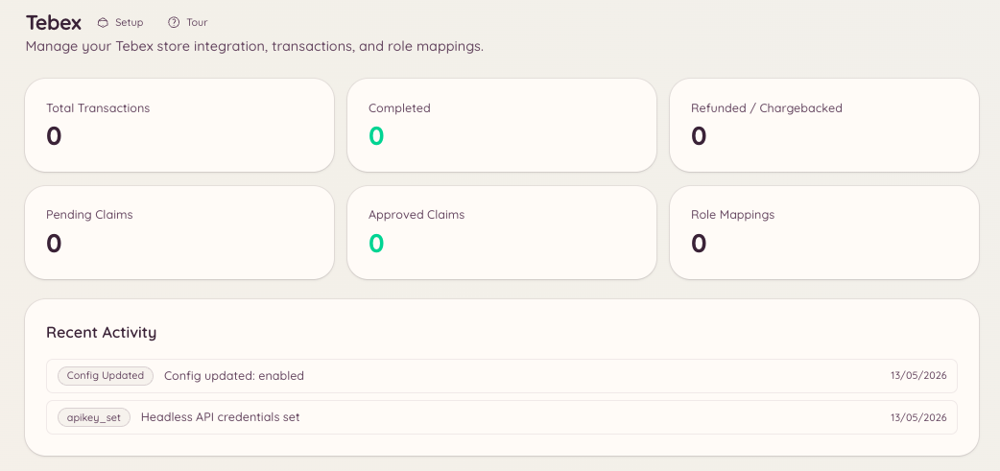

import { DashboardLink } from "/snippets/dashboard-link.jsx";

L’intégration Tebex relie ta boutique de jeu Tebex à Discord. Le staff peut rechercher des transactions, créer des cartes cadeaux et traiter des réclamations manuelles sans quitter Discord. Les membres peuvent vérifier le statut de leurs propres achats.

<Frame>
  
</Frame>

## Configuration

Ouvre <DashboardLink to="tebex/config">**Tebex \> Configuration**</DashboardLink> dans le tableau de bord et saisis ta clé d’API Tebex. Tu la trouveras dans la section **Settings \> API Keys** de ta boutique Tebex.

```text
/tebex
```

La commande de base donne accès à toutes les sous-commandes Tebex via un panneau interactif.

## Transactions

```text
/tebex transaction lookup <transaction_id>
```

Recherche une transaction précise grâce à son identifiant de transaction Tebex. Renvoie :

- Le package acheté
- Le nom et l’adresse e-mail de l’acheteur
- La date d’achat
- Le montant et la devise du paiement
- Le statut actuel de la transaction

Ouvre <DashboardLink to="tebex/transactions">**Tebex \> Transactions**</DashboardLink> dans le tableau de bord pour parcourir les transactions, chercher par acheteur et filtrer par période ou par package.

## Cartes cadeaux

```text
/tebex giftcard create <amount>
/tebex giftcard lookup <code>
```

| Sous-commande | Description |
| --- | --- |
| `create` | Crée une nouvelle carte cadeau de la valeur indiquée, dans la devise de ta boutique |
| `lookup` | Vérifie le solde actuel et la date d’expiration d’un code de carte cadeau existant |

Les codes de cartes cadeaux sont générés via l’API Tebex et peuvent être distribués directement aux membres.

## Réclamations

Les réclamations te permettent d’attribuer manuellement des packages aux membres. Ouvre <DashboardLink to="tebex/claims">**Tebex \> Claims**</DashboardLink> dans le tableau de bord ou utilise la commande slash Tebex pour gérer les réclamations en attente.

## Correspondances de rôles

Les correspondances de rôles attribuent automatiquement des rôles Discord quand un membre achète un package Tebex précis. Ouvre <DashboardLink to="tebex/mappings">**Tebex \> Role Mappings**</DashboardLink> pour les configurer.

Chaque correspondance définit :

| Paramètre | Description |
| --- | --- |
| **Package** | Le package Tebex qui déclenche la correspondance |
| **Rôle à donner** | Le rôle Discord attribué à l’achat |
| **Rôle à retirer** | Un rôle Discord facultatif retiré à l’achat (utile pour passer à un niveau d’abonnement supérieur) |
| **Permanent** | Si l’attribution du rôle est définitive, ou si le rôle doit être retiré quand l’abonnement du membre prend fin |

Pour les packages d’abonnement, Heimdall peut aussi retirer le rôle quand l’abonnement expire ou est annulé. Il faut pour cela que ton webhook Tebex soit configuré pour envoyer les événements d’abonnement.

## Permissions requises

| Action | Clé de permission |
| --- | --- |
| Voir les informations de la boutique | `tebex.store.view_store` |
| Gérer les paramètres de la boutique | `tebex.store.manage_store` |
| Voir l’historique des transactions | `tebex.store.view_transactions` |
| Créer des cartes cadeaux et traiter les réclamations | `tebex.store.manage_claims` |
