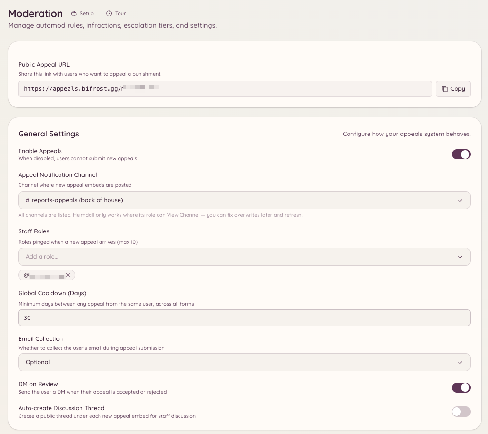

import { DashboardLink } from "/snippets/dashboard-link.jsx";

Le système d’appels donne aux membres bannis un moyen de contester leur ban en remplissant un formulaire, plutôt que de devoir contacter directement le staff. Les demandes arrivent dans <DashboardLink to="appeals/submissions">**Appeals \> Submissions**</DashboardLink> pour être examinées par le staff, et le site des appels (une interface web séparée, accessible sans compte Discord) gère le formulaire côté membre.

<Frame>
  
</Frame>

## Comment ça marche pour les membres

Quand un membre est banni, il peut aller sur l’adresse du site des appels de Heimdall et remplir un formulaire d’appel. Le formulaire est accessible sans être connecté à Discord, donc il fonctionne même si le membre a été banni. Le membre indique son nom d’utilisateur Discord, le serveur dont il a été banni et les champs définis dans ton formulaire d’appel, puis l’envoie.

L’appel envoyé apparaît dans <DashboardLink to="appeals/submissions">**Appeals \> Submissions**</DashboardLink> pour être examiné par le staff.

## Configurer le système d’appels

Va dans <DashboardLink to="appeals/config">**Appeals \> Configuration**</DashboardLink> sur le tableau de bord.

### Configurer le formulaire d’appel

Ouvre <DashboardLink to="appeals/forms">**Appeals \> Forms**</DashboardLink> pour définir les questions de ton formulaire d’appel. Chaque question a :

- **Label** : le texte de la question affiché à la personne qui fait appel
- **Type** : texte court, texte long ou choix multiple
- **Required** : si la personne doit répondre avant de pouvoir envoyer

Les questions courantes sont par exemple : « Pourquoi as-tu été banni ? », « Pourquoi ton ban devrait-il être levé ? » et « Que feras-tu différemment ? »

### Ton lien d’appel

Il n’y a rien à configurer. Chaque serveur a son propre lien sur le site des appels, affiché comme **Public Appeal URL** dans <DashboardLink to="appeals/config">**Appeals \> Configuration**</DashboardLink> avec un bouton de copie. Un bot en marque blanche utilise sa propre adresse d’appels une fois qu’elle est configurée.

La façon dont un membre banni reçoit le lien par MP dépend de la manière dont il a été banni :

- **Avec Heimdall** (`/ban` ou le tableau de bord) : le lien figure dans le MP de sanction, qui n’est envoyé que si **DM on Infraction** est activé dans <DashboardLink to="moderation/settings">**Moderation \> Settings**</DashboardLink>. Les mutes l’incluent aussi.
- **En dehors de Heimdall** (Discord lui-même, ou un autre bot) : tant que les appels sont activés, Heimdall envoie un MP de notification de ban séparé avec le lien.
- **Automatiquement** (bans au départ, escalade, automod) : aucun MP n’est envoyé, donc partage le lien toi-même si tu veux que la personne puisse faire appel.

Les deux MP peuvent être reformulés dans <DashboardLink to="settings/messages">**Settings \> Messages**</DashboardLink>, sous **Punishment DM** et **Ban notification DM**.

## Examiner les appels sur le tableau de bord

Va dans <DashboardLink to="appeals/submissions">**Appeals \> Submissions**</DashboardLink>. Chaque appel affiche :

- Le nom d’utilisateur et l’ID Discord indiqués par la personne
- La date d’envoi
- Toutes les réponses aux champs du formulaire

Depuis le panneau d’examen, tu peux :

- **Approve** : débannir le membre et, si tu veux, lui envoyer un MP avec les instructions pour revenir
- **Deny** : enregistrer la décision et, si tu veux, envoyer la raison du refus
- **Mark under review** : marquer l’appel comme en attente pendant que le staff en discute

### Dossiers liés

Chaque appel est lié au [dossier](/fr/moderation/cases) qu’il concerne, et le panneau d’examen affiche le numéro de ce dossier avec un lien vers lui. Le lien affiché sur un écran de ban en jeu et sur chaque ligne de ta page des bans indique le dossier. Un appel sans dossier est associé au ban ou au mute en cours du membre, et n’est jamais lié qu’à un dossier qui concerne le membre qui fait appel ou un compte qui lui est lié.

Approuver l’appel lève ce dossier sur la plateforme d’origine : un déban ou un démute sur Discord, ou une révocation sur Minecraft. Le dossier affiche l’appel et son issue dans sa chronologie. Si la levée échoue, par exemple parce qu’il manque une permission au bot, le dossier reste actif et l’appel y est quand même enregistré.

## Formulaire d’appel par commande

```text
/appeals config
```

Ouvre le panneau de configuration des appels dans Discord, pour accéder rapidement aux réglages du formulaire sans passer par le tableau de bord.

## Permissions requises

| Action | Clé de permission |
| --- | --- |
| Voir les appels reçus | `appeals.submissions.view` |
| Examiner les appels et y donner suite | `appeals.submissions.manage` |
| Configurer le formulaire d’appel | `appeals.forms.manage_forms` |
| Voir la configuration sur le tableau de bord | `appeals.config.view_config` |
