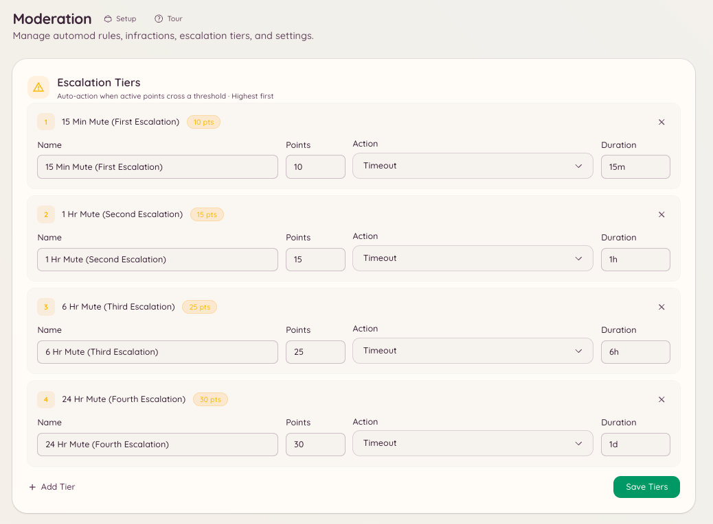

import { DashboardLink } from "/snippets/dashboard-link.jsx";

L’escalade automatise le passage des petits avertissements aux sanctions sérieuses. Tu définis des seuils (des totaux de points) et la sanction que le bot doit appliquer quand les points actifs d’un membre atteignent chaque seuil. Le staff n’a plus besoin d’alourdir les sanctions à la main, et les règles sont appliquées de façon cohérente.

<Frame>
  
</Frame>

## Comment ça marche

Chaque avertissement, infraction à l’automod et sanction manuelle attribue un nombre de points. Les points ne sont pas permanents : chaque sanction a une durée d’expiration après laquelle ses points ne comptent plus dans le total du membre. Quand le total de points actifs d’un membre franchit un seuil configuré, le bot applique immédiatement la sanction correspondante.

L’escalade se déclenche à nouveau chaque fois qu’une nouvelle sanction fait passer le membre au-dessus d’un seuil. Si un membre a déjà été mute à 10 points et atteint ensuite 20 points, l’action des 20 points se déclenche : la sanction précédente ne réinitialise pas le seuil.

## Configurer les seuils d’escalade

Va dans <DashboardLink to="moderation/escalation">**Moderation \> Escalation**</DashboardLink> sur le tableau de bord et clique sur **New Threshold**.

Chaque seuil a les paramètres suivants :

| Paramètre | Description |
| --- | --- |
| **Points** | Le total de points actifs à partir duquel ce seuil se déclenche. |
| **Action** | La sanction à appliquer : Warn, Mute, Kick ou Ban. |
| **Duration** | Pour les actions Mute et Ban temporaire, combien de temps dure la sanction. |
| **Reason** | La raison enregistrée dans le journal des sanctions et envoyée au membre. |

### Exemple de configuration

| Points | Action | Durée |
| --- | --- | --- |
| 5 | Mute | 1 heure |
| 10 | Mute | 24 heures |
| 20 | Kick | - |
| 30 | Ban | 7 jours |
| 50 | Ban | Permanent |

Dans cet exemple, un membre qui reçoit cinq avertissements d’un point pendant la période d’expiration est automatiquement mute pendant une heure. S’il continue d’accumuler des points après la fin du mute, le seuil des 10 points se déclenche et le mute passe à 24 heures.

## Points des sanctions

Un avertissement manuel vaut 1 point, sauf si le modérateur définit `points`. Les règles d’automod définissent leur propre valeur dans <DashboardLink to="moderation/rules">**Moderation \> Rules**</DashboardLink> : par exemple, une règle grave peut attribuer 10 points par infraction au lieu de 1.

## Expiration des points

L’expiration des points de chaque sanction est fixée au moment où la sanction est créée. Les sanctions créées par les règles d’automod utilisent l’expiration configurée sur la règle. Les actions manuelles permettent au membre du staff qui les donne de choisir une expiration ou d’utiliser celle du serveur par défaut.

Les points des sanctions expirées sont retirés automatiquement du total du membre. Le staff peut aussi gracier un avertissement plus tôt : ouvre son dossier dans <DashboardLink to="cases/list">**Cases \> All cases**</DashboardLink> et clique sur **Pardon**, et ses points cessent de compter.

## Permissions requises

| Action | Clé de permission |
| --- | --- |
| Voir la configuration de l’escalade | `moderation.config.view_config` |
| Créer et modifier des seuils | `moderation.enforcement.manage_rules` |
