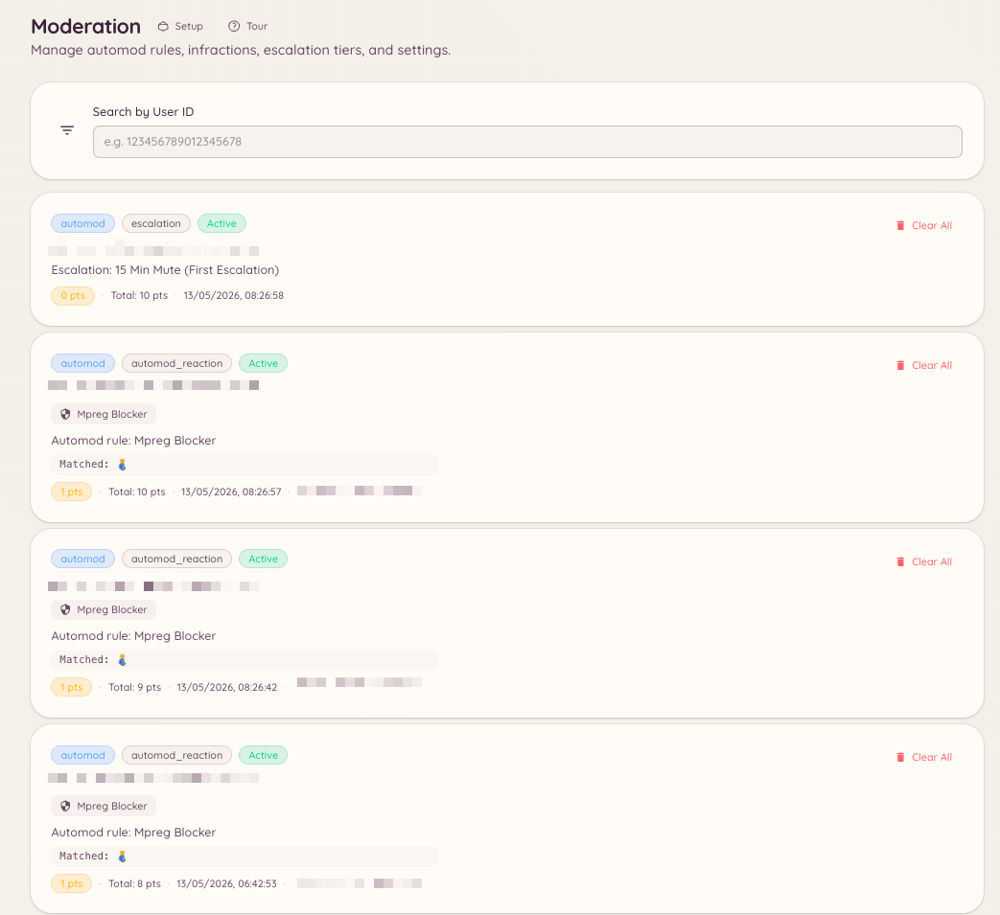

import { DashboardLink } from "/snippets/dashboard-link.jsx";

Chaque action de modération dans Heimdall, qu’elle soit lancée par un membre du staff ou déclenchée par une règle d’automod, crée une sanction. L’historique des sanctions donne au staff une vue complète du dossier de modération de n’importe quel membre, y compris son total de points actifs.

<Frame>
  
</Frame>

## Voir les sanctions d’un membre

### Avec une commande slash

```text
/infractions <user>
```

Affiche les dossiers du membre directement dans Discord, sur Discord et sur tout compte Minecraft lié, avec son total de points actifs. C’est le même panneau que `/case lookup`.

### Depuis le tableau de bord

Chaque sanction est aussi un [dossier](/fr/moderation/cases). Ouvre <DashboardLink to="cases/list">**Cases \> All cases**</DashboardLink> (Dossiers, tous les dossiers) dans le tableau de bord. Cherche un membre et ouvre sa fiche pour voir tous ses dossiers, sur Discord et sur tout compte Minecraft lié, avec son total de points actifs actuel.

## Gérer les sanctions

Sur la fiche d’un membre, le staff qui a `moderation.enforcement.manage_infractions` peut utiliser **Clear active infractions** (effacer les sanctions actives), qui remet les points actifs du membre à zéro.

Depuis un dossier, tu peux ajouter des notes et des preuves, changer la raison, et lever un avertissement pour que ses points ne comptent plus. Voir [Dossiers](/fr/moderation/cases).

## Fixer les points directement

```text
/setpoints <user> <points>
```

Fixe le total de points de sanction actifs d’un membre à une valeur précise, sans passer par une sanction individuelle. C’est utile pour ajuster à la main la position d’un membre dans le système d’escalade sans créer de sanctions supplémentaires.

## Filtres du tableau de bord

La liste des dossiers peut être filtrée par plateforme, type d’action, statut et membre du staff qui a effectué l’action.

## Permissions requises

| Action | Clé de permission |
| --- | --- |
| Voir l’historique des sanctions | `moderation.config.view_config` ou `cases.view_discord` |
| Effacer les sanctions actives d’un membre, lever un avertissement | `moderation.enforcement.manage_infractions` |
