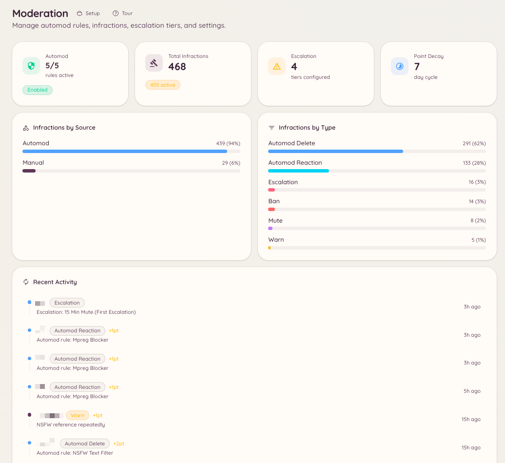

import { DashboardLink } from "/snippets/dashboard-link.jsx";

Le plugin de modération de Heimdall réunit des commandes de sanction manuelles, un moteur de règles automatiques, une escalade progressive et un historique complet des sanctions. Tous ces éléments reposent sur le même système de sanctions : les avertissements manuels et les infractions aux règles automatiques s’additionnent dans le même total de points et alimentent les mêmes seuils d’escalade.

<Frame>
  
</Frame>

## Éléments

<Columns cols={2}>
  <Card title="Actions manuelles" icon="gavel" href="/fr/moderation/manual-actions">
    Avertis, bannis, expulse, rends muet et purge des messages directement.
  </Card>

  <Card title="Règles d’automod" icon="robot" href="/fr/moderation/automod">
    Définis des filtres de mots-clés, des motifs regex et des règles par type de contenu qui s’appliquent automatiquement.
  </Card>

  <Card title="Escalade" icon="arrow-up" href="/fr/moderation/escalation">
    Configure des sanctions automatiques qui se déclenchent à mesure qu’un membre accumule des points de sanction.
  </Card>

  <Card title="Historique des sanctions" icon="clock-rotate-left" href="/fr/moderation/infractions">
    Vois chaque action prise contre un membre, avec les totaux de points et les dates d’expiration.
  </Card>

  <Card title="Contrôles des salons" icon="lock" href="/fr/moderation/channel-controls">
    Verrouille des salons, applique des bannissements par salon et empêche les membres de quitter puis revenir pour échapper à une sanction.
  </Card>

  <Card title="Messages persistants" icon="thumbtack" href="/fr/moderation/stickies">
    Garde automatiquement un message tout en bas d’un salon.
  </Card>

  <Card title="Appels" icon="scale-balanced" href="/fr/moderation/appeals">
    Laisse les membres bannis demander un réexamen via un formulaire structuré.
  </Card>
</Columns>

## Comment fonctionnent les sanctions et les points

Chaque action de modération, qu’elle vienne d’un membre du staff ou de l’automod, crée une sanction. Chaque sanction enregistre le type d’action, la raison, le membre du staff ou la règle qui l’a déclenchée, une valeur en points configurable et une expiration facultative.

Les points s’accumulent avec le temps. Quand le total de points actifs d’un membre dépasse un seuil que tu configures dans les paramètres d’escalade, le bot applique automatiquement la sanction correspondante. Les points expirent un par un, selon la durée d’expiration de chaque sanction, et le total du membre baisse à mesure qu’ils expirent.

Un membre qui reçoit plusieurs petits avertissements dans la semaine peut donc déclencher un mute automatique, même si aucune action ne dépassait un seuil à elle seule.

## Où le trouver dans le tableau de bord

Ouvre <DashboardLink to="moderation">**Moderation**</DashboardLink> dans la barre latérale du tableau de bord. La section modération contient ces pages : <DashboardLink to="moderation/overview">**Overview**</DashboardLink>, <DashboardLink to="moderation/rules">**Rules**</DashboardLink>, <DashboardLink to="moderation/escalation">**Escalation**</DashboardLink>, <DashboardLink to="moderation/stickies">**Stickies**</DashboardLink>, <DashboardLink to="moderation/auto-responses">**Auto-Responses**</DashboardLink>, <DashboardLink to="moderation/leave-bans">**Leave Bans**</DashboardLink>, <DashboardLink to="moderation/channel-bans">**Channel Bans**</DashboardLink>, <DashboardLink to="moderation/locked-channels">**Locked Channels**</DashboardLink>, <DashboardLink to="moderation/slow-mode">**Slow Mode**</DashboardLink> et <DashboardLink to="moderation/settings">**Settings**</DashboardLink>.

Les sanctions sont désormais des [dossiers](/fr/moderation/cases), sous <DashboardLink to="cases/list">**Cases**</DashboardLink>, et les appels de bannissement ont leur propre section <DashboardLink to="appeals">**Appeals**</DashboardLink>.

## Permissions requises

L’accès au tableau de bord et l’utilisation des commandes sont tous deux gérés par le système de permissions de Heimdall. Les principales clés de permission pour la modération :

| Clé | Ce qu’elle contrôle |
| --- | --- |
| `moderation.enforcement.warn` | Lancer `/warn` |
| `moderation.enforcement.ban` | Lancer `/ban` et `/unban` |
| `moderation.enforcement.kick` | Lancer `/kick` |
| `moderation.enforcement.mute` | Lancer `/mute` |
| `moderation.enforcement.purge` | Lancer `/purge` |
| `moderation.enforcement.lock_channels` | Lancer `/lock` et `/unlock` |
| `moderation.enforcement.manage_rules` | Créer et modifier des règles d’automod dans le tableau de bord |
| `moderation.config.view_config` | Voir la configuration de la modération dans le tableau de bord |
