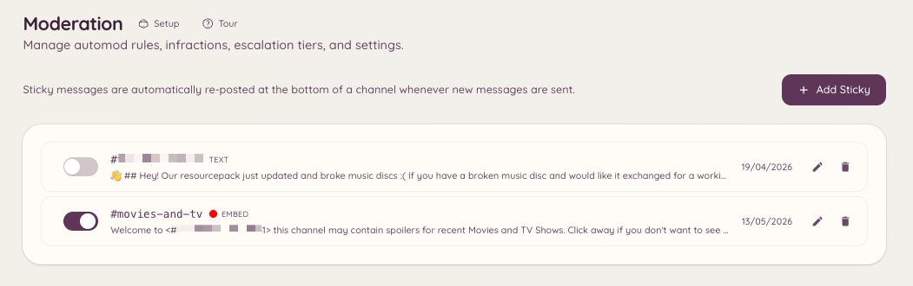

import { DashboardLink } from "/snippets/dashboard-link.jsx";

Un message persistant (sticky) est un message que le bot republie en bas d’un salon chaque fois qu’il disparaîtrait sinon de l’écran. Quand les membres envoient des messages et le font remonter, le bot supprime l’ancienne copie et en publie une nouvelle en bas.

C’est utile pour mettre en avant des règles, des instructions ou des annonces importantes dans des salons actifs, où un message épinglé classique de Discord passerait facilement inaperçu.

<Frame>
  
</Frame>

## Créer un message persistant

```text
/sticky create [channel]
```

Lancer cette commande ouvre une fenêtre où tu saisis le contenu du message. Le message prend en charge la mise en forme markdown habituelle de Discord. Après l’envoi, le bot publie immédiatement le message persistant dans le salon cible.

Un seul message persistant peut être actif par salon.

## Gérer les messages persistants depuis le tableau de bord

Va dans <DashboardLink to="moderation/stickies">**Moderation \> Stickies**</DashboardLink> sur le tableau de bord. Cette page liste tous les messages persistants actifs sur ton serveur. De là, tu peux :

- **Voir le contenu** de chaque message persistant
- **Modifier** le contenu d’un message persistant
- **Supprimer** un message persistant, ce qui retire le message publié du salon

## Modifier et supprimer par commande

```text
/sticky delete [channel]
```

Retire le message persistant actif du salon indiqué (par défaut, le salon actuel). Le bot supprime le message persistant publié le plus récemment.

## Remarques sur le fonctionnement

Le bot republie le message persistant chaque fois qu’un nouveau message est envoyé dans le salon. Un petit délai de regroupement évite d’inonder le salon quand des messages sont envoyés en rafale. En période de forte activité, le message persistant peut remonter temporairement de plusieurs messages avant d’être republié.

Les messages persistants sont publiés avec le compte du bot. Si un modérateur supprime le message persistant à la main, le bot le republiera la prochaine fois qu’un nouveau message sera envoyé dans le salon.

## Permissions requises

| Action | Clé de permission |
| --- | --- |
| Créer et supprimer des messages persistants | `moderation.enforcement.manage_rules` |
| Voir les messages persistants sur le tableau de bord | `moderation.config.view_config` |
