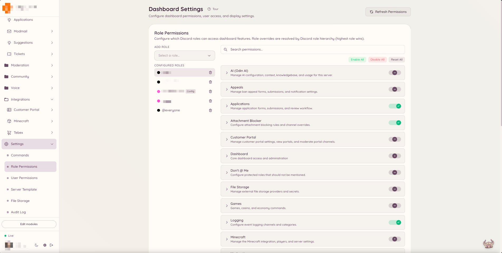

import { DashboardLink } from "/snippets/dashboard-link.jsx";

Heimdall a son propre système de permissions, indépendant des permissions de rôle natives de Discord. Au lieu de s’appuyer sur des permissions comme **Gérer les messages** ou **Bannir des membres**, Heimdall vérifie si les rôles d’un membre ont reçu une clé de permission Heimdall précise. Tu peux ainsi donner un accès à la modération à un rôle de staff personnalisé sans lui accorder de larges permissions au niveau de Discord.

## Comment fonctionnent les permissions

<Warning>
  **Copie les clés exactement. Ne reconstruis jamais une clé à partir du nom de la fonctionnalité et de l’action.**

  {/* docs-manifest-ignore -- names the wrong form on purpose; that is the point of the line */}
  La plupart des clés ont trois parties, pas deux : `confessions.log.view_author`, et non
  `confessions.view_author`. Le segment du milieu fait partie de la clé, ce n’est pas une
  indication de l’endroit où elle se trouve.

  Une clé qui n’existe pas est **refusée sans avertissement**. Heimdall traite une clé inconnue
  comme refusée et l’enregistre dans son journal, donc rien dans le tableau de bord ne la signale
  comme fausse. Le seul symptôme est un rôle qui semble bien configuré et qui ne peut pas utiliser
  la fonctionnalité.

  [Toutes les clés, exactement comme elles doivent être écrites](/docs/reference/permission-keys).
</Warning>


Chaque fonctionnalité de Heimdall expose une ou plusieurs clés de permission nommées. Par exemple, le plugin de modération expose des clés comme `moderation.enforcement.ban` et `moderation.enforcement.warn`. Le plugin de tickets expose `tickets.operations.manage_tickets` et `tickets.operations.claim_tickets`.

Tu attribues ces clés à des rôles Discord depuis le tableau de bord. Quand un membre lance une commande ou ouvre une section du tableau de bord, Heimdall vérifie si l’un de ses rôles actuels a reçu la clé correspondante. Si c’est le cas, l’action continue. Sinon, le bot répond par un message de permission refusée.

## Accès par défaut

Certaines fonctionnalités sont accessibles à tous les membres par défaut. Ce sont en général des fonctionnalités destinées aux membres, par exemple créer une suggestion, ouvrir un ticket, utiliser les commandes de jeux ou demander une traduction. Ces fonctionnalités ont l’option **autorisé par défaut** activée et ne demandent aucune attribution de permission explicite.

Les fonctionnalités destinées au staff et à l’administration sont restreintes par défaut. Aucun membre ne peut lancer une commande `ban`, gérer les règles d’automod ou ouvrir la section <DashboardLink to="moderation">**Moderation**</DashboardLink> du tableau de bord si son rôle n’a pas reçu la clé de permission correspondante.

<Info>
  Les membres qui ont la permission Discord **Administrateur** passent outre toutes les vérifications de permission de Heimdall et ont toujours un accès complet.
</Info>

## Configurer les permissions

<Steps>
  <Step title="Ouvre Settings">
    Dans la barre latérale du tableau de bord, clique sur <DashboardLink to="settings">**Settings**</DashboardLink> (Paramètres). La page Settings répartit la configuration en plusieurs onglets en haut de la page.
  </Step>
  <Step title="Choisis l’onglet des rôles ou des utilisateurs">
    Choisis l’onglet <DashboardLink to="settings/roles">**Role Permissions**</DashboardLink> pour configurer des exceptions au niveau des rôles, ou l’onglet <DashboardLink to="settings/users">**User Permissions**</DashboardLink> pour des exceptions par utilisateur. Les exceptions par utilisateur passent avant toutes les permissions basées sur les rôles. Elles sont utiles pour donner ou bloquer l’accès à une personne précise, quels que soient ses rôles.
  </Step>
  <Step title="Choisis un rôle ou un utilisateur">
    Utilise le menu déroulant pour choisir le rôle Discord (ou l’utilisateur précis) à configurer. Toutes les clés de permission disponibles s’affichent en dessous, regroupées par plugin.
  </Step>
  <Step title="Définis les exceptions">
    Chaque clé de permission a un sélecteur à trois positions : **Allow** (autoriser), **Deny** (refuser) ou **Default** (par défaut). Allow accorde la permission. Deny la retire, même si le réglage par défaut du système aurait autorisé l’accès. Default s’en remet au réglage global de cette clé : la plupart des clés refusent par défaut pour les actions du staff et autorisent pour les fonctionnalités destinées aux membres.
  </Step>
  <Step title="Enregistre tes changements">
    Quand tout te convient, clique sur **Save** dans la barre d’enregistrement qui apparaît en bas de la page. Les changements s’appliquent immédiatement à tous les membres qui ont le rôle configuré.
  </Step>
</Steps>

<Frame>
  
</Frame>

## Clés de permission par section

La page de documentation de chaque fonctionnalité liste les clés de permission qu’elle utilise. Les clés suivent un modèle de nommage cohérent :

```text
<plugin>.<action>
```

Par exemple :

- `moderation.enforcement.ban` : permet de lancer `/ban`
- `tickets.operations.manage_tickets` : permet de gérer tous les tickets dans le tableau de bord
- `modmail.analytics.view_analytics` : permet de voir les statistiques du modmail

## Hiérarchie des rôles

Heimdall prend en compte tous les rôles actuels d’un membre. Si l’un d’eux a reçu la permission, le membre est autorisé. Il n’y a pas de hiérarchie des rôles dans le système de permissions : il est purement cumulatif. Retirer un rôle retire cette source de permissions, mais les autres rôles du membre peuvent toujours lui donner l’accès.

## Modifier les réglages par défaut

Si tu veux restreindre une fonctionnalité autorisée par défaut pour tous les membres (par exemple, limiter qui peut utiliser la commande IA `/ask`), tu peux activer l’option **Restricted** (restreint) sur cette clé de permission. Une fois restreinte, seuls les rôles que tu attribues explicitement y ont accès.
