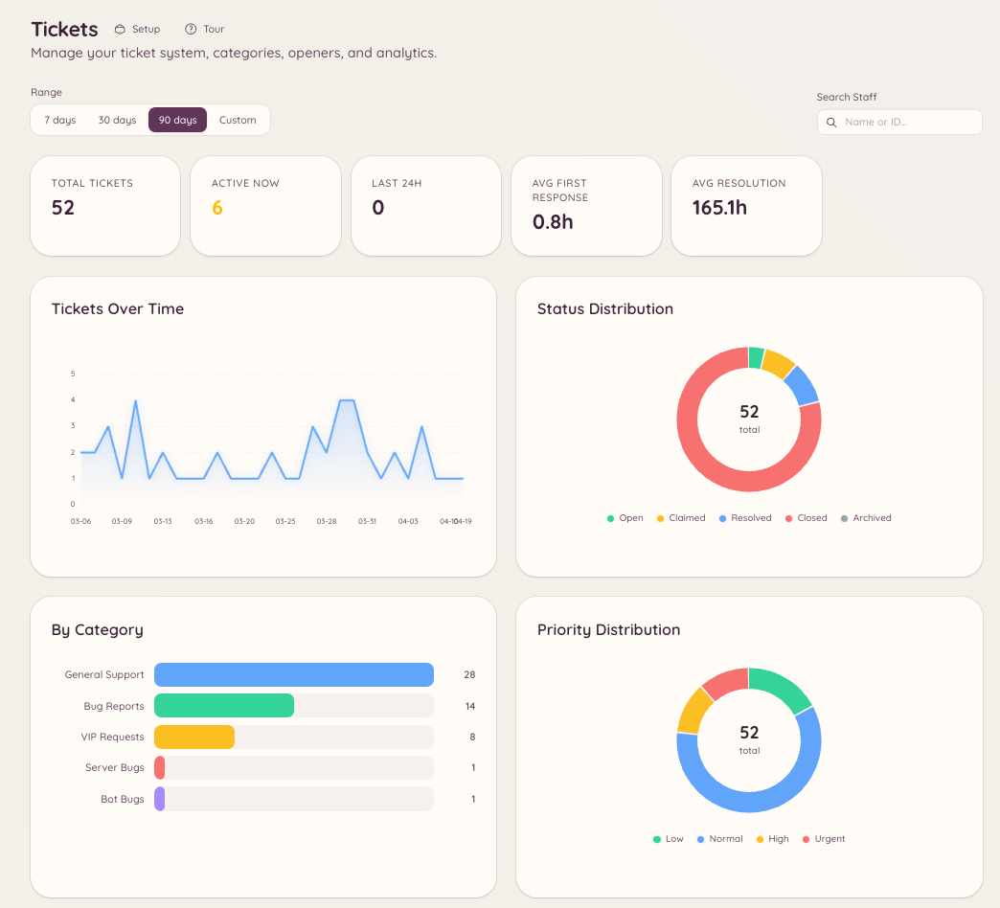

import { DashboardLink } from "/snippets/dashboard-link.jsx";

Les plugins de tickets et de modmail ont tous les deux une couche de statistiques qui suit le volume, les temps de réponse et l’activité du staff. Les statistiques donnent aux administrateurs du serveur des données objectives sur le bon fonctionnement du support et sur les membres du staff qui contribuent le plus.

## Accéder aux statistiques

- Statistiques des tickets : <DashboardLink to="tickets/analytics">**Tickets \> Analytics**</DashboardLink>
- Statistiques du modmail : <DashboardLink to="modmail/analytics">**Modmail \> Analytics**</DashboardLink>

Les deux sections ont la même structure et les mêmes types de mesures.

<Frame>
  
</Frame>

## Mesures suivies

### Volume

| Mesure | Description |
| --- | --- |
| **Total ouverts** | Le nombre de tickets ou de fils ouverts sur la période choisie |
| **Total fermés** | Le nombre de tickets résolus sur la période choisie |
| **Ouverts en fin de période** | Les tickets toujours non résolus à la fin de la période |
| **Détail par jour** | Un graphique des ouvertures et fermetures par jour |

### Temps de réponse

| Mesure | Description |
| --- | --- |
| **Délai de première réponse** | Le temps entre la création du ticket et le premier message d’un membre du staff |
| **Durée moyenne de traitement** | La durée totale entre l’ouverture et la fermeture |
| **Respect du SLA** | Le pourcentage de tickets dont la première réponse est arrivée dans le délai cible configuré |

Les objectifs de SLA se configurent dans <DashboardLink to="tickets/config">**Tickets \> Configuration**</DashboardLink> ou <DashboardLink to="modmail/config">**Modmail \> Configuration**</DashboardLink>, sous forme de durée (par exemple 2 heures pour la première réponse).

### Performances du staff

Le tableau des performances du staff indique, pour chaque membre du staff :

- Le nombre de tickets pris en charge ou attribués
- Le délai moyen de première réponse
- La durée moyenne de traitement
- Le nombre de tickets fermés
- La note des avis clients (si les avis sont activés)

Clique sur la ligne d’un membre du staff pour voir le détail de son historique de tickets.

## Avis de satisfaction

Quand un ticket ou un fil de modmail est fermé, le membre peut être invité à laisser une note de satisfaction. La note prend la forme d’une note de 1 à 5 étoiles, avec un commentaire facultatif.

### Activer les avis

Ouvre <DashboardLink to="tickets/config">**Tickets \> Configuration**</DashboardLink> ou <DashboardLink to="modmail/config">**Modmail \> Configuration**</DashboardLink> et active les avis (**Enable Ticket Reviews** pour les tickets, **Enable Reviews** pour le modmail). Tu peux aussi régler :

- **Review Channel** : le salon où les avis envoyés sont publiés
- **Require Moderation** : garde les avis en attente de validation par le staff avant leur publication, dans le **Moderation Channel** que tu choisis
- **Button emoji** : l’emoji du bouton d’avis
- **Review fields** : les questions à noter. Laisse la liste vide pour une seule note globale en étoiles

### Voir les avis

Les avis apparaissent dans <DashboardLink to="tickets/reviews">**Tickets \> Reviews**</DashboardLink> et <DashboardLink to="modmail/analytics">**Modmail \> Analytics**</DashboardLink>. La page des avis affiche chaque note, le ticket associé et les éventuels commentaires du membre.

## Filtrer par période

Toutes les pages de statistiques peuvent être filtrées par période. Choisis un préréglage (7 derniers jours, 30 derniers jours, 90 derniers jours) ou définis une période personnalisée. Les mesures se mettent à jour dès que la période change.

## Permissions requises

| Action | Clé de permission |
| --- | --- |
| Voir les statistiques des tickets | `tickets.analytics.view_analytics` |
| Voir les statistiques du modmail | `modmail.analytics.view_analytics` |
| Gérer les avis | `tickets.operations.manage_reviews`, `modmail.management.manage_reviews` |
