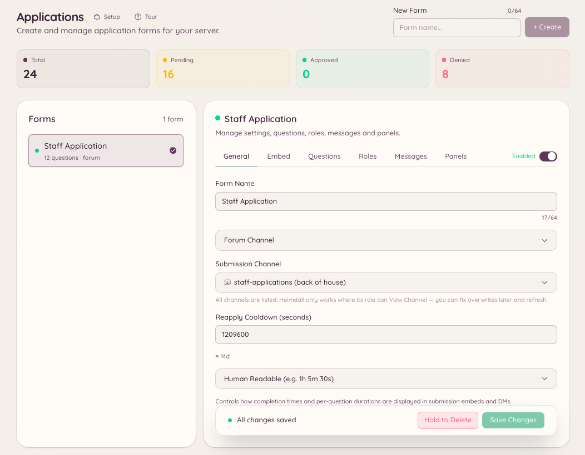

import { DashboardLink } from "/snippets/dashboard-link.jsx";

Le plugin de candidatures te permet de créer des formulaires que les membres remplissent et envoient pour examen par le staff. Utilise-le pour les candidatures au staff, les inscriptions à des événements, les demandes d’ajout à une liste d’autorisation, ou chaque fois que tu as besoin d’informations structurées de la part des membres.

<Frame>
  
</Frame>

## Comment fonctionnent les candidatures

Tu crées un formulaire dans <DashboardLink to="applications">**Applications**</DashboardLink> sur le tableau de bord, avec autant de questions que nécessaire. Les membres accèdent au formulaire en lançant `/application` et en choisissant le formulaire auquel ils veulent répondre. Après l’envoi, leurs réponses apparaissent dans <DashboardLink to="applications">**Applications**</DashboardLink> pour que le staff les examine, les approuve ou les refuse. Les membres sont informés de la décision par MP.

## Créer un formulaire

Va dans <DashboardLink to="applications">**Applications**</DashboardLink> sur le tableau de bord et clique sur **New Form**.

| Paramètre | Description |
| --- | --- |
| **Name** | Le nom affiché du formulaire, montré aux membres quand ils le choisissent |
| **Description** | Une courte explication de ce à quoi sert le formulaire |
| **Channel** | L’endroit où les notifications d’envoi sont publiées pour le staff |
| **Questions** | Les champs que les membres remplissent (texte court, texte long ou choix multiple) |
| **Review roles** | Les rôles qui peuvent approuver ou refuser les candidatures |
| **Acceptance message** | Le MP envoyé au membre quand sa candidature est approuvée |
| **Rejection message** | Le MP envoyé au membre quand sa candidature est refusée |

### Types de questions

| Type | Description |
| --- | --- |
| **Short text** | Un champ de texte sur une ligne, jusqu’à 256 caractères |
| **Long text** | Un champ de texte sur plusieurs lignes, jusqu’à 4000 caractères |
| **Multiple choice** | Le membre choisit une option dans une liste définie |

## Envoyer une candidature

```text
/application list
/application post <form>
```

`/application list` montre au membre tous les formulaires disponibles. `/application post` ouvre le formulaire choisi sous forme de fenêtre interactive dans Discord. Le membre remplit chaque champ et envoie. Si le formulaire a plus de champs qu’une seule fenêtre Discord ne peut en contenir, l’envoi est réparti sur plusieurs étapes.

## Examiner les candidatures

Va dans <DashboardLink to="applications">**Applications**</DashboardLink> sur le tableau de bord. Chaque candidature affiche toutes les réponses aux questions, le nom d’utilisateur Discord du candidat et la date d’envoi. Depuis le panneau d’examen :

- **Approve** : marque la candidature comme approuvée et envoie le MP d’acceptation au candidat
- **Decline** : marque la candidature comme refusée et envoie le MP de refus
- **Pending** : aucune action pour l’instant, visible par tous les examinateurs

## Permissions requises

| Action | Clé de permission |
| --- | --- |
| Envoyer une candidature | Aucune permission requise |
| Voir les formulaires et les candidatures | `applications.view` |
| Approuver et refuser des candidatures | `applications.review` |
| Créer, modifier et publier des formulaires | `applications.manage` |
