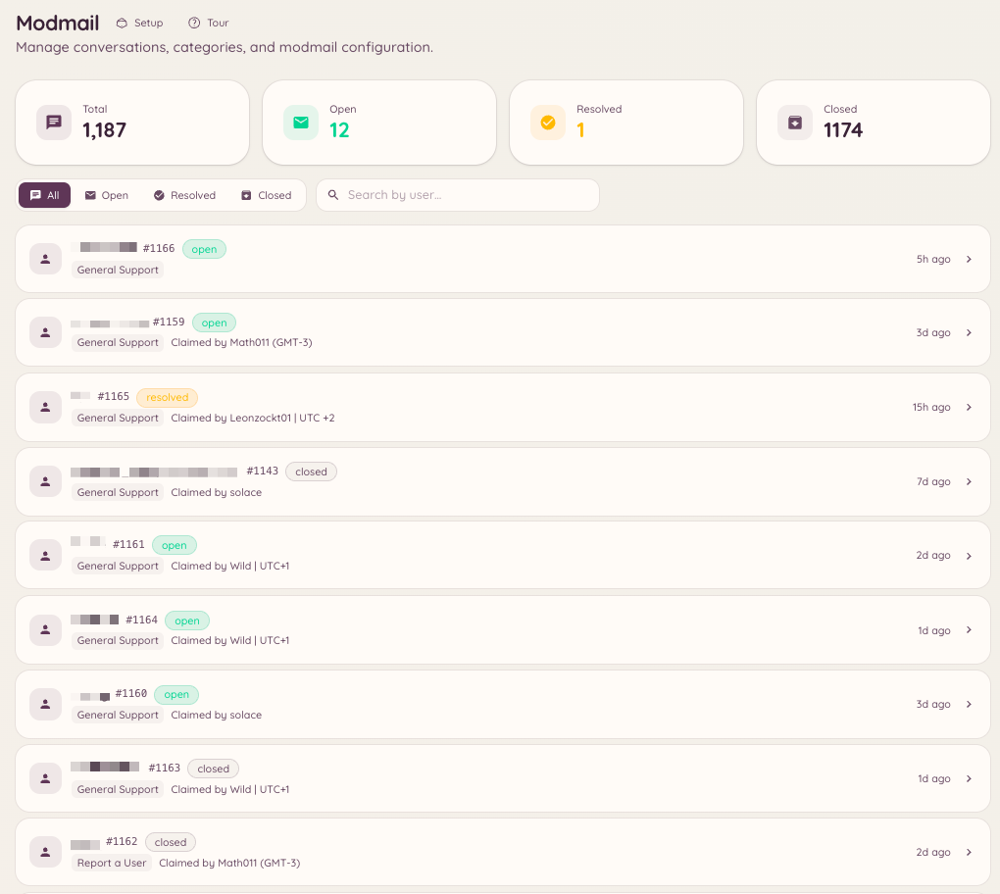

import { DashboardLink } from "/snippets/dashboard-link.jsx";

Le modmail donne aux membres une ligne privée vers ton équipe staff via les messages privés Discord. Quand un membre envoie un MP au bot, un fil est créé dans un salon forum dédié sur ton serveur. Le staff répond dans ce fil et le bot relaie ses messages au membre par MP. Le membre et le staff ne voient jamais les serveurs l’un de l’autre au passage : du point de vue du membre, il a une conversation privée avec le bot.

<Frame>
  
</Frame>

## Comment ça marche pour les membres

Un membre envoie un message privé au bot Heimdall. Le bot confirme qu’un fil de support a été ouvert et prévient le membre que le staff va répondre. Tous les messages suivants du membre sont transférés dans le fil du staff. Quand le staff répond dans le fil, ses messages apparaissent dans la conversation privée du membre comme s’ils étaient envoyés par le bot.

Les membres ne peuvent pas savoir quel membre du staff s’occupe de leur demande, sauf si le staff choisit de s’identifier dans ses messages.

## Configuration

### Configuration de base

Va dans <DashboardLink to="modmail/config">**Modmail \> Configuration**</DashboardLink> sur le tableau de bord. Les paramètres principaux sont :

| Paramètre | Description |
| --- | --- |
| **Forum channel** | Le salon où les fils de modmail sont créés. Ce doit être un salon forum Discord. |
| **Staff roles** | Les rôles qui peuvent voir les fils de modmail et y répondre |
| **Opening message** | Le MP envoyé au membre quand son fil est ouvert pour la première fois |
| **Auto-close** | Ferme automatiquement les fils inactifs depuis une durée définie |
| **Anonymous replies** | Masque quel membre du staff a envoyé chaque réponse (activé par défaut) |

### Catégories

Les catégories de modmail te permettent d’acheminer différents types de MP vers différents salons forum ou équipes du staff. Va dans <DashboardLink to="modmail/categories">**Modmail \> Categories**</DashboardLink> et crée des catégories pour tes différents domaines de support. Quand un membre ouvre un modmail, on lui demande de choisir une catégorie s’il y en a plusieurs.

### Réponses auto

Les réponses auto sont des messages écrits à l’avance que le bot envoie automatiquement selon les mots-clés du premier message du membre. Va dans <DashboardLink to="modmail/auto-responses">**Modmail \> Auto-responses**</DashboardLink> pour les configurer. Les réponses auto ne ferment pas le fil : elles donnent des premières informations pendant que le staff prend le relais.

## Commandes slash

```text
/modmail open <user>
/modmail close [reason]
/modmail ban <user> [reason]
/modmail unban <user>
/modmail note <content>
/modmail snippet <name>
/modmail transfer <category>
```

| Sous-commande | Description |
| --- | --- |
| `open` | Ouvre un fil de modmail pour un membre sans qu’il l’ait lancé |
| `close` | Ferme le fil actuel et envoie un MP de clôture au membre |
| `ban` | Empêche un membre d’ouvrir de nouveaux fils de modmail |
| `unban` | Retire un ban de modmail |
| `note` | Ajoute une note privée du staff, invisible pour le membre |
| `snippet` | Insère une réponse enregistrée dans le fil |
| `transfer` | Déplace le fil vers une autre catégorie |

## Notes du staff

Les notes du staff sont des messages publiés dans le fil de modmail qui ne sont visibles que par le staff. Elles sont mises en forme différemment des réponses normales et ne sont jamais transférées au membre. Utilise-les pour la coordination interne : mentionner des membres de l’équipe, ajouter du contexte ou signaler des points à examiner.

## Boutons d’ouverture

Les boutons d’ouverture (openers) sont des boutons ou des panneaux publiés dans un salon, sur lesquels les membres cliquent pour lancer un fil de modmail sans envoyer de MP au bot directement. C’est utile pour les serveurs où les membres ne savent pas forcément qu’il faut envoyer un MP à Heimdall, ou si tu veux placer un bouton « Contacter le staff » dans un salon précis.

Va dans <DashboardLink to="modmail/openers">**Modmail > Openers**</DashboardLink> et clique sur **New Opener**. Configure le libellé du bouton, la catégorie qu’il ouvre et l’éventuel message d’ouverture envoyé au membre. Une fois configuré, clique sur **Post** pour que le bot place le panneau dans le salon de ton choix.

## Quotas

Les quotas du staff limitent le nombre de fils ouverts simultanément qu’un membre du staff peut gérer. Quand un membre du staff atteint son quota, les nouveaux fils des catégories qui lui sont attribuées sont mis en file d’attente ou envoyés à d’autres membres du staff disponibles. Configure les quotas dans <DashboardLink to="modmail/quotas">**Modmail > Quotas**</DashboardLink>.

## Permissions requises

| Action | Clé de permission |
| --- | --- |
| Voir les conversations | `modmail.conversations.view_conversations` |
| Gérer les conversations | `modmail.conversations.manage_conversations` |
| Voir les statistiques | `modmail.analytics.view_analytics` |
| Gérer les avis | `modmail.management.manage_reviews` |
| Gérer la configuration | `modmail.management.manage_config` |
