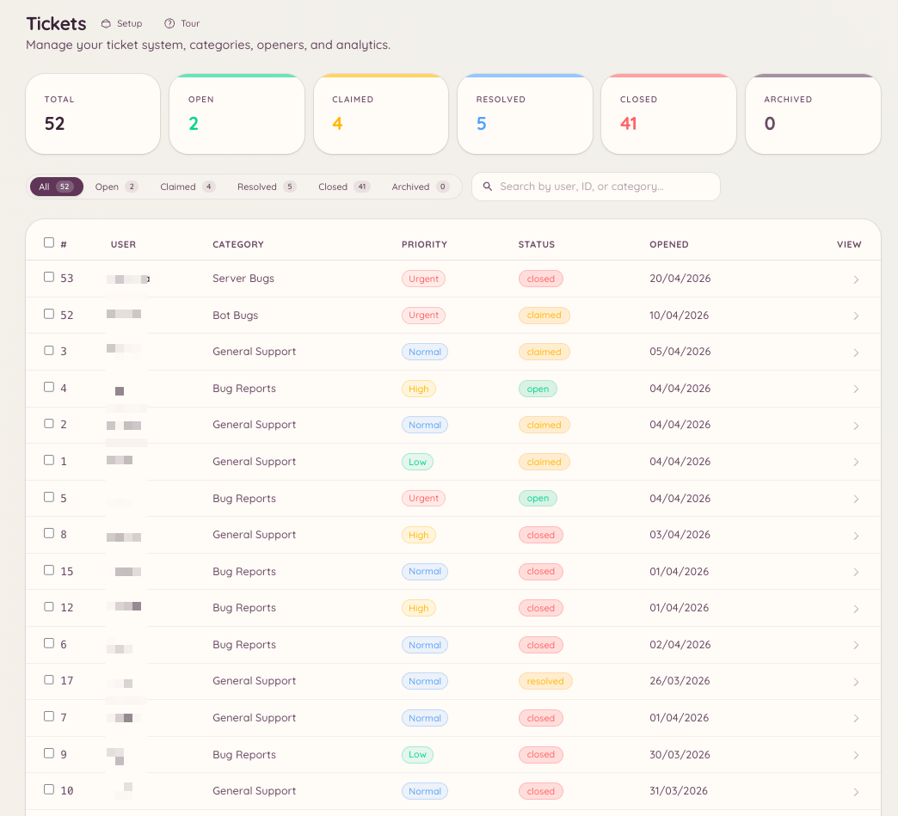

import { DashboardLink } from "/snippets/dashboard-link.jsx";

Le système de tickets crée des fils Discord privés pour chaque demande de support. Un membre ouvre un ticket, le staff répond dans le fil, et le ticket est fermé quand le problème est réglé. La configuration sur le tableau de bord définit les catégories de support disponibles, qui peut ouvrir des tickets et le comportement automatique du système.

<Frame>
  
</Frame>

## Comment les tickets fonctionnent pour les membres

Un membre lance `/ticket open` ou clique sur un bouton d’ouverture que tu as placé dans un salon. Il choisit une catégorie, remplit éventuellement un formulaire d’ouverture, et un fil privé est créé. Le fil n’est visible que par le membre et les rôles staff configurés pour cette catégorie. Le membre et le staff échangent des messages dans le fil comme dans une conversation normale.

Quand le problème est réglé, le membre ou un membre du staff ferme le ticket. Les tickets fermés peuvent être consultés sur le tableau de bord dans <DashboardLink to="tickets/list">**Tickets \> Tickets**</DashboardLink>.

## Configuration

### Créer des catégories

Va dans <DashboardLink to="tickets/categories">**Tickets \> Categories**</DashboardLink> sur le tableau de bord et clique sur **New Category**. Chaque catégorie définit :

| Paramètre | Description |
| --- | --- |
| **Name** | Affiché quand un membre choisit un type de ticket |
| **Description** | Une courte explication de ce à quoi sert cette catégorie |
| **Channel** | Le salon parent où les fils de tickets sont créés |
| **Staff roles** | Les rôles qui peuvent voir les tickets de cette catégorie et y répondre |
| **Opening form** | Des questions facultatives que le membre remplit à l’ouverture du ticket |
| **Opening message** | Le premier message publié par le bot dans le fil du ticket |
| **Auto-close** | Ferme automatiquement les tickets inactifs après une durée définie |

### Rappels d’inactivité

Chaque catégorie peut prévenir, puis fermer, les tickets qui deviennent silencieux. Sous **Inactivity Reminder** dans l’éditeur de catégorie, tu définis combien de temps un ticket peut rester sans activité avant que l’avertissement soit publié, combien de temps après l’avertissement il se ferme, et qui l’avertissement mentionne :

| Comportement de mention | Qui est mentionné |
| --- | --- |
| **Ping ticket opener** | Le membre qui a ouvert le ticket |
| **Ping all participants** | La personne qui a ouvert le ticket et le membre du staff qui l’a pris en charge |
| **Smart (direction-aware)** | Celui qui doit la prochaine réponse : la personne qui a ouvert le ticket si le staff a parlé en dernier, le staff si c’est elle qui a parlé en dernier |
| **No ping** | Personne |

Avec **Smart**, choisis si un ticket qui attend le staff mentionne les rôles staff de la catégorie ou seulement le membre du staff qui l’a pris en charge. Un ticket non pris en charge mentionne toujours les rôles staff.

#### Demander à la personne si elle semble avoir fini

Une conversation de support se termine souvent par une réponse du staff, puis un « merci » du membre. Smart considérerait alors que le ticket attend le staff. Pour éviter de mentionner le staff pour un ticket résolu, Smart peut reconnaître un message de conclusion et interroger plutôt le membre : l’avertissement devient « Ton problème est-il réglé ? » avec les boutons **Yes, close it** et **I still need help**. « I still need help » mentionne le staff immédiatement. Si personne ne répond, le ticket se ferme selon le calendrier normal.

Deux paramètres décident quand une réponse compte comme une conclusion :

| Paramètre | Comment il décide | Par défaut |
| --- | --- | --- |
| **Ask the opener when they look done (AI)** | [Odin AI](/fr/ai/odin) lit la fin de la conversation. Ne fonctionne que sur les serveurs où l’IA est configurée, et envoie les messages récents du ticket au fournisseur d’IA | Activé |
| **Ask the opener when they look done (length)** | Tout ce que le membre a écrit depuis la dernière réponse du staff est sous la limite de caractères, sans point d’interrogation ni pièce jointe. Utilisé aussi quand la vérification par IA ne peut pas s’exécuter | Désactivé |

Le texte de la question peut être modifié dans <DashboardLink to="tickets/config">**Tickets \> Configuration**</DashboardLink>, avec le message **Resolution Check**.

### Configurer les boutons d’ouverture

Les boutons d’ouverture (openers) sont les boutons ou menus déroulants que les membres utilisent pour créer des tickets. Va dans <DashboardLink to="tickets/openers">**Tickets \> Openers**</DashboardLink> et clique sur **New Opener**. Après avoir configuré le bouton d’ouverture, clique sur **Post** pour que le bot envoie le panneau dans le salon de ton choix. Tu peux publier le même panneau dans plusieurs salons, et rafraîchir ou supprimer chaque copie depuis la liste **Posted in** de la fenêtre de publication. Voir [Panneaux publiés dans plusieurs salons](/fr/dashboard#panels-posted-in-more-than-one-channel).

Un bouton d’ouverture peut afficher un seul bouton « Open Ticket » ou un menu déroulant listant plusieurs catégories, selon ta configuration.

## Commandes slash

La commande `/ticket` propose les sous-commandes suivantes :

| Sous-commande | Description |
| --- | --- |
| `/ticket open [category]` | Ouvre un nouveau ticket, avec éventuellement une catégorie présélectionnée |
| `/ticket close [reason]` | Ferme le fil du ticket actuel |
| `/ticket claim` | T’attribue le ticket en tant que membre du staff qui s’en occupe |
| `/ticket unclaim` | Libère ta prise en charge du ticket |
| `/ticket assign <user>` | Attribue le ticket à un autre membre du staff |
| `/ticket add <user>` | Ajoute un membre au fil privé |
| `/ticket remove <user>` | Retire un membre du fil privé |
| `/ticket rename <name>` | Renomme le fil du ticket |
| `/ticket priority <level>` | Définit le niveau de priorité du ticket |
| `/ticket note <content>` | Ajoute une note privée du staff au ticket |
| `/ticket transcript` | Génère une transcription texte de la conversation |

La commande `/ticket-admin` permet de gérer les catégories directement depuis Discord, avec les mêmes opérations que <DashboardLink to="tickets/categories">**Tickets \> Categories**</DashboardLink>.

## Réponses assistées par IA

Si le plugin IA est activé et relié à tes catégories de tickets, Heimdall peut suggérer des brouillons de réponse à partir de ta base de connaissances et des résolutions passées. Consulte [Odin AI](/fr/ai/odin) pour la configuration.

## Avis

Les membres peuvent, si tu le souhaites, être invités à laisser un avis de satisfaction quand un ticket est fermé. L’invitation demande au membre de noter son expérience et, s’il le souhaite, de laisser un commentaire. Les notes et commentaires sont regroupés dans le tableau de bord des statistiques sous <DashboardLink to="tickets/reviews">**Tickets > Reviews**</DashboardLink> et peuvent être filtrés par catégorie et par période.

Active les avis dans <DashboardLink to="tickets/config">**Tickets > Configuration**</DashboardLink>. L’envoi de l’invitation à la fermeture d’un ticket se règle par catégorie, avec **Send Review Prompt on Close** dans <DashboardLink to="tickets/categories">**Tickets \> Categories**</DashboardLink>.

## Réponses auto

Les réponses auto des tickets sont des réponses écrites à l’avance qui se déclenchent automatiquement à l’ouverture d’un ticket si le premier message correspond à un déclencheur. Va dans <DashboardLink to="tickets/auto-responses">**Tickets > Auto-Responses**</DashboardLink> pour les configurer.

Chaque réponse auto a :

| Paramètre | Description |
|---|---|
| **Name** | Un libellé interne |
| **Trigger** | Un mot-clé ou une phrase qui doit apparaître dans le premier message |
| **Response** | Le message publié automatiquement dans le fil du ticket |
| **Category scope** | Limite éventuellement la réponse auto à certaines catégories de tickets |

Les réponses auto sont publiées par le bot dans le fil. Elles ne ferment pas le ticket : le staff gère toujours la conversation.

## Quotas

Les quotas limitent le nombre de tickets ouverts qu’un membre du staff peut se voir attribuer en même temps. Va dans <DashboardLink to="tickets/quotas">**Tickets > Quotas**</DashboardLink> pour configurer des limites par rôle ou par utilisateur.

Quand un membre du staff atteint son quota :

- L’attribution automatique le saute lors de la répartition des nouveaux tickets
- L’attribution manuelle reste possible si un responsable passe outre le quota

L’utilisation des quotas est visible dans <DashboardLink to="tickets/analytics">**Tickets \> Analytics**</DashboardLink>, à côté des indicateurs de temps de réponse et de fermeture.

## Permissions requises

| Action | Clé de permission |
| --- | --- |
| Ouvrir un ticket | Aucune permission requise |
| Fermer n’importe quel ticket | `tickets.operations.manage_tickets` |
| Prendre en charge des tickets | `tickets.operations.claim_tickets` |
| Voir tous les tickets | `tickets.operations.view_tickets` |
| Voir les statistiques | `tickets.analytics.view_analytics` |
| Gérer la configuration | `tickets.config.manage_config` |
