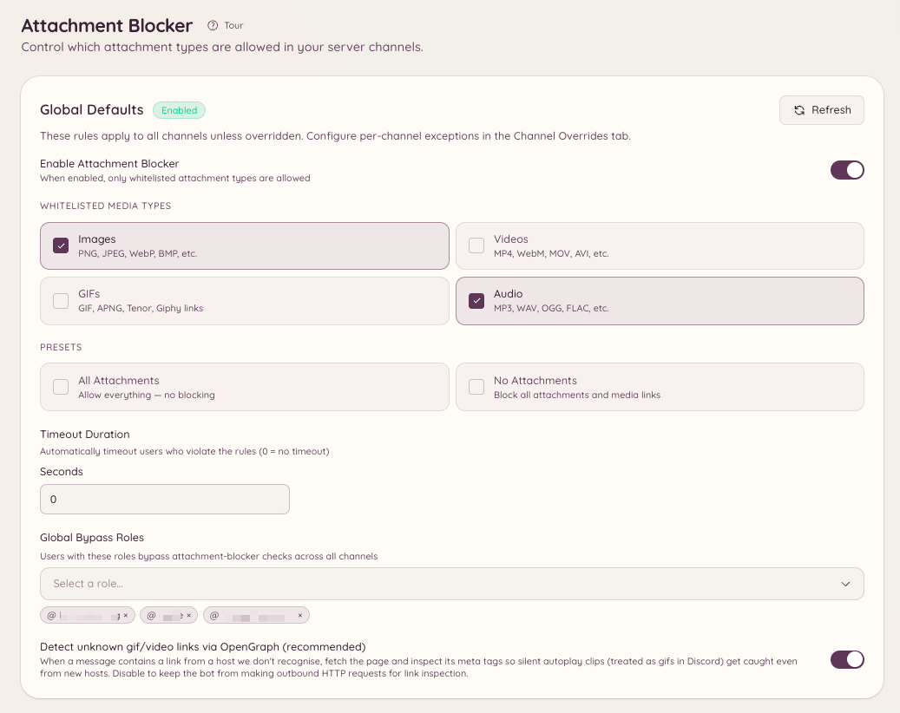

import { DashboardLink } from "/snippets/dashboard-link.jsx";

Le bloqueur de pièces jointes décide quels types de médias les membres ont le droit de publier, et retire tout ce qui enfreint la règle. Il gère quatre types de médias : **Images**, **Vidéos**, **GIF** et **Audio**. Tu fixes une règle pour tout le serveur, tu la remplaces dans les salons qui ont besoin d’autre chose, et tu restreins des membres précis quand le problème vient d’une seule personne.

<Frame>
  
</Frame>

## Comment ça marche

Chaque message d’un salon couvert est vérifié selon la règle qui s’y applique. La vérification regarde :

- Les fichiers envoyés en pièce jointe.
- Les médias contenus dans un message transféré.
- Les embeds que Discord génère pour un lien, ce qui permet d’attraper un GIF Tenor ou une vidéo intégrée.
- Les liens de médias dans le texte du message : Tenor, Giphy, Imgur et liens directs vers des fichiers.
- Les liens inconnus, analysés à la recherche de médias OpenGraph quand **OG fallback** est activé. Un lien qui pointe en fait vers une image ou une vidéo est traité comme ce type de média.

Il ne bloque pas par extension de fichier. Il n’y a pas de liste de `.exe` ou de `.zip` à remplir, ni de types MIME à saisir. Tu choisis des types de médias, et le mode que tu prends décide du sort de tout le reste.

## Choisir un mode

Chaque niveau de configuration utilise l’un des deux modes.

| | Liste blanche | Liste noire |
| --- | --- | --- |
| Ce que signifie la liste | Seuls les types listés sont autorisés | Seuls les types listés sont retirés |
| Un type de média que tu n’as pas listé | Retiré | Autorisé |
| Un fichier qui n’est pas un média, comme un PDF ou une archive | Retiré | Autorisé |
| Préréglages | **All** (tout autoriser, revient à désactiver) et **No attachments** (tout bloquer) | Aucun préréglage |
| Une liste vide | Pas un état utile, choisis un type ou utilise un préréglage | Ne bloque rien |

C’est la ligne des fichiers qui ne sont pas des médias qui surprend. Une liste blanche porte sur tout, donc un salon en liste blanche sur **Images** retire aussi les PDF, les fichiers texte et les archives. Une liste noire porte seulement sur les types qu’elle nomme, donc une liste noire de **Vidéos** retire les vidéos et laisse un PDF tranquille.

Une liste noire vide ne bloque rien, volontairement. C’est l’état honnête pour « j’ai choisi le mode, je n’ai pas encore choisi les types ».

Les configurations créées avant l’arrivée du mode liste noire sont des listes blanches, donc rien n’a changé pour un serveur déjà configuré.

## Réglages par défaut du serveur

Le réglage par défaut du serveur s’applique partout où il n’y a pas d’exception. Règle-le depuis <DashboardLink to="attachment-blocker/global">**Attachment Blocker \> Global Settings**</DashboardLink> dans le tableau de bord, ou dans Discord :

```text
/attachment-blocker setup type: Images mode: Whitelist timeout: 60
```

Chaque appel ajoute **un seul** type à la liste, donc lance-le une fois par type que tu veux ajouter. Si tu n’indiques pas `mode`, le serveur garde le mode qu’il utilise déjà. **All** et **None** sont des notions de liste blanche et sont refusés en mode liste noire, parce qu’une liste noire de tout est une liste blanche de rien, et une seule façon d’écrire chaque résultat suffit.

`/attachment-blocker view` affiche la règle actuellement en vigueur, et `/attachment-blocker disable` désactive la fonctionnalité sur tout le serveur.

## Exceptions par salon

Une exception de salon remplace le réglage par défaut du serveur dans ce salon, mode compris. Ajoutes-en une depuis <DashboardLink to="attachment-blocker/channels">**Attachment Blocker \> Channel Overrides**</DashboardLink>, ou :

```text
/attachment-blocker channel add channel: #media type: Videos mode: Blacklist
/attachment-blocker channel remove channel: #media
```

Deux choses à savoir :

- **Les fils suivent leur salon parent.** Un fil sans exception propre utilise l’exception du salon ou du forum dans lequel il se trouve.
- **Une exception qui ne liste aucun type hérite de tout.** Elle reprend le mode et la liste du réglage par défaut du serveur, donc une exception à moitié remplie ne devient jamais discrètement une règle à part entière.

## Salons vocaux temporaires

Les salons vocaux temporaires sont créés à la demande, on ne peut donc pas leur donner une exception à la main. À la place, tu fixes la règle sur l’ouvreur qui les crée, depuis <DashboardLink to="attachment-blocker/tempvc">**Attachment Blocker \> TempVC Openers**</DashboardLink>. Chaque salon temporaire créé par cet ouvreur reçoit cette règle.

## Rôles de contournement

Un rôle de contournement passe outre la vérification du mode : les personnes qui l’ont peuvent publier ce qu’elles veulent. Tu peux accorder un contournement sur tout le serveur, ou seulement dans un salon :

```text
/attachment-blocker bypass add role: @Moderator
/attachment-blocker bypass channel-add channel: #media role: @Content Team
```

`/attachment-blocker bypass list` et `/attachment-blocker bypass channel-list` montrent qui contourne actuellement les règles, et `/attachment-blocker bypass remove` et `/attachment-blocker bypass channel-remove` retirent le rôle.

Un rôle de contournement ne protège pas un membre d’une restriction qui le vise personnellement. C’est tout l’intérêt des restrictions.

## Restreindre un membre

Quand le problème vient d’un seul membre, restreins ce membre au lieu de durcir le salon pour tout le monde. Ouvre le panneau de restriction avec l’une de ces commandes :

```text
/attachment-blocker user restrict user: @member
/attachmentban user: @member
```

L’entrée de menu contextuel **Applications \> Restrict Attachments** sur l’un de ses messages ouvre le même panneau, et c’est en général plus rapide.

Dans le panneau, tu choisis les types à bloquer, si la restriction s’applique à tout le serveur ou seulement à certains salons, sa durée et une raison. Une restriction :

- **Passe avant les rôles de contournement.** Un membre restreint reste restreint même s’il en a un.
- **Passe avant la règle du salon.** Elle s’applique quoi que ce salon autorise.
- **Prévient le membre quand elle prend fin.** Il reçoit un MP quand elle est levée et quand elle expire.

`/attachment-blocker user list` affiche les restrictions actives, `/attachment-blocker user unrestrict` et `/attachmentunban` en lèvent une, et <DashboardLink to="attachment-blocker/restrictions">**Attachment Blocker \> User Restrictions**</DashboardLink> dans le tableau de bord permet de tout faire depuis le web.

## Exclusions temporaires et MP

Quand un message enfreint la règle :

1. Le message est supprimé.
2. Le membre reçoit un MP qui explique ce qui a été retiré et pourquoi. Ce message est un modèle, tu peux donc le réécrire sous **Message Templates**.
3. Si le niveau qui a intercepté le message fixe une exclusion temporaire, le membre est exclu temporairement pendant ce nombre de secondes.

L’exclusion temporaire passe par le système de modération de Heimdall plutôt que par une action Discord brute, elle apparaît donc dans le fil des actions de modération avec le reste de ton historique de modération. Mets-la à `0` pour supprimer sans exclure personne. Chaque niveau a sa propre exclusion temporaire, donc une exception de salon peut exclure plus longtemps que le réglage par défaut du serveur, ou pas du tout.

## Commandes

```text
/attachment-blocker setup type: [mode:] [timeout:]
/attachment-blocker view
/attachment-blocker disable
```

```text
/attachment-blocker channel add channel: type: [mode:] [timeout:]
/attachment-blocker channel remove channel:
```

```text
/attachment-blocker bypass add role:
/attachment-blocker bypass remove role:
/attachment-blocker bypass list
/attachment-blocker bypass channel-add channel: role:
/attachment-blocker bypass channel-remove channel: role:
/attachment-blocker bypass channel-list channel:
```

```text
/attachment-blocker user restrict user:
/attachment-blocker user unrestrict user:
/attachment-blocker user list
/attachmentban user:
/attachmentunban user:
```

## Permissions requises

| Action | Clé de permission |
| --- | --- |
| Voir la configuration et les listes de contournement | `attachment-blocker.view_config` |
| Modifier les réglages par défaut du serveur, les exceptions de salon et d’ouvreur | `attachment-blocker.manage_config` |
| Voir les restrictions par membre | `attachment-blocker.view_restrictions` |
| Appliquer, modifier et lever les restrictions par membre | `attachment-blocker.manage_restrictions` |
| Te restreindre ou lever ta propre restriction, surtout pour tester | `attachment-blocker.manage_own_restrictions` |

**Manage Own Restrictions** lève seulement la protection qui t’empêche de te cibler toi-même dans le panneau de restriction. Elle ne fait rien seule, donc accorde-la avec **Manage User Restrictions**.
