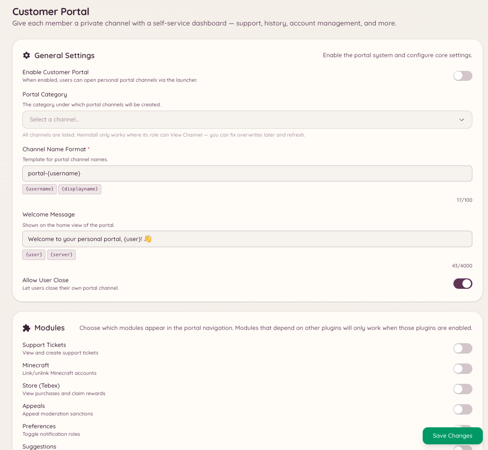

import { DashboardLink } from "/snippets/dashboard-link.jsx";

Le portail client est un tableau de bord destiné aux membres, entièrement accessible depuis Discord. Quand un membre ouvre le portail, il affiche un résumé de tout ce que Heimdall sait de lui : ses comptes liés (Minecraft, PlanetSide 2, comptes de forum), ses tickets ou fils de modmail actifs, ses rappels en cours et son solde dans l’économie.

Le portail sert de point d’entrée unique pour que les membres gèrent leur relation avec le bot et les services du serveur sans avoir à jongler entre plusieurs commandes.

<Frame>
  
</Frame>

## Ouvrir le portail

```text
/portal setup
```

Ouvre le panneau du portail client pour le membre qui a lancé la commande. Le panneau s’affiche sous forme de message interactif visible uniquement par ce membre. Le portail rafraîchit ses données à l’ouverture.

## Ce que le portail affiche

Le contenu du portail dépend des plugins actifs sur ton serveur :

| Section | Affichée quand |
| --- | --- |
| **Linked accounts** | Les intégrations Minecraft, PlanetSide 2 ou NamelessMC sont activées |
| **Active tickets** | Le plugin de tickets est activé et le membre a des tickets ouverts |
| **Modmail threads** | Le plugin de modmail est activé et le membre a des conversations ouvertes |
| **Reminders** | Le plugin de rappels est activé |
| **Economy balance** | Le plugin de jeux et d’économie est activé |

Les membres peuvent agir directement depuis le portail (fermer un ticket, voir un rappel ou vérifier quels comptes sont liés) sans lancer de commandes séparées.

## Configurer le portail

Va dans <DashboardLink to="customer-portal/config">**Customer Portal \> Configuration**</DashboardLink> sur le tableau de bord pour :

- Activer ou désactiver les sections qui apparaissent
- Choisir les intégrations que le portail inclut
- Configurer les salons dans lesquels la commande du portail est disponible

```text
/portal close
```

Ferme un panneau de portail actif. Les portails expirent automatiquement après une période d’inactivité.

```text
/portal refresh
```

Récupère à nouveau toutes les données et met à jour le panneau du portail avec les informations actuelles. Utile si le statut d’un membre a changé pendant que le portail était ouvert.

## Permissions requises

| Action | Clé de permission |
| --- | --- |
| Utiliser le portail | Disponible pour tous les membres par défaut |
| Voir la configuration du portail | `customerPortal.viewConfig` |
| Gérer la configuration du portail | `customerPortal.manageConfig` |
| Gérer les portails des membres | `customerPortal.managePortals` |
