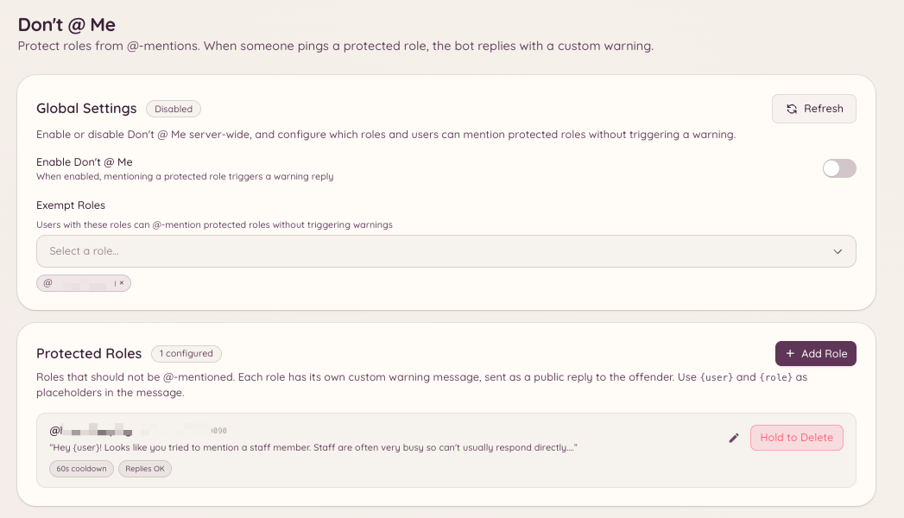

import { DashboardLink } from "/snippets/dashboard-link.jsx";

Le plugin « Don't @ Me » empêche les membres de mentionner des rôles qui ne doivent pas être mentionnés en masse. Quand le message d’un membre mentionne un rôle protégé, le bot supprime le message et l’avertit. C’est une alternative légère à la désactivation complète des @mentions sur un rôle : le rôle reste mentionnable pour les besoins du staff, mais le bot intercepte les utilisations non autorisées.

<Frame>
  
</Frame>

## Configurer les rôles protégés

```text
/dontatme add <role>
```

Ajoute un rôle à la liste des rôles protégés. Les membres qui mentionnent ce rôle (hors exemptions) voient leur message supprimé et reçoivent un avertissement.

```text
/dontatme remove <role>
```

Retire un rôle de la liste des rôles protégés.

Ouvre <DashboardLink to="dont-at-me">**Don't @ Me**</DashboardLink> dans le tableau de bord pour voir la liste de tous les rôles protégés. Depuis le tableau de bord, tu peux aussi configurer le message d’avertissement envoyé aux membres, et choisir si l’avertissement est publié dans le salon ou envoyé en MP.

## Exemptions

Des rôles et des salons peuvent être exemptés du plugin :

- **Exemption de rôle** : les rôles du staff qui ont réellement besoin de mentionner des rôles protégés sont exemptés. Ajoute les rôles exemptés sur la page <DashboardLink to="dont-at-me">**Don't @ Me**</DashboardLink> du tableau de bord.
- **Exemption de salon** : certains salons (par exemple ceux réservés au staff) peuvent être exclus de la surveillance.

## Comportement de l’avertissement

Quand une mention protégée est détectée :

1. Le message est supprimé immédiatement.
2. Le bot publie un court avertissement dans le salon (ou envoie un MP au membre, selon ta configuration) qui explique que le rôle ne peut pas être mentionné.
3. L’avertissement peut aussi être enregistré comme sanction via le plugin de modération, ce qui ajoute des points au dossier du membre.

## Permissions requises

| Action | Clé de permission |
| --- | --- |
| Voir la configuration | `dontAtMe.viewConfig` |
| Modifier la configuration | `dontAtMe.manageConfig` |
