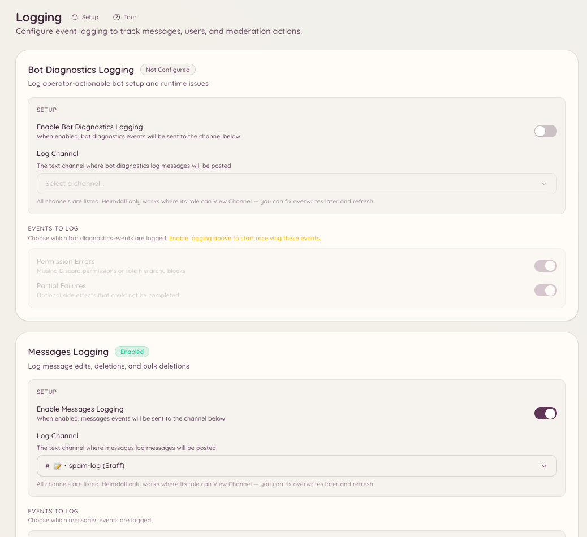

import { DashboardLink } from "/snippets/dashboard-link.jsx";

Le plugin de journaux capture les événements du serveur Discord et publie des notifications mises en forme dans les salons de ton choix. Chaque catégorie d’événements peut être envoyée vers un salon différent : tu peux par exemple envoyer les événements de messages dans un salon, ceux des membres dans un autre, et les actions de modération dans un troisième.

<Frame>
  
</Frame>

## Configuration

```text
/logging setup <category> <channel>
```

Configure une catégorie d’événements pour qu’elle soit journalisée dans le salon indiqué. Lance la commande une fois par catégorie que tu veux activer.

```text
/logging disable <category>
```

Arrête la journalisation d’une catégorie sans retirer le reste de ta configuration.

Va dans <DashboardLink to="logging">**Logging**</DashboardLink> sur le tableau de bord pour avoir une vue d’ensemble de toutes les catégories configurées et de leurs salons cibles.

## Catégories d’événements

| Catégorie | Événements journalisés |
| --- | --- |
| **Messages** | Modifications de messages (avec le contenu avant et après), suppressions de messages, suppressions en masse |
| **Members** | Arrivées et départs de membres, changements de nom d’utilisateur, d’avatar et de pseudo |
| **Roles** | Création, suppression et modification de rôles ; attribution et retrait de rôles |
| **Channels** | Création, suppression et changements de paramètres des salons |
| **Voice** | Membres qui rejoignent, quittent ou changent de salon vocal |
| **Moderation** | Bans, débans, expulsions, exclusions temporaires et leurs raisons (depuis le journal d’audit de Discord) |
| **Server** | Changements du nom, de l’icône ou des paramètres du serveur |
| **Invites** | Création et suppression d’invitations (et quelle invitation un membre a utilisée pour rejoindre) |

## Format des messages de journal

Chaque entrée de journal affiche :

- Le type d’événement en en-tête
- L’utilisateur, le salon ou le rôle concerné, avec une mention ou un nom
- Les valeurs avant et après pour les modifications
- Un horodatage
- Quand c’est pertinent, un lien vers le message d’origine ou le contexte

Le bot utilise le journal d’audit de Discord pour attribuer, quand c’est possible, les événements au membre du staff qui les a effectués. Les événements qui ne figurent pas dans le journal d’audit (comme les modifications de messages par leur auteur) sont attribués directement à l’auteur.

## Permissions requises

| Action | Clé de permission |
| --- | --- |
| Voir la configuration des journaux | `logging.view_config` |
| Modifier la configuration des journaux | `logging.manage_config` |
