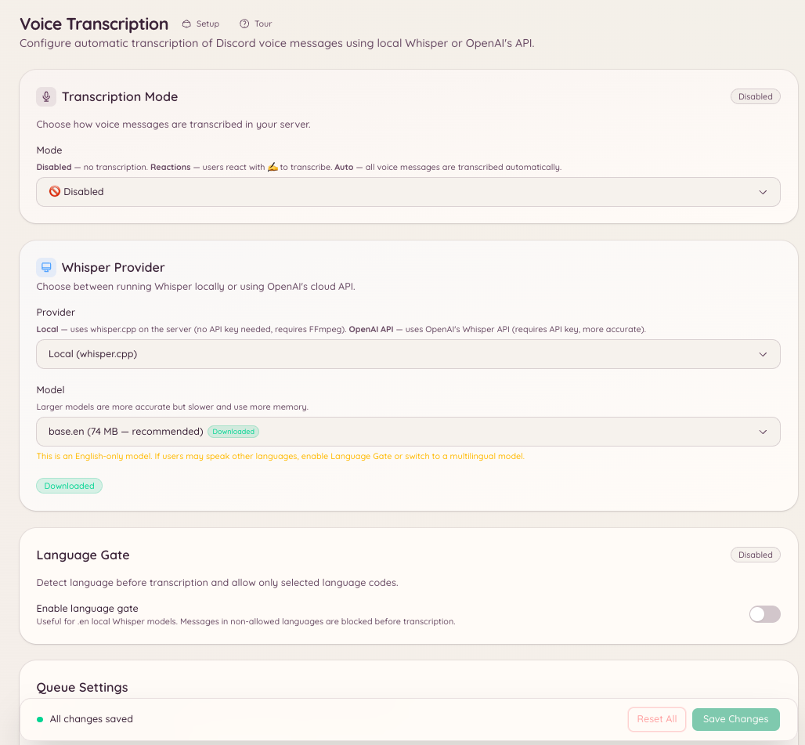

import { DashboardLink } from "/snippets/dashboard-link.jsx";

Le plugin de transcription vocale convertit en texte les messages vocaux Discord, c’est-à-dire les clips audio que les membres enregistrent directement dans le client Discord. Quand un membre envoie un message vocal dans un salon configuré, le bot répond avec la transcription de ce qui a été dit.

Les messages vocaux deviennent ainsi accessibles aux membres qui ne peuvent pas ou préfèrent ne pas écouter de l’audio. Les conversations sont plus faciles à rechercher, et c’est pratique dans les environnements bruyants où écouter n’est pas possible.

<Note>
  Ce plugin transcrit les messages vocaux Discord (la fonction d’enregistrement de message vocal du client Discord). Il ne transcrit pas l’audio des salons vocaux.
</Note>

<Frame>
  
</Frame>

## Configuration

Ouvre <DashboardLink to="vc-transcription">**VC Transcription**</DashboardLink> dans le tableau de bord, ou utilise la commande slash :

```text
/voice-transcription set <channel>
```

Choisis les salons dans lesquels le bot doit surveiller les messages vocaux. Tu peux activer la transcription pour certains salons ou pour tout le serveur.

```text
/voice-transcription status
```

Indique quels salons ont actuellement la transcription activée.

## Comment fonctionne la transcription

Quand un message vocal est envoyé dans un salon configuré, le bot télécharge l’audio, l’envoie au modèle de reconnaissance vocale Whisper et publie la transcription en réponse au message vocal. La transcription apparaît quelques secondes après l’envoi du message vocal, selon la durée de l’audio.

Les transcriptions sont clairement indiquées comme générées par le bot et peuvent contenir des erreurs, surtout avec des accents inhabituels, des termes techniques ou un audio de mauvaise qualité.

## Configuration dans le tableau de bord

Ouvre <DashboardLink to="vc-transcription">**VC Transcription**</DashboardLink> dans le tableau de bord pour :

- Ajouter ou retirer des salons de la liste de transcription
- Voir l’historique des transcriptions d’un salon
- Activer ou désactiver la transcription sans supprimer la configuration

## Permissions requises

| Action | Clé de permission |
| --- | --- |
| Voir la configuration | `vcTranscription.viewConfig` |
| Modifier la configuration | `vcTranscription.manageConfig` |
