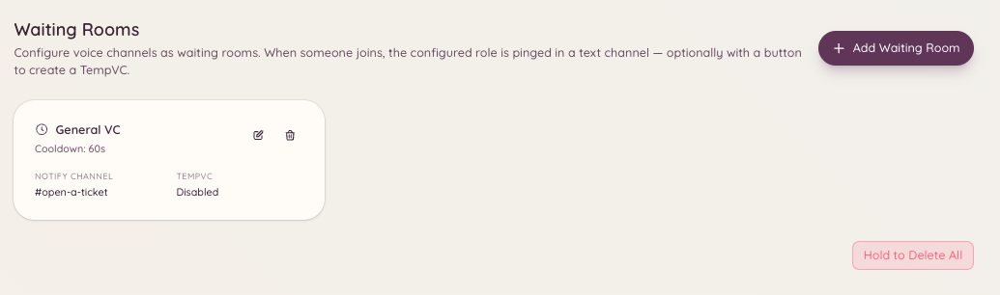

import { DashboardLink } from "/snippets/dashboard-link.jsx";

Le plugin de salle d’attente surveille un salon vocal que tu désignes comme salle d’attente. Quand un membre rejoint ce salon, le bot publie une notification dans un salon du staff configuré, pour qu’un membre du staff puisse s’occuper de lui. C’est utile pour les serveurs qui font du support vocal individuel, des entretiens, ou tout autre cas où un membre doit signaler qu’il est prêt à parler.

<Frame>
  
</Frame>

## Comment ça marche

Un membre rejoint le salon vocal de la salle d’attente. Le bot envoie aussitôt une notification dans le salon de notifications du staff configuré. Le message contient le nom du membre et l’heure. Le staff voit la notification et peut alors rejoindre le salon vocal de la salle d’attente ou déplacer le membre dans un salon privé.

Quand le membre quitte la salle d’attente, le bot met à jour ou supprime la notification pour éviter les alertes périmées.

## Configuration

Ouvre <DashboardLink to="waiting-room/config">**Waiting Room \> Configuration**</DashboardLink> dans le tableau de bord.

| Paramètre | Description |
| --- | --- |
| **Salon de la salle d’attente** | Le salon vocal que les membres rejoignent pour signaler qu’ils ont besoin d’aide |
| **Salon de notifications** | Le salon textuel où le staff reçoit les alertes de la salle d’attente |
| **Message de notification** | Le modèle de message publié quand un membre entre |
| **Rôles à mentionner** | Les rôles à mentionner dans la notification pour que le staff soit prévenu tout de suite |

Tu peux configurer plusieurs salles d’attente, chacune avec son propre salon de notifications et ses propres rôles à mentionner.

## Variables du message de notification

| Variable | Remplacée par |
| --- | --- |
| `{user}` | Une mention du membre qui a rejoint |
| `{user.name}` | Le pseudo affiché du membre |
| `{channel}` | Le nom du salon de la salle d’attente |
| `{time}` | L’heure à laquelle le membre a rejoint |

## Utiliser la prise en charge

Le staff peut cliquer sur le bouton **Accept** (Accepter) du message de notification pour prendre en charge la personne en attente. La prise en charge marque la notification comme traitée et évite que plusieurs membres du staff s’occupent de la même personne en même temps.

## Permissions requises

| Action | Clé de permission |
| --- | --- |
| Voir la configuration | `waitingRoom.viewConfig` |
| Modifier la configuration | `waitingRoom.manageConfig` |
| Accepter les membres en attente | `waitingRoom.accept` |
