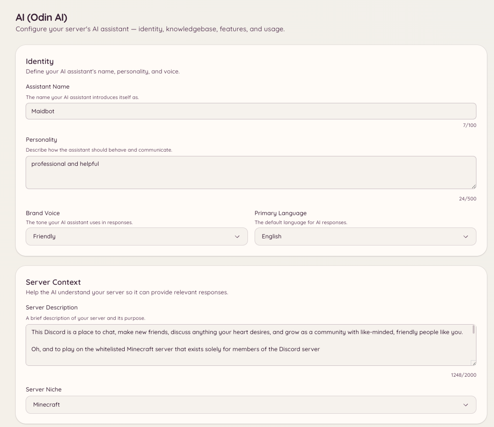

import { DashboardLink } from "/snippets/dashboard-link.jsx";

Odinは、HeimdallのAIアシスタントです。メンバーが質問すると、サーバーのナレッジベース（ドキュメント、FAQ、ルール、その他アップロードしたあらゆるコンテンツ）をもとにした回答が返ってきます。Odinはセッション内の会話の文脈を覚えているので、背景情報を繰り返さなくても、続けて自然に質問できます。

<Frame>
  
</Frame>

## 質問する

```text
/ask <question>
```

メンバーは、どんな質問でも普通の言葉で尋ねられます。Odinはナレッジベースをもとに回答し、使った項目を出典として示します。デフォルトでは、`/ask` はナレッジベースだけをもとに回答します。ナレッジベースが質問をカバーしていない場合、Odinは推測するのではなくそう伝え、スタッフに連絡する方法をメンバーに案内します（サーバーのサポートの受け付け方に応じて、チケットまたはModmailのボタン）。

`/ask` がOdin自身の知識から一般的な質問にも答えられるようにするには、<DashboardLink to="ai/feature-qa_bot">**AI \> Q&A Bot**</DashboardLink> で **Allow general knowledge**（一般知識を許可）をオンにします。サーバーに関する事実（リンク、料金、コマンド、スタッフ）は、引き続きナレッジベースからのみ取得されます。

デフォルトでは、`/ask` はすべてのメンバーが使えます。権限の設定でアクセスを制限できます。

## ナレッジベース

ナレッジベースは、Odinが質問に答えるために使うドキュメントの集まりです。管理するには、ダッシュボードの <DashboardLink to="ai/knowledgebase">**AI \> Knowledgebase**</DashboardLink>（AI > ナレッジベース）を開きます。

### ドキュメントを追加する

**Add Document**（ドキュメントを追加）をクリックし、内容を貼り付けるかファイルをアップロードします。各ドキュメントは、サーバーのルール、FAQ、連携機能のガイドなど、Odinに参照してほしい特定のトピックや構造化されたコンテンツを扱うようにしましょう。

対応形式：

- プレーンテキスト
- Markdown
- PDF
- 一般的なドキュメント形式

アップロードすると、ドキュメントは処理されてインデックスが作成されます。数分以内に、Odinが回答でそのドキュメントを参照し始めます。

### Webからインポートする

内容を貼り付ける代わりに、Webサイトからページを直接取り込めます。

- **Import URLs**（URLをインポート）は、1行に1つずつ並べたページを取得し、それぞれを整理して個別の項目にします。
- **Deep Crawl**（ディープクロール）は、設定したページ数の上限までサイト内のリンクをたどり、実際の内容があるすべてのページをインポートします。

どちらも、各ページを整理するためにAIトークンを使います。ページのMarkdown版を公開しているサイト（ほとんどのドキュメントプラットフォームがそうです）の場合は、書かれたとおりに保存され、整理のコストはかかりません。

すでにナレッジベースにあるページをインポートしても、2つ目のコピーは作成されません。ページはアドレスで照合されます。変更のないページはトークンを使わずにスキップされ、変更されたページは、あなたが付けたタイトルとタグを残したまま既存の項目が更新されます。**Preview Pages**（ページをプレビュー）を使うと、確定する前に、新しいページ、変更されたページ、変更のないページの数がわかります。そのため、インポート済みのサイトを再クロールしても、トークンがかかるのは変更された部分だけです。

### 項目を最新に保つ

Odinは、インポートしたすべてのページを週に1回確認し直します。ページが変更されていなければ何も起こらず、トークンも使いません。変更されていれば、ページの内容で項目を更新し、整理が必要なページにはこのサーバーのAIトークンを使います。たとえばサーバーのAIトークンが足りないなどの理由でAIが新しい版を整理できない場合、項目は整理されていないページのテキストに置き換えられることなく、そのまま残され、後で再試行されます。<DashboardLink to="ai/usage">**AI \> Usage**</DashboardLink>（AI > 使用量）ページでは、これが **Knowledgebase Upkeep**（ナレッジベースの維持）として別に表示されます。オフにするには、<DashboardLink to="ai/knowledgebase">**AI \> Knowledgebase**</DashboardLink> ページの下部にある **Keep imported pages up to date**（インポートしたページを最新に保つ）を使います。

- **あなたの編集は保持されます。** 項目の内容を手動で編集すると、Odinがその上からページの内容をコピーすることはありません。その後にページが変更された場合、項目には **Page changed since your edit**（編集後にページが変更されました）と表示され、**Replace with new version**（新しい版に置き換える）か **Keep my version**（自分の版を残す）かを選べます。
- **削除されたページは、削除されずに警告されます。** ページが「not found」を返す項目には **Page missing**（ページがありません）と表示されます。2週続けてそうなった場合は回答から除外されるため、Odinがサイトから削除されたページを引用し続けることはありません。ページが戻れば、自動的に復活します。それでも使い続けたい場合は、項目を編集してソースURLを消してください。
- **サイトの新しいページを見張る。** ディープクロールしたすべてのサイトは **Crawled sites**（クロール済みのサイト）に一覧表示されます。見張りのスイッチをオンにすると、Odinはそのサイトを毎週クロールし、まだナレッジベースにないページを最大25ページインポートします。ページを見つけるのにトークンはかかりませんが、新しいページを整理するにはかかります。ログインページなど、AIが残す価値のあるものを見つけられなかったページは記憶され、内容が変わるまで再び調べられることはありません。
- **毎回変わるページは、確認の頻度が下がります。** 現在時刻を表示しているなどの理由で、読み込むたびに変わるページもあります。3週続けて変更が見つかると、確認の間隔はそのたびに倍になり、最大で8週間ごとになります。そのため、こうしたページで毎週トークンがかかることはありません。

**Needs attention**（要確認）フィルターを使うと、ページがない項目、編集後にページが変更された項目、同じページを2回インポートした項目をすべて確認できます。

<Note>
AIが複数のページを一度にまとめて作った項目には **Not updated automatically**（自動更新されません）と表示されます。そのうちの1ページを読み直すと、項目が元の一部だけに置き換わってしまうためです。更新するには、サイトを再クロールしてください。
</Note>

### ドキュメントを管理する

<DashboardLink to="ai/knowledgebase">**AI \> Knowledgebase**</DashboardLink> ページには、すべてのドキュメントが作成日とステータスとともに一覧表示されます。次の操作ができます。

- 情報が変わったら、ドキュメントの内容を **編集**
- Odinに参照させたくないドキュメントを **削除**
- Odinがドキュメントをどう解釈して要約するかを **プレビュー**

## 会話の文脈

Odinは、会話のセッション内で文脈を保持します。メンバーが続けて質問すると、Odinは同じセッション内のそれまでのやり取りを使って、何を指しているのかを理解します。文脈はメンバーごとに保持され、一定時間やり取りがないと期限切れになります。

スタッフは <DashboardLink to="ai/conversations">**AI \> Conversations**</DashboardLink>（AI > 会話）で過去の会話を読めます。予想外の応答の原因を調べるのに便利です。

## 設定

ダッシュボードの <DashboardLink to="ai/setup">**AI \> Setup & Context**</DashboardLink>（AI > セットアップとコンテキスト）を開き、次の項目を設定します。

| 設定 | 説明 |
| --- | --- |
| **Identity**（アイデンティティ） | Odinの名前、性格、ブランドの口調、主な言語 |
| **Server context**（サーバーのコンテキスト） | サーバーとそのジャンルの説明。回答をコミュニティに合ったものにします |
| **Channel context**（チャンネルのコンテキスト） | 各チャンネルの用途。Odinがメンバーを適切な場所に案内できるようにします |
| **Rules and guidelines**（ルールとガイドライン） | サーバーのルール、すべきこととしてはいけないこと、禁止の話題、必要な注意書き |
| **Branding**（ブランディング） | Odinの返信の色、ロゴ、フッターのテキスト |

`/ask` を使えるチャンネルを制限したり、クールダウンを設定したりするには、<DashboardLink to="ai/feature-qa_bot">**AI \> Q&A Bot**</DashboardLink> を使います。

## 機能

<DashboardLink to="ai/features">**AI \> Features**</DashboardLink>（AI > 機能）を開くと、サーバーで使える個々のAI機能を確認して有効にできます。各機能は、Odinが実行できるそれぞれ独立した動作です。

### テキストモデレーション

Odinは、設定したチャンネルのすべてのメッセージを評価し、ルールに違反するコンテンツを警告したり削除したりできます。正規表現ベースのautomodとは違い、テキストモデレーションは文脈を理解するので、ある話題について話し合っていることと、その話題に関するルールに実際に違反していることを区別できます。

監視するチャンネル、AIが何を探すか、どの処分を取るか（審査のために警告、削除、警告処分）は、<DashboardLink to="ai/feature-text_moderation">**AI \> Text Moderation**</DashboardLink>（AI > テキストモデレーション）で設定します。

#### 推奨設定

テキストモデレーションは、私たちが管理し、継続的に改善している推奨設定から始まります。変更していない設定はすべて推奨に従うため、より良い版を公開すると、サーバーに自動的に反映されます。

変更した設定はあなたのものになり、**Custom**（カスタム）と表示されます。推奨が変わっても、あなたの値は保持されます。推奨に従う状態に戻すには、その横の **Use recommended**（推奨を使う）を押します。

新しい版でカスタマイズ済みの設定が変わる場合は、**New recommendations**（新しい推奨）カードに一覧表示されます。それぞれについて、**Use recommended**（推奨を使う）か **Keep mine**（自分の設定を残す）を選べます。また、変更が見落とされないよう、Heimdallは段階的処分のチャンネルに1回だけお知らせを投稿します。

#### フィードバックと推奨の改善

ログチャンネルにあるAIによるエスカレーションには、どれも 👍 と 👎 のボタンと、コメントボタンが付いています。判断が正しかったか間違っていたかを、これらのボタンでOdinに伝えましょう。このフィードバックによって、推奨設定が改善されていきます。

すべてのサーバーの推奨を改善するため、フィードバックは、それに関する判断とともに一元的に収集されます。サーバーから何かが送られる前に、メッセージからメンション、ユーザーID、投稿者の名前が取り除かれ、投稿者は、DiscordのIDに戻すことのできない一方向のコードによってのみ識別されます。心身の健康や自傷に関する懸念があるメッセージは、決して送信されません。フィードバックは最長24か月間保持されます。

<Note>
独自のOpenRouterキーを使っているサーバーは、<DashboardLink to="ai/feature-text_moderation">**AI \> Text Moderation**</DashboardLink> ページの **Improving recommended settings**（推奨設定の改善）でオプトアウトできます。オプトアウトすると、サーバーがすでに送ったフィードバックも削除されます。HeimdallのマネージドAIを使っているサーバーは、頼りにしている推奨がこのフィードバックから作られているため、オプトアウトできません。
</Note>

### 画像モデレーション

有効にすると、Odinは監視対象のチャンネルでメッセージに添付された画像を分析します。感度のしきい値と、ルール違反が検出されたときの処分は、<DashboardLink to="ai/feature-image_moderation">**AI \> Image Moderation**</DashboardLink>（AI > 画像モデレーション）で設定します。

### チケットの自動返信

チケットが作成されると、Odinは開始メッセージをナレッジベースと照らし合わせて読み、スタッフが送信前に確認できるよう、回答の案をスレッドに投稿します。これにより、スタッフが手動で対応しなければならないチケットの数が減り、よくある質問への応答時間が短くなります。

有効にして設定するには、<DashboardLink to="ai/feature-ticket_auto_reply">**AI \> Ticket Auto-Reply**</DashboardLink>（AI > チケットの自動返信）か、<DashboardLink to="tickets/ai">**Tickets \> AI**</DashboardLink>（チケット > AI）のセクションを使います。

### Modmailアシスタント

チケットの自動返信と同じ機能を、届いたModmailの会話に適用します。メンバーがModmailのスレッドを開くと、Odinが最初のDMとナレッジベースをもとに返信を提案します。

有効にして設定するには、<DashboardLink to="ai/feature-modmail_assistant">**AI \> Modmail Assistant**</DashboardLink>（AI > Modmailアシスタント）か、<DashboardLink to="modmail/ai">**Modmail \> AI**</DashboardLink>（Modmail > AI）のセクションを使います。

### Q&A Bot

Q&A Botは、設定したチャンネルを監視し、メンバーが `/ask` コマンドを使わなくても、質問に自動で答えます。メッセージが質問のように見えると、Odinはそれをナレッジベースと照らし合わせて評価し、自信のある回答が見つかれば返信します。

これは自動応答とは別のものです。Q&A Botはパターンの照合ではなく本格的なAIの推論を使い、十分な自信があるときにだけ返信します。監視するチャンネルと確信度のしきい値は、<DashboardLink to="ai/feature-qa_bot">**AI \> Q&A Bot**</DashboardLink> で設定します。

### 会話モード

会話モードでは、特定のチャンネルでOdinがどう振る舞うかを設定できます。たとえば、Odinが会話の文脈を保ち続け、常駐のアシスタントとして振る舞うチャンネルを用意できます。利用できるモードと、それを適用するチャンネルは、<DashboardLink to="ai/feature-conversation_modes">**AI \> Conversation Modes**</DashboardLink>（AI > 会話モード）で設定します。

各モードには、回答の仕方を決める2つの設定があります。

- **Allow general knowledge**（一般知識を許可、デフォルトでオン）。Odinは、コミュニティのテーマであるゲームや話題などの一般的な質問には自身の知識で答え、サーバーに関することにはナレッジベースを使います。自信がないときはそう伝え、サーバーが一般的なケースと異なる可能性がある点を指摘します。リンク、料金、コマンド、スタッフなど、サーバー自体に関する事実は、引き続きナレッジベースからのみ取得されます。オフにすると、デフォルトの `/ask` と同じように、ナレッジベースだけをもとに回答するモードになります。
- **Handoff action**（引き継ぎの動作）。メンバーが人間との対応を求めたときや、スタッフにしかできないことが必要なときにどうするかです。普通の質問には常に回答し、引き継ぐことはありません。
  - **No hand-off**（引き継ぎなし、デフォルト）：Odinは対応できないと伝え、そこで終わります。
  - **Open a ticket**（チケットを作成）：Odinがサーバーのチケットボタンを表示します。チケットの代わりにModmailを使っている場合は、Modmailのボタンを表示します。
  - **Ping a staff role**（スタッフロールにメンション）：Odinが選んだロールにメンションします。各メンバーがメンションできるのは10分に1回まで、ロールへのメンションは1分に1回までです。それ以降の引き継ぎでは、通知せずにロール名だけを示します。ロールがメンション可能になっているか、Heimdallに **@everyone、@here、全てのロールにメンション**（Mention @everyone, @here, and All Roles）権限が必要です。そうでない場合、モードは **No hand-off** として動作します。

Odinは、メンバーが書いた言語で返信します。決まった文言の引き継ぎメッセージとボタンのラベルは、<DashboardLink to="ai/setup">**AI \> Setup & Context**</DashboardLink> で設定した **Primary Language**（主な言語）に従います。

## モデレーションログ

<DashboardLink to="ai/moderation-logs">**AI \> Moderation Logs**</DashboardLink>（AI > モデレーションログ）には、AIによるモデレーション操作のログ（テキストと画像のモデレーションのイベント、何が警告されたか、どの処分が取られたか）が表示されます。AIの判断を確認し、厳しすぎたり甘すぎたりする場合に設定を調整するのに使いましょう。

## 会話

<DashboardLink to="ai/conversations">**AI \> Conversations**</DashboardLink> は、メンバーとOdinの会話のログです。スタッフは会話を開いて読んだり、フラグを付けたり確認済みにしたり、良い回答をナレッジベースに追加したり、そのメンバーのAI機能の利用を制限したりできます。

## 制限

<DashboardLink to="ai/restrictions">**AI \> Restrictions**</DashboardLink>（AI > 制限）には、AI機能の利用をBANまたはタイムアウトされているメンバーが一覧表示され、スタッフはそうした制限を追加したり解除したりできます。

`/ask` を特定のチャンネルに限定する設定とクールダウンは、代わりに <DashboardLink to="ai/feature-qa_bot">**AI \> Q&A Bot**</DashboardLink> にあります。チャンネルを限定しなければ、`/ask` はすべてのチャンネルで使えます。

## 使用量と請求

<DashboardLink to="ai/usage">**AI \> Usage**</DashboardLink> には、サーバーのAIトークンの消費量の推移が、機能別（Q&A、モデレーション、チケットの自動返信など）と日別に表示されます。どの機能がいちばんトークンを消費しているかを把握するのに便利です。

<DashboardLink to="ai/billing">**AI \> Billing**</DashboardLink>（AI > 請求）には、現在のAIクレジットの残高が表示され、追加のクレジットを購入できます。AI機能は処理したトークンごとにクレジットを消費します。正確なコストは、あなたの環境に設定されている基盤モデルによって異なります。

<Note>
  使用量と請求は、HeimdallのデプロイがトークンベースのAIクレジットを使っている場合にのみ表示されます。ローカルモデルや独自のAPIキーを使うセルフホストのデプロイでは、これらのセクションは表示されません。
</Note>

## 他のプラグインでのAI

Odinは、チケット、Modmail、提案と連携します。

- <DashboardLink to="tickets/ai">**Tickets \> AI**</DashboardLink>：特定のチケットカテゴリでチケットの自動返信を有効にします
- <DashboardLink to="modmail/ai">**Modmail \> AI**</DashboardLink>：特定のModmailカテゴリでModmailアシスタントを有効にします
- **Suggestions**（提案）：<DashboardLink to="suggestions/categories">**Suggestions \> Categories**</DashboardLink>（提案 > カテゴリ）で、提案のカテゴリの **AI Titles**（AIタイトル）がオンになっていれば、メンバーが提案を送信したときにOdinが簡潔なタイトルを自動で作成します。カテゴリのない提案にはタイトルは作成されません。HeimdallのマネージドAIでは、<DashboardLink to="ai/features">**AI \> Features**</DashboardLink> で **Suggestion Titles**（提案のタイトル）もオンにする必要があります

## 必要な権限

| 操作 | 権限キー |
| --- | --- |
| `/ask` の利用 | `ai.qa.use_ask`（デフォルトで許可） |
| 会話の文脈の閲覧 | `ai.context.view_context` |
| 会話の文脈の管理 | `ai.context.manage_context` |
| 設定の閲覧 | `ai.config.view_config` |
| 設定の管理 | `ai.config.manage_config` |
| ナレッジベースの閲覧 | `ai.knowledgebase.view_knowledgebase` |
| ナレッジベースの管理 | `ai.knowledgebase.manage_knowledgebase` |
