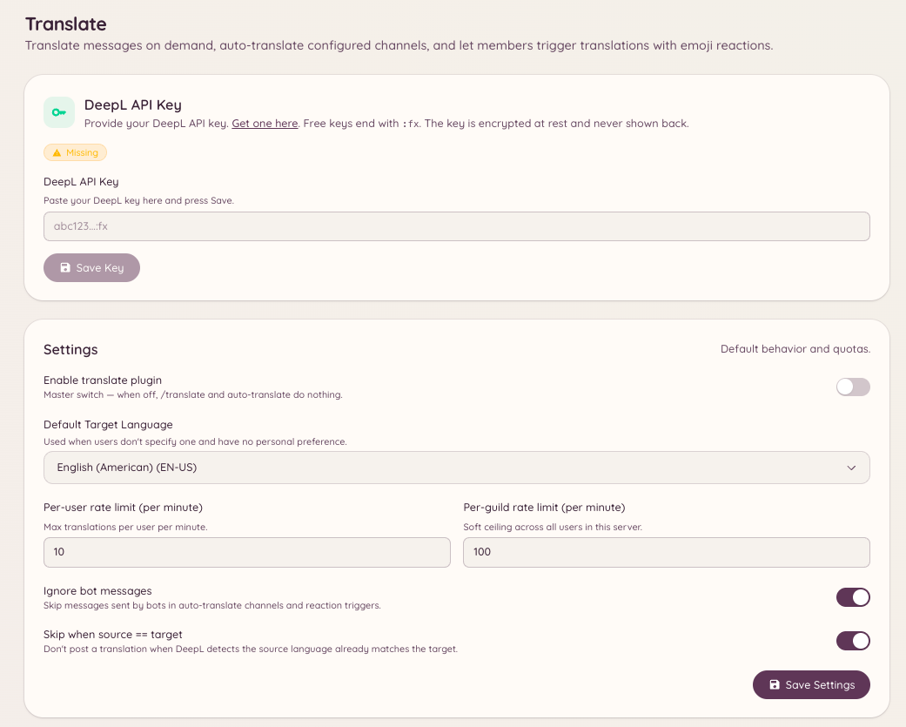

import { DashboardLink } from "/snippets/dashboard-link.jsx";

翻訳プラグインは、DeepLを使ってメッセージを翻訳します。メンバーはどのメッセージでも必要なときに翻訳でき、管理者は、すべてのメッセージを指定した言語に自動翻訳するチャンネルを設定できます。

<Frame>
  
</Frame>

## メッセージを翻訳する

```text
/translate message <message_id> <target_language>
```

指定したメッセージを、翻訳先の言語に翻訳します。Botは翻訳したテキストを返信します。元のメッセージは変更されません。

Discordの **アプリ** コンテキストメニューからも翻訳できます。メッセージを右クリックして **アプリ** を選び、**Translate** を選択します。

## 言語を確認する

```text
/translate language <language>
```

名前またはコードで言語を検索し、DeepLがその言語をどう識別しているか、またその言語からどの言語へ、どの言語からその言語へ翻訳できるかを確認します。

## 自動翻訳チャンネル

チャンネルを、すべてのメッセージを指定した言語に自動翻訳するように設定できます。異なる言語を話す人たちが1つのチャンネルを使えるようにしたい、多言語のコミュニティで便利です。

ダッシュボードの <DashboardLink to="translate/channels">**Translate \> Channels**</DashboardLink>（翻訳 > チャンネル）を開き、自動翻訳リストにチャンネルを追加します。チャンネルごとに次の項目を設定します。

| 設定 | 説明 |
| --- | --- |
| **Channel**（チャンネル） | 自動翻訳を有効にするDiscordチャンネル |
| **Target language**（翻訳先の言語） | すべてのメッセージの翻訳先の言語 |
| **Source language**（翻訳元の言語） | 想定される翻訳元の言語。未設定の場合は自動検出 |
| **Translate bot messages**（Botのメッセージを翻訳） | 他のBotが送信したメッセージも翻訳するかどうか |

自動翻訳が有効な場合、Botは各メッセージへの返信として翻訳を投稿します。すでに翻訳先の言語で書かれているメッセージはスキップされます。

## 言語と絵文字の対応

ダッシュボードの <DashboardLink to="translate/emoji">**Translate \> Emoji Mappings**</DashboardLink>（翻訳 > 絵文字の対応）を開き、各言語を表す国旗やカスタム絵文字を設定します。これらの絵文字は翻訳メッセージの見出しで使われ、翻訳元と翻訳先の言語をひと目でわかるようにします。

## 翻訳をテストする

ダッシュボードの <DashboardLink to="translate/test">**Translate \> Test**</DashboardLink>（翻訳 > テスト）を開くと、テスト用の文字列を翻訳エンジンに通し、実際のチャンネルに適用する前に結果を確認できます。

## 必要な権限

| 操作 | 権限キー |
| --- | --- |
| メッセージの翻訳 | `translate.use`（デフォルトで許可） |
| 設定の閲覧 | `translate.view_config` |
| 設定の管理 | `translate.manage_config` |
