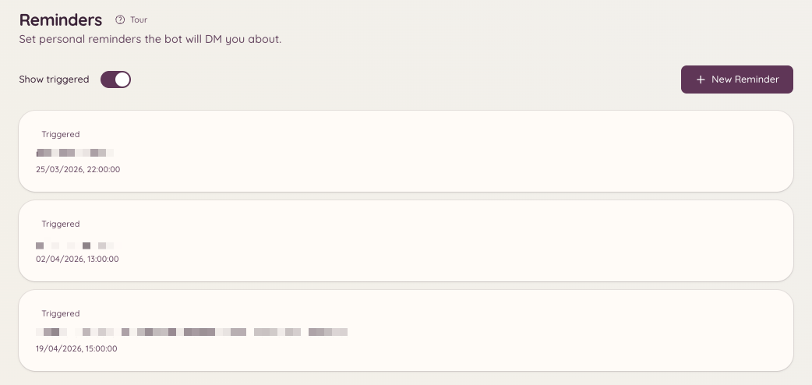

import { DashboardLink } from "/snippets/dashboard-link.jsx";

リマインダープラグインを使うと、メンバーが自分用のリマインダーを設定できます。指定した時刻になると、BotがリマインダーをDMで届けるか、リマインダーを設定したチャンネルに投稿します。リマインダーにはオプションで文脈を含めることもできます（たとえばチケットやModmailスレッドへのリンク）。そうすれば、すぐに行動に移せるだけの情報と一緒にリマインダーが届きます。

<Frame>
  
</Frame>

## リマインダーを設定する

```text
/reminder
```

`/reminder` を実行すると、操作用のパネルが開きます。パネルでは次のことができます。

- 覚えておきたい内容を書く
- リマインドしてほしいタイミングを設定する（特定の時刻、または `in 2 hours` や `tomorrow at 9am` のように今からの期間）
- リマインダーをDMで届けるか、現在のチャンネルに投稿するかを選ぶ

Botは、内容と配信予定時刻を示すメッセージでリマインダーの設定を確認します。

## 自分のリマインダーを管理する

```text
/reminders
```

これから届く有効なリマインダーをすべて一覧表示するパネルを開きます。このパネルでは次のことができます。

- 各リマインダーの内容全体を**表示**する
- 不要になったリマインダーを**削除**する
- 配信待ちのリマインダーの時刻や内容を**編集**する

ダッシュボードを開ける場合は、<DashboardLink to="reminders">**Reminders**</DashboardLink>（リマインダー）ページに同じ一覧（常に自分のリマインダーだけ）が表示され、そこでも追加、編集、削除ができます。

## チケットとModmailの文脈

進行中のチケットやModmailスレッドの中で `/reminder` を実行すると、Botはそのスレッドへのリンクを自動でリマインダーに添付します。リマインダーが届くと、会話に直接戻れるジャンプリンクが含まれています。

## リマインダーの配信

リマインダーは、あなたがオンラインかどうかに関係なく、指定した時刻に配信されます。BotがDMを届けられない場合（たとえばサーバーメンバーからのDMを無効にしている場合）は、代わりにリマインダーを最初に設定したチャンネルへの投稿を試みます。

## 必要な権限

| 操作 | 権限キー |
| --- | --- |
| リマインダーの設定 | `reminders.view_reminders`（デフォルトで許可） |
| 自分のリマインダーの管理 | `reminders.view_reminders`（デフォルトで許可） |
| ほかのメンバーへのリマインダーの送信 | `reminders.send_public_reminders` |
| サーバーのすべてのリマインダーの表示 | `reminders.manage_reminders` |
