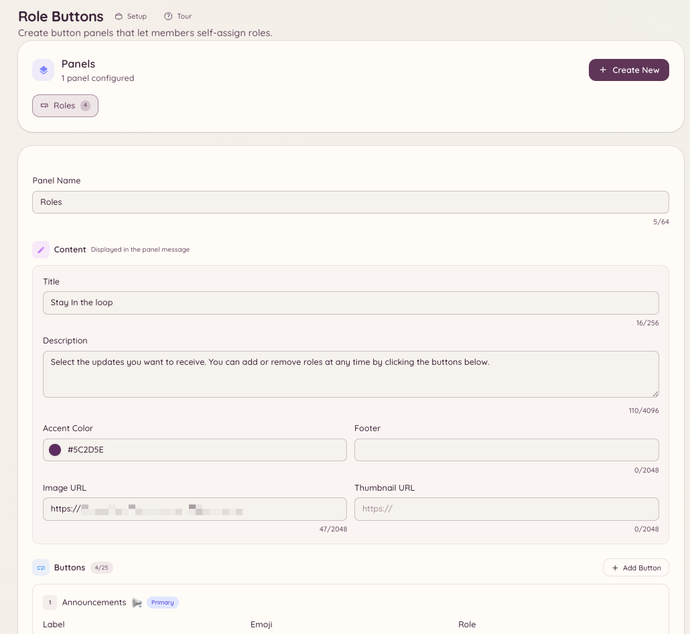

import { DashboardLink } from "/snippets/dashboard-link.jsx";

ロールボタンは、チャンネルに投稿される常設のパネルで、メンバーがボタンをクリックして自分にロールを付けたり外したりできます。Discord標準のロール選択機能とは違い、Heimdallのパネルは切り替えモード、ロールのグループ化、ボタンのラベルとスタイルのカスタマイズに対応しています。

<Frame>
  
</Frame>

## パネルを作成する

```text
/rolebuttons create
```

このコマンドを実行すると、パネルを定義する設定フローが開きます。ダッシュボードの <DashboardLink to="rolebuttons">**Role Buttons**</DashboardLink>（ロールボタン）だけでパネルを作成・管理することもできます。

### パネルの設定

| 設定 | 説明 |
| --- | --- |
| **Title**（タイトル） | パネルの見出しテキスト |
| **Description**（説明） | タイトルの下に表示される説明文 |
| **Mode**（モード） | ロールの付与方法（下記を参照） |

### 付与モード

| モード | 動作 |
| --- | --- |
| **Toggle**（切り替え） | ロールを持っていなければ付与し、持っていれば外します |
| **Add only**（付与のみ） | クリックすると常にロールを付与し、外すことはありません |
| **Remove only**（削除のみ） | クリックすると常にロールを外し、付与することはありません |
| **Exclusive**（排他） | パネル内のロールは同時に1つだけ持てます。新しいロールを選ぶと、前のロールは外れます |

### ボタンを追加する

パネル上の各ボタンは、Discordのロール1つに対応します。ボタンごとに次の項目を設定します。

| 設定 | 説明 |
| --- | --- |
| **Role**（ロール） | 付与するDiscordのロール |
| **Label**（ラベル） | ボタンのテキストラベル |
| **Style**（スタイル） | Primary（ブラープル）、Secondary（グレー）、Success（緑）、Danger（赤） |
| **Emoji**（絵文字） | ボタンに表示する絵文字（任意） |

1つのパネルには最大25個のボタン（5個 x 5行）を置けます。

## パネルを投稿する

```text
/rolebuttons post <panel_id> [channel]
```

指定したチャンネル（指定しなかった場合は現在のチャンネル）にパネルを投稿します。パネルは常設で、チャンネルにずっと残り、Botが再起動しても動き続けます。

投稿後にパネルの内容を更新したい場合は、ダッシュボードの <DashboardLink to="rolebuttons">**Role Buttons**</DashboardLink> で編集します。投稿済みのメッセージは自動的に更新されます。

## パネルを管理する

```text
/rolebuttons list
/rolebuttons edit <panel_id>
/rolebuttons delete <panel_id>
/rolebuttons update <panel_id>
```

ダッシュボードの <DashboardLink to="rolebuttons">**Role Buttons**</DashboardLink> には、すべてのパネルが、投稿先、ボタンの数、最終更新日時とともに表示されます。

## 必要な権限

| 操作 | 権限キー |
| --- | --- |
| ロールボタンパネルの利用 | デフォルトですべてのメンバー |
| ダッシュボードでのパネルの閲覧 | `rolebuttons.view` |
| パネルの作成と編集 | `rolebuttons.manage` |
