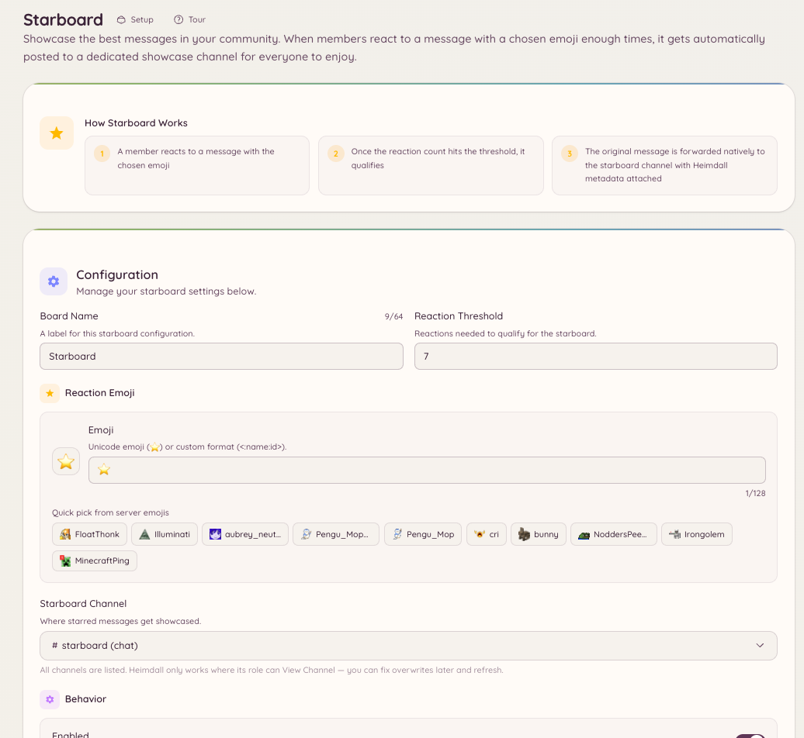

import { DashboardLink } from "/snippets/dashboard-link.jsx";

スターボードは、十分な数のリアクションを集めたメッセージを専用のチャンネルに再投稿します。コミュニティ主導でコンテンツを選ぶツールで、メンバーがリアクションで投票し、人気の高いコンテンツが自動的に浮かび上がります。

<Frame>
  
</Frame>

## 仕組み

メッセージのリアクション数が設定したしきい値以上になると、Botはそのメッセージをスターボードチャンネルにコピーします。再投稿されたメッセージには、元の投稿者、元のチャンネル、元のメッセージへのリンク、現在のリアクション数が表示されます。

メンバーがリアクションを外してリアクション数がしきい値を下回った場合、設定に応じて、Botはスターボードの投稿を削除するか、そのまま残します。

## セットアップ

ダッシュボードの <DashboardLink to="starboard">**Starboard**</DashboardLink>（スターボード）を開き、次の項目を設定します。

| 設定 | 説明 |
| --- | --- |
| **Channel**（チャンネル） | スターが付いたメッセージを再投稿するチャンネル |
| **Reaction emoji**（リアクション絵文字） | スターボードのきっかけになるリアクション（デフォルト：星の絵文字） |
| **Threshold**（しきい値） | 必要なリアクションの最小数 |
| **Self-star**（セルフスター） | 元の投稿者自身のリアクションを数に含めるかどうか |
| **Bot messages**（Botのメッセージ） | Botのメッセージにスターを付けられるかどうか |
| **NSFW channels**（NSFWチャンネル） | NSFWに指定されたチャンネルのメッセージを含めるかどうか |

## モデレーションキュー

スターボードには、オプションでモデレーションキューがあります。有効にすると、メッセージはしきい値に達してもすぐにはスターボードに投稿されません。代わりに <DashboardLink to="starboard">**Starboard**</DashboardLink> ページの保留キューに入り、表示される前にスタッフが承認または却下できます。

ダッシュボードの <DashboardLink to="starboard">**Starboard**</DashboardLink> を開き、**Require moderation approval**（モデレーションの承認を必須にする）を有効にします。保留中の投稿は、同じページの **Moderation Queue**（モデレーションキュー）に表示されます。

`starboard.moderate` 権限を持つスタッフは、保留中の投稿を承認または却下できます。承認された投稿は掲載され、却下された投稿は破棄されます。

## セットアップ後にしきい値を変更する

セットアップ後にしきい値を上げても、以前のしきい値で掲載済みのスターボードの投稿は削除されません。しきい値を下げても、古いメッセージがさかのぼって追加されることはありません。しきい値は、変更した時点以降に付いたリアクションにのみ適用されます。

## 必要な権限

スターボードは完全に自動で、メンバーに権限は必要ありません。設定は管理者専用です。

| 操作 | 権限キー |
| --- | --- |
| 設定の閲覧 | `starboard.view_config` |
| 設定の変更 | `starboard.manage_config` |
| 承認キューのモデレーション | `starboard.moderate` |
