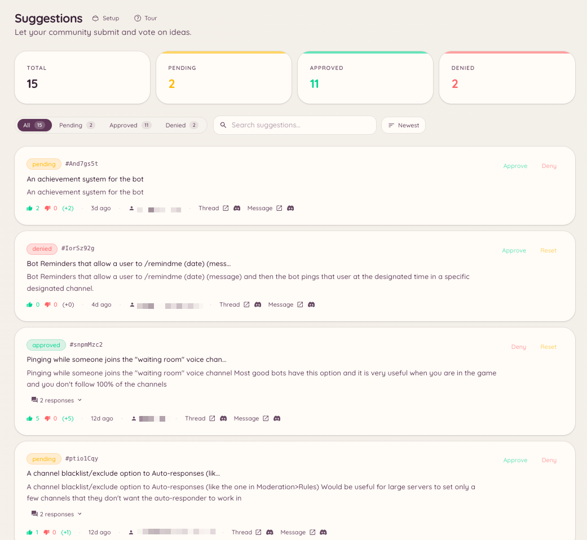

import { DashboardLink } from "/snippets/dashboard-link.jsx";

提案プラグインは、メンバーからのフィードバック専用の流れを作ります。メンバーがスラッシュコマンドで提案を送ると、Botが指定のチャンネルに賛成と反対のリアクション付きの整ったメッセージとして投稿し、スタッフがダッシュボードやスラッシュコマンドで審査して対応します。

<Frame>
  
</Frame>

## 提案を送る

```text
/suggest <content>
```

メンバーが提案の文章を書きます。Botは設定された提案チャンネルに、投票用のリアクションをあらかじめ付けて投稿します。AIによるタイトル生成が有効な場合は、内容をもとに提案の簡潔な要約タイトルもBotが作成します。

## カテゴリ

提案は、カテゴリに応じて別々のチャンネルに振り分けられます。カテゴリを作るには、ダッシュボードの <DashboardLink to="suggestions/categories">**Suggestions \> Categories**</DashboardLink>（提案 > カテゴリ）を開きます。

各カテゴリには次の設定があります。

| 設定 | 説明 |
| --- | --- |
| **Name**（名前） | メンバーがカテゴリを選ぶときに表示されます |
| **Channel**（チャンネル） | このカテゴリの提案が投稿される場所 |
| **Voting style**（投票方式） | 賛成/反対、星の評価、またはカスタム絵文字のリアクション |
| **Who can suggest**（提案できる人） | 提案できるのを特定のロールに限定します |

カテゴリが複数ある場合、`/suggest` を実行したメンバーにカテゴリを選ぶよう求められます。

## 提案の管理

```text
/suggestion-config
/suggestion-categories list
/suggestion-categories create <name>
/suggestion-categories delete <id>
```

スタッフは、ダッシュボードの <DashboardLink to="suggestions/list">**Suggestions \> Suggestions**</DashboardLink>（提案 > 提案）で、または提案メッセージのコンテキストメニューの操作で、個々の提案を管理します。

提案に対して行える操作は次のとおりです。

| 操作 | 説明 |
| --- | --- |
| **Approve**（承認） | 提案を採用済みにします。Botがメッセージにステータスバッジを付けます |
| **Reject**（却下） | 却下にします。任意の理由が返信として投稿されます |
| **In progress**（対応中） | 対応中にします |
| **Implemented**（実装済み） | 完了にします |
| **Archive**（アーカイブ） | 削除せずに、進行中の一覧から外します |

提案に対応すると、Botは元のメッセージを更新して新しいステータスを表示し、投票結果も見えるように残します。

## ダッシュボードでの設定

<DashboardLink to="suggestions/config">**Suggestions \> Configuration**</DashboardLink>（提案 > 設定）では、次の項目を設定できます。

| 設定 | 説明 |
| --- | --- |
| **Default channel**（デフォルトチャンネル） | カテゴリが定義されていないときに提案が送られる場所 |
| **Anonymous suggestions**（匿名の提案） | 提案者の名前を表示せずに提案を投稿します |
| **Duplicate detection**（重複の検出） | 似た提案がすでにある場合、提案者に警告します |
| **AI titles**（AIタイトル） | 提案の文章から短いタイトルを自動生成します |
| **Min/max length**（最小/最大の長さ） | 提案の内容に文字数の制限をかけます |

## オープナー

オープナーはチャンネルに投稿されるボタンで、メンバーがクリックすると、`/suggest` コマンドを入力しなくてもモーダルのフォームから提案を送れます。<DashboardLink to="suggestions/openers">**Suggestions \> Openers**</DashboardLink>（提案 > オープナー）を開き、**New Opener**（新しいオープナー）をクリックします。ボタンのラベルと任意の案内文を設定してから **Post**（投稿）をクリックし、オープナーのパネルをチャンネルに設置します。

オープナーは、専用の提案チャンネルで提案の流れを目に見える形にしておきたいときや、スラッシュコマンドが制限されているサーバーで便利です。

## 必要な権限

| 操作 | 権限キー |
| --- | --- |
| 提案の送信 | `suggestions.create_suggestion`（デフォルトで許可） |
| ダッシュボードでの提案の表示 | `suggestions.items.view_suggestions` |
| 提案の承認と却下 | `suggestions.items.manage_suggestions` |
