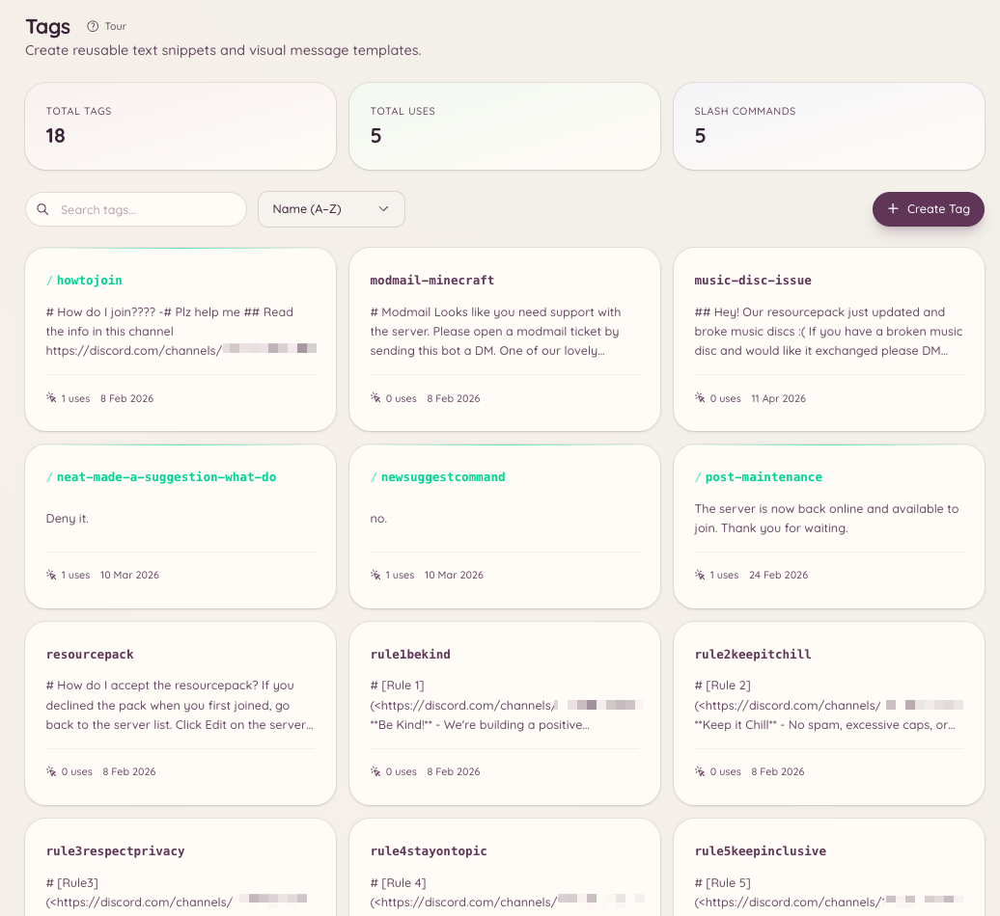

import { DashboardLink } from "/snippets/dashboard-link.jsx";

タグは、テキストのまとまり、埋め込み、書式付きメッセージなどの使い回せるコンテンツで、コマンド1つでどのチャンネルにも投稿できます。同じ質問に何度も答えたり、同じ資料を共有したり、書式付きのお知らせを投稿したりすることが多いスタッフに特に便利です。タグはコンテンツを一度保存しておけば、アクセスできる人なら誰でもすぐに使えます。

<Frame>
  
</Frame>

## タグを使う

```text
/tag use <name>
```

タグの内容を現在のチャンネルに投稿します。タグ名はオートコンプリートに対応しており、入力を始めると一致するタグをBotが候補として表示します。

## タグを作成する

```text
/tag create <name>
```

タグの内容を書くためのモーダルが開きます。内容にはDiscordのマークダウンが使えます。リッチな埋め込みのタグを作りたい場合は、代わりにダッシュボードの <DashboardLink to="tags/tags">**Tags**</DashboardLink>（タグ）を使いましょう。埋め込みを見た目で組み立てられるビルダーがあります。

ダッシュボードからタグを作成するには、<DashboardLink to="tags/tags">**Tags**</DashboardLink> を開いて **New Tag**（新しいタグ）をクリックします。ダッシュボードのエディターでは次のものに対応しています。

- プレーンテキストの内容
- タイトル、説明、フィールド、色、サムネイル付きの埋め込み
- 添付ファイルのアップロード

## 編集と削除

```text
/tag edit <name>
/tag delete <name>
```

編集では、作成時と同じモーダルが開きます。削除すると、タグは完全に削除されます。

## タグの一覧

```text
/tag list
```

サーバーで使えるタグをすべて一覧表示します。ダッシュボードの <DashboardLink to="tags/tags">**Tags**</DashboardLink> ページでも、検索と絞り込みのオプション付きで同じ一覧を見られます。

## 投稿

投稿はタグに似ていますが、特定のチャンネルにピン留めする長めのコンテンツ向けです。予約投稿は、ダッシュボードの <DashboardLink to="settings/messages">**Settings \> Messages**</DashboardLink>（設定 > メッセージ）の **Scheduled posts**（予約投稿）で管理します。`/post` コマンドは `/tag` と組み合わせて使います。

```text
/post send <name> [channel]
/post list
```

投稿は、コマンドを実行したチャンネルではなく、指定したチャンネルにコンテンツを送ります。週ごとのお知らせやピン留めの資料など、コマンドをどこで実行したかに関係なく決まった場所に届けたいものには投稿を使いましょう。

## テンプレート

テンプレートはダッシュボードに保存された埋め込みのひな形で、スタッフが新しいタグを作るときの出発点として使えます。<DashboardLink to="settings/messages">**Settings \> Messages**</DashboardLink> の **Reusable templates**（再利用できるテンプレート）にあります。

## 必要な権限

| 操作 | 権限キー |
| --- | --- |
| タグの使用 | `tags.view_tags`（デフォルトで許可） |
| タグの作成、編集、削除 | `tags.manage_tags` |
| 投稿の送信 | `tags.manage_posts` |
