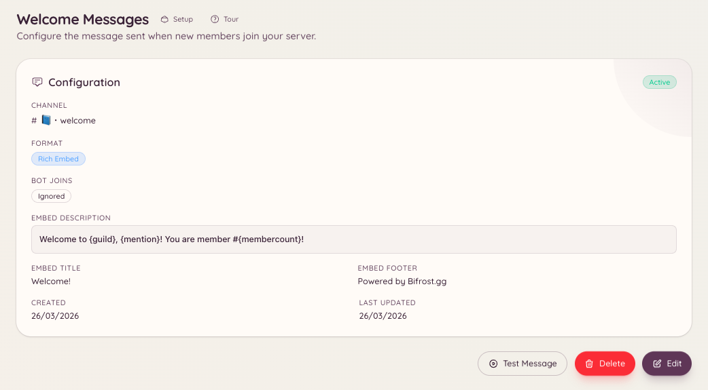

import { DashboardLink } from "/snippets/dashboard-link.jsx";

ウェルカムプラグインは、メンバーがサーバーに参加するたびに、指定したチャンネルにメッセージを投稿します。メッセージは自由にカスタマイズできます。プレーンテキストでもリッチな埋め込みでも書けて、変数を使ってメンバーの名前、サーバー名、現在のメンバー数を入れられます。

<Frame>
  
</Frame>

## 設定する

```text
/welcome setup
```

`/welcome setup` を実行すると設定用のモーダルが開き、ウェルカムチャンネルの指定とメッセージの作成ができます。ダッシュボードの <DashboardLink to="welcome">**Welcome**</DashboardLink>（ウェルカム）ですべてを設定することもできます。

### ダッシュボードでの設定

ダッシュボードのサイドバーで <DashboardLink to="welcome">**Welcome**</DashboardLink> を開きます。設定ページには次の項目があります。

| 設定 | 説明 |
| --- | --- |
| **Channel**（チャンネル） | ウェルカムメッセージを投稿するチャンネル |
| **Message content**（メッセージの内容） | ウェルカムメッセージのプレーンテキストまたは埋め込みの内容 |
| **Embed toggle**（埋め込みの切り替え） | 色や項目付きのリッチな埋め込みとしてメッセージを送信 |
| **Embed colour**（埋め込みの色） | 埋め込みの左側の色 |

## 使える変数

変数とは、メッセージ内のプレースホルダーで、送信時にBotが内容を埋めます。変数は波かっこで囲みます。

| 変数 | 置き換えられる内容 |
| --- | --- |
| `{user}` | 新しいメンバーへのメンション（`@Username`） |
| `{user.name}` | メンバーの表示名（メンションなし） |
| `{user.id}` | メンバーのDiscordユーザーID |
| `{server}` | サーバー名 |
| `{server.count}` | 参加後の合計メンバー数 |
| `{server.id}` | サーバーのID |

### メッセージの例

```text
Welcome to {server}, {user}! You are member number {server.count}.
Please read <#channel-id> before getting started.
```

## ウェルカムメッセージをテストする

```text
/welcome test
```

自分のアカウントをテスト用のメンバーとして使い、ウェルカムメッセージのプレビューを現在のチャンネルに投稿します。次に実際に誰かが参加する前に、書式や変数を確認するのに便利です。

## 現在の設定を確認する

```text
/welcome view
```

テスト送信は行わずに、現在のウェルカムメッセージの設定を表示します。

## ウェルカムメッセージを削除する

```text
/welcome remove
```

ウェルカムメッセージを無効にします。設定は保持されるので、後でまた有効にできます。

## 必要な権限

| 操作 | 権限キー |
| --- | --- |
| ウェルカム設定の閲覧 | `welcome.view_config` |
| ウェルカム設定の編集 | `welcome.manage_config` |
