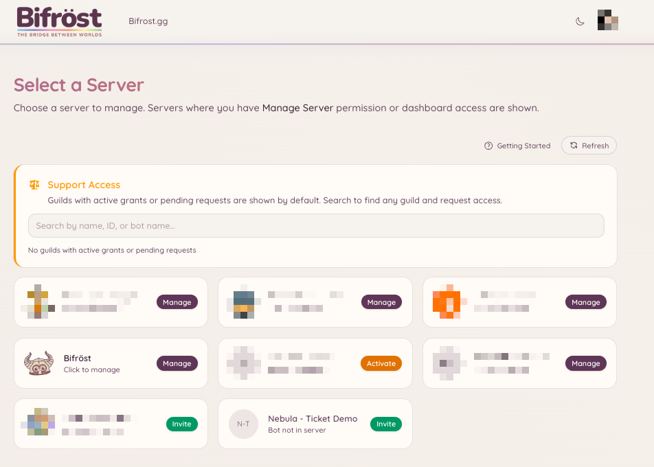
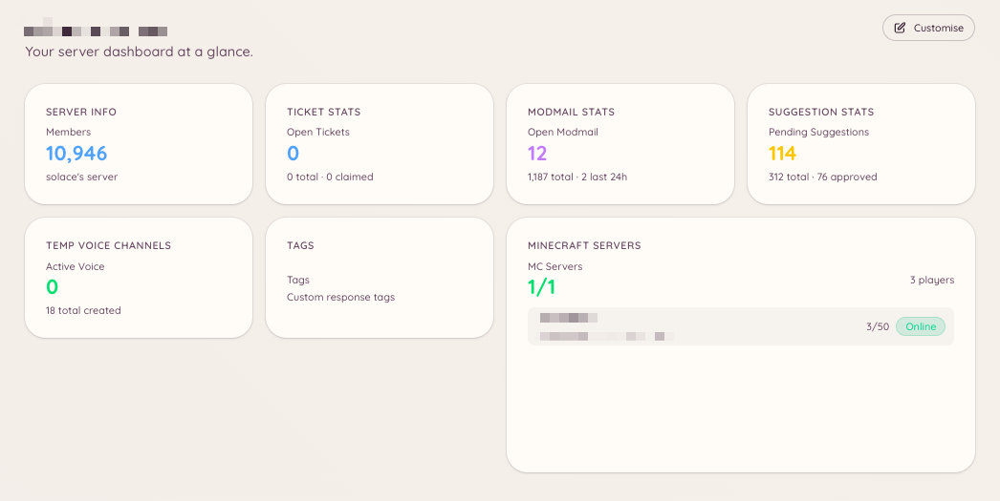

import { DashboardLink } from "/snippets/dashboard-link.jsx";

Heimdallダッシュボードは、サーバー管理者がBotのあらゆる機能を設定するためのWeb画面です。一般のメンバーは、明示的にアクセス権を与えられていない限り、ダッシュボードを使う必要はありません。

## ログイン

[**bot.bifrost.gg**](https://bot.bifrost.gg) を開き、**Sign in with Discord**（Discordでサインイン）をクリックします。Discordからダッシュボードのアプリケーションを承認するよう求められます。このアプリケーションが読み取るのは、ユーザー名、アバター、あなたが管理しているサーバーの一覧です。メッセージやコンテンツへのアクセスは求めません。

サインインすると、サーバー選択画面が表示されます。

## サーバー選択画面

サーバー選択画面には、あなたが「サーバー管理」権限を持ち、かつHeimdallが導入されているDiscordサーバーがすべて表示されます。サーバーのカードをクリックすると、そのサーバーのダッシュボードが開きます。

管理しているサーバーにHeimdallがまだ追加されていない場合、カードには「Invite」（招待）と表示されます。クリックするだけで、Heimdallをサーバーに招待できます。

<Frame>
  
</Frame>

## 概要ページ

サーバーを選ぶと、最初に <DashboardLink to="overview">**Overview**</DashboardLink>（概要）ページが表示されます。決まったレイアウトではなく、自由にカスタマイズできるウィジェット式のダッシュボードです。Heimdallには、サーバーのメンバー数やチケットの待ち行列から、Minecraftサーバーのステータス、Modmailの件数まで、さまざまな情報ウィジェットが用意されており、あなたの仕事のしかたに合わせて配置できます。

レイアウトをカスタマイズするには、<DashboardLink to="overview">**Overview**</DashboardLink> ページの右上にある **Edit layout**（レイアウトを編集）をクリックします。編集モードでは次のことができます。

- **ウィジェットを追加する**：**\+** ボタンをクリックしてウィジェットの選択画面を開き、一覧からウィジェットを配置します
- **ウィジェットを移動する**：カードをドラッグして、グリッド上の新しい位置に動かします
- **ウィジェットのサイズを変える**：サイズ変更ハンドルをドラッグして、カードの大きさを変えます
- **ウィジェットを削除する**：カードにカーソルを合わせて削除ボタンをクリックし、グリッドから外します

使えるウィジェットは、サーバーで有効になっているプラグインと、あなたのロールに付与されているダッシュボードの権限によって変わります。有効になっていないプラグインのウィジェットは、選択画面に表示されません。

<Frame>
  
</Frame>

## 画面の移動

左のサイドバーには、使えるプラグインがすべて表示されます。各項目は、そのプラグインの設定と管理のセクションにつながっています。サブページのあるセクションはクリックすると展開され、**Configuration**（設定）、**Analytics**（分析）、**Categories**（カテゴリ）などのタブが表示されます。

サイドバーは、このドキュメントのセクションと同じグループに分かれています：モデレーション、サポート、コミュニティ、ボイス、ゲーム、連携、AI、ユーティリティです。

## 複数のチャンネルに投稿されたパネル

パネルとは、メンバーが押すボタンの付いたメッセージのことで、チケットのオープナー、ロールボタンのパネル、Minecraftアカウントの連携パネルなどがあります。同じパネルを好きなだけ多くのチャンネルに投稿できます。新しいチャンネルに投稿すると、そこにコピーが追加されます。すでにあるコピーが移動したり削除されたりすることはありません。

パネルを投稿するとき、投稿ダイアログには、Heimdallが把握しているすべてのコピーを示す **Posted in**（投稿先）の一覧が表示されます。各行には、チャンネル、コピーを投稿した日時、投稿した人（Heimdallが把握している場合）、そして状態が表示されます。

| 状態 | 意味 | できること |
| --- | --- | --- |
| **Live**（表示中） | メッセージがチャンネルにある | **Refresh**（更新）で最新の文面に更新します。**Delete**（削除）でチャンネルから削除します |
| **Deleted**（削除済み） | 誰かがDiscordでメッセージを削除した | **Post again**（再投稿）で同じチャンネルに戻します。**Remove from list**（一覧から削除）で記録を消します |
| **Can't reach**（到達不可） | Heimdallがチャンネルを見られない、または履歴を読めない | **Remove from list** で記録を消します。メッセージがまだあるかどうかHeimdallには判断できないため、残っている場合は手動で削除してください |

パネルの文面や、表示内容が変わる設定を変更すると、まだ残っているすべてのコピーが更新されます。誰かが削除したコピーは、再投稿されるのではなく一覧から外されます。

Heimdallが削除するのは、自分が送ったメッセージだけです。一覧のコピーがほかの人のメッセージだとわかった場合、Deleteはそのメッセージをチャンネルに残し、一覧から外すだけです。

提案やゲームのオープナーを削除すると、Heimdallが到達できる一覧のコピーも削除されます。到達できないコピーや一覧に載っていなかったコピーは、もう機能しないボタンの付いた状態でDiscordに残るため、Discordで削除してください。

<Note>
  ほとんどのパネルについて、以前のHeimdallは最新のコピーしか記憶していなかったため、最初の時点で一覧に載る古いコピーはその1つだけです。ほかの場所にある古いコピーは、どのパネルのものかHeimdallが判断できる限り、メンバーがそのボタンを初めて押したときに追加されます。オープナー（チケット、Modmail、提案、ゲーム）については、古いコピーがどのオープナーのものかをHeimdallが常に判断できるとは限らないため、古いオープナーのコピーがこの方法で追加されないこともあります。コピーが一覧に載るまではRefreshとDeleteはそのコピーに届かないので、いつもどおりDiscordで削除できます。
</Note>

## ダッシュボードでの権限

ダッシュボードのどのセクションにアクセスできるかは、あなたのDiscordロールに付与されている権限によって決まります。セクションが見えない場合は、該当する権限がないか、プラグインが有効になっていません。Discordの「管理者」権限を持つ管理者は、常にすべてにアクセスできます。

権限システムの仕組みについて詳しくは、[権限](/ja/permissions)をご覧ください。

## 変更を加える

ダッシュボードでの変更は、すぐに反映されます。公開やすべてを保存するといった手順はなく、各セクションにそのセクションだけの変更を適用する **Save**（保存）ボタンがあります。

<Note>
  設定を変更しても、Botを再起動する必要はありません。変更は自動で読み込まれます。
</Note>
